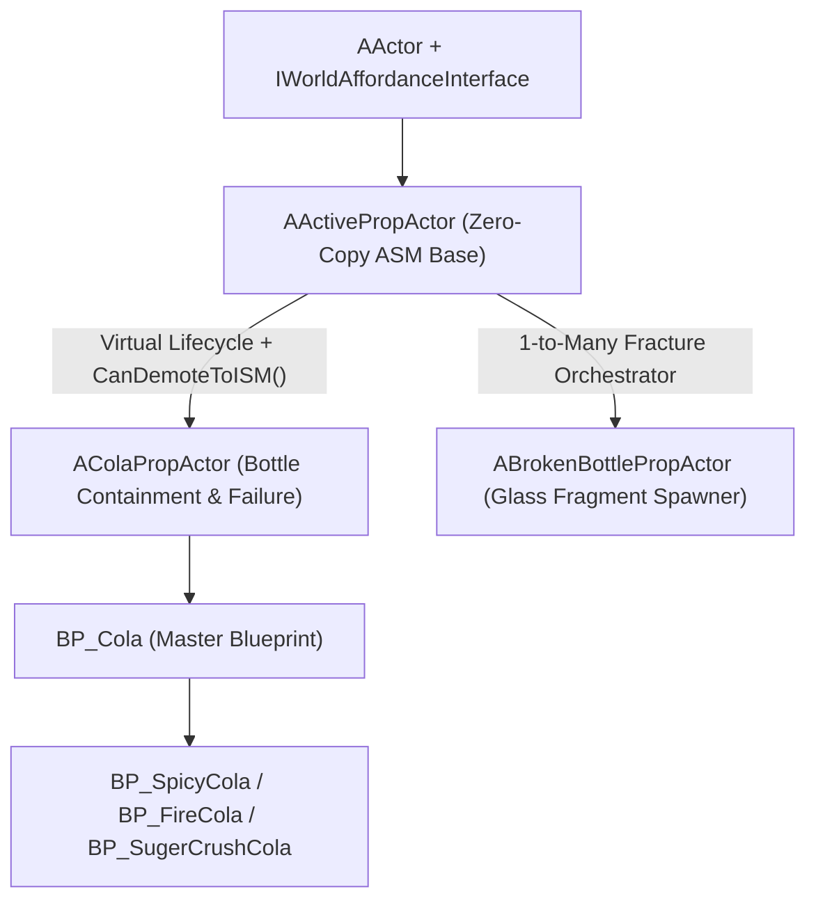

# `AActivePropActor` & `AColaPropActor` — ASM Runtime Architecture

**Project:** Midnight Fizz: Giant Thirst (*MarryByMidnight*)  
**Primary C++ Sources (Sibling Docs & Verified References):**  
- [`InteractableProp.h`](file:///c:/Users/PC/Documents/Unreal%20Projects/MarryByMidnight/Source/MarryByMidnight/Public/Props/InteractableProp.h) & [`InteractableProp.cpp`](file:///c:/Users/PC/Documents/Unreal%20Projects/MarryByMidnight/Source/MarryByMidnight/Private/Props/InteractableProp.cpp) *(Pre-authorized for Phase B edits)*
- [`ColaPropActor.h`](file:///c:/Users/PC/Documents/Unreal%20Projects/MarryByMidnight/Source/MarryByMidnight/Public/Props/ColaPropActor.h) & [`ColaPropActor.cpp`](file:///c:/Users/PC/Documents/Unreal%20Projects/MarryByMidnight/Source/MarryByMidnight/Private/Props/ColaPropActor.cpp) *(Pre-authorized for Phase B edits)*
- Companion Docs: [`ISM_Data_Architecture.md`](file:///c:/Users/PC/Documents/Unreal%20Projects/MarryByMidnight/Docs/ISM_Data_Architecture.md) | [`PropManager_ISM_ASM_Architecture.md`](file:///c:/Users/PC/Documents/Unreal%20Projects/MarryByMidnight/Docs/PropManager_ISM_ASM_Architecture.md) | [`Bottle_Damage_Transformation_and_Fragments.md`](file:///c:/Users/PC/Documents/Unreal%20Projects/MarryByMidnight/Docs/Bottle_Damage_Transformation_and_Fragments.md)

---

## 1. Architectural Role in the ISM <-> ASM Pipeline

[`AActivePropActor`](file:///c:/Users/PC/Documents/Unreal%20Projects/MarryByMidnight/Source/MarryByMidnight/Public/Props/InteractableProp.h#L32) is the **temporary, pooled Active Static Mesh (ASM)** actor representing a permanent logical [`ISID`](file:///c:/Users/PC/Documents/Unreal%20Projects/MarryByMidnight/Source/MarryByMidnight/Public/Props/InteractableProp.h#L60) only while it is grabbed, moving, settling, filling, capping, thermally unequalized, or failing.

Under the new architecture, **`AActivePropActor` obeys three strict rules**:
1. **Zero Shared-Data Duplication:** Pooled ASM actors (100–500 pre-spawned instances) must **not** store local copies of shared arrays/profiles (`StimuliPerPortion`, `ExpiryStimulusProfile`, `TasteProfile`, `NumOfPortions`, `Price`, thermal thresholds, etc.). They hold only `ISID`, `ProductID`, and unique/transient state, resolving shared configuration via `ResolveProductDefinition()` / `ResolveContentDefinition(ContentID)` from `APropManager` (with `PropDataAsset` fallback only in standalone Editor/preview scenes lacking `APropManager`).
2. **Split Channel Flow (`Event` vs `Continuous`):**
   - **Event Data** (`ContentLevel`, `ContentID`, `CapType`, `CapSealed`, `CreationTime`, `bIsGrabbable`, discrete `Strength`) initializes on ISM -> ASM promotion and emits back to `APropManager` only when an authoritative discrete event mutates it.
   - **Continuous Data** (`Temperature`, `LastUpdatedTime`, continuous thermal `Strength` drain, `ExpiryAge`) advances smoothly in `UPropBatchUpdateComponent` / ASM ticks without ever touching `CreationTime`.
3. **ASM Demotion Gate (`CanDemoteToISM()`):** An active actor **cannot** return to rest as an ISM while it still holds unpersisted transient simulation state (`ContentTemperature != Temperature`, `AccumulatedInteractionPressure > Epsilon`, active leaking, active cap-closing validation window, or in-flight rocket/held lock).

---

## 2. Class Hierarchy



---

## 3. Three-Tier State Model on `AActivePropActor`

To prevent pooled actor reuse bugs and eliminate permanent-damage loss during recovery, every runtime field on `AActivePropActor` and `AColaPropActor` is assigned to one of three explicit state tiers:

### Tier A — Persistent Event Mirror *(Synced to/from ISM Event Channel & SaveGame)*
Synced into ASM on `InitializeFromISIDRecord`, pushed outward via `EmitPropEventUpdate(...)` on discrete changes, and written back on `WriteToISIDRecord`:
- `ContentLevel` (`float`, `0.0 .. MaxOverfillLevel`): Replaces integer `RemainingPortions` (`ColaLevel` in `AColaPropActor` aliases/drives `ContentLevel`).
- `ContentID` (`int32`, `0 = None`): Active liquid definition key in `APropManager::ContentDefinitions`.
- `CapType` (`uint8` `EBottleCapType`) & `CapSealed` (`float`, `0.0 .. 1.0`): Replaces both `bIsCapSealed` and `SealIntegrity` while preserving cap hardware type (`Twist`, `Cork`, `BoltLock`, `RuneSeal`) inside `FPropEventUpdateData`.
- `Strength` (`float`, `0.0 .. MaxStrength`): Unified monotonic integrity; replaces `PermanentDeformation`, `CrackProgression`, and `ThermalDamageLevel`.
- `CreationTime` (`double`): World elapsed seconds when created/filled; **read-only during normal ticks and content resets**.
- `bIsGrabbable` (`bool`) and `EventSequence` (`uint32`).

### Tier B — Persistent Continuous Mirror *(Synced to/from Continuous Channel & GPU)*
- `CurrentTemperature` (`float`, `°C`): Bottle shell temperature.
- `LastUpdatedTime` (`double`): World elapsed seconds of last thermal integration.
- Derived read-only helpers: `GetExpiryAgeSeconds()`, `GetNormalizedExpiryAge()`, `GetFractionalRemainingPortions()`.

### Tier C — Transient ASM-Only State *(Never Stored in ISM; Cleared on `ResetTransientPoolState()`)*
Active only while an object is promoted to ASM; `CanDemoteToISM()` keeps the actor in ASM until these settle or equalize:
- **Thermal Equalization:** `ContentTemperature` (`float`), `TArray<FPropThermalSource> ActiveThermalSources` (hot nozzle, ice bath, fire, heater).
- **Dynamic Agitation & Pressure:** `AccumulatedInteractionPressure` (`float`), `FoamPressure` (`float`), `TemporaryDeformation` (`float`), `LastImpulseTimestamp` (`double`), `TSet<uint32> ProcessedInteractionEventIDs`.
- **Containment Failure & Leakage Guards:** `EContainmentFailureState FailureState`, `EContainmentFailureType AcceptedFailureType`, `uint32 LastProcessedFailureEventID`, `TSet<uint32> ProcessedFailureEventIDs`, `bool bFailureExecutionInProgress`, `bFailureExecuted`, `bIsLeaking`, `float AccumulatedLeakage`.
- **Cap Validation & Pooling Tokens:** `EBottleCapState CapState`, `uint32 ClosingTimerGeneration`, `uint32 PoolGeneration` (incremented on every `ActivateASMRepresentation` / `DeactivateToPoolState` so stale timers cannot fire on the next pooled reuse!), `bool bPendingServerPromoteAck` (protects client-predicted `MakeISMToASM` transforms/state from stale pre-event Continuous packets), `TMap<int32, TObjectPtr<UMaterialInstanceDynamic>> DynamicMaterials`, `WarmupFramesRemaining`, `HeldGracePeriod`, `PrevLocation`, `PrevVelocity`, `PrevGForce`.

---

## 4. `AActivePropActor` Lifecycle Flow & Event Routing

```mermaid
sequenceDiagram
    participant PM as APropManager
    participant ASM as AActivePropActor
    participant Cola as AColaPropActor
    participant Batch as UPropBatchUpdateComponent

    PM->>ASM: InitializeFromISIDRecord(Record, UniqueData, PIDDef, CIDDef)
    ASM->>ASM: ++PoolGeneration; ResetTransientPoolState()
    ASM->>ASM: OnApplySharedDefinitions(PIDDef, CIDDef)
    ASM->>Cola: OnApplyEventData(EventData)
    ASM->>Cola: OnApplyContinuousData(ContinuousData)
    Note over ASM,Cola: Apply retroactive DeltaT thermal catch-up from LastUpdatedTime
    ASM->>ASM: UpdateMaterialCustomPrimitiveData() [4 Floats]

    loop While Active in Gameplay
        Cola->>Cola: Handle agitation / Fill / Cap / Damage
        Cola->>PM: EmitPropEventUpdate(EPropEventDirtyMask)
        Batch->>ASM: Continuous Batch step Temperature -> OnApplyContinuousData
    end

    Note over ASM,PM: Physics settled -> UASMComponent checks ASM->CanDemoteToISM()
    alt Abs(ContentTemp - Temp) > Eps OR InteractionPressure > Eps OR Leaking OR ClosingTimer
        ASM-->>PM: CanDemoteToISM() == false (Stay in ASM until normalized)
    else All Transient State Equilibrated
        ASM->>PM: WriteToISIDRecord() + ConvertASMToISM()
        ASM->>ASM: OnBeforePoolDeactivate(); ResetTransientPoolState()
    end
```

### Virtual Lifecycle Contract on `AActivePropActor`
- `const FPropProductDefinition* ResolveProductDefinition() const` — Zero-copy lookup via `PropManagerReference` -> `FindProductDefinition(ProductID)`, falling back only when no `APropManager` exists.
- `const FPropContentDefinition* ResolveContentDefinition() const` — Zero-copy lookup via `FindContentDefinition(EventData.ContentID)`.
- `virtual void OnApplySharedDefinitions(const FPropProductDefinition* ProductDef, const FPropContentDefinition* ContentDef)` — Configures mesh, base materials, physics tolerances, and container rules without copying arrays into instance fields.
- `virtual void OnApplyEventData(const FPropEventUpdateData& InEventData)` — Applies `ContentLevel`, `ContentID`, `CapType`, `CapSealed`, `Strength`, `bIsGrabbable`, updates `EventSequence` (ignoring out-of-order packets with `InEventData.EventSequence < EventData.EventSequence`), and refreshes visuals.
- `virtual void OnApplyContinuousData(const FPropContinuousUpdateData& InContinuousData)` — Applies `Temperature`, `LastUpdatedTime`, rejects stale pre-event updates (`LastUpdatedTime < LastDiscreteEventTime`), recalculates `ExpiryAge`, checks extreme-temperature wear, and refreshes GPU Custom Primitive Data.
- `virtual void ApplyInitialImpactFromPromotion(FVector UnclampedImpulse, const FVector& ImpactPoint, AActor* HittingActor, uint32 InteractionEventID)` — Server-authoritative bypass for initial ISM hit damage/agitation before `WarmupFramesRemaining` expires, using unclamped impact energy (`EffectiveImpulse`).
- `virtual bool CanDemoteToISM() const` — Base checks `!bIsHeld && !bIsInMotion && !bIsInterpolatingToRest`; `AColaPropActor` extends it to also require thermal equalization, dissipated interaction pressure, no active leakage, no active cap validation delay, and idle rocket simulation.
- `virtual void OnBeforePoolDeactivate()` & `virtual void ResetTransientPoolState()` — Cleans up detached cap timers (`++PoolGeneration`), resets morph targets, clears transient MID pointers, and clears active thermal sources before parking at `ResetTransform`.
- `void UpdateMaterialCustomPrimitiveData()` — Writes **4 floats** to both `PropMesh` and `SkeletalMeshComponent`: `0 = ContentLevel`, `1 = ExpiryAge`, `2 = Temperature`, `3 = Strength / MaxStrength`.

---

## 5. `AColaPropActor` Mapping of Bottle Containment & Failure Systems

Maps every requirement from [`Bottle_Containment_&_Failure_System.txt`](file:///C:/Users/PC/.gemini/antigravity/brain/aaf8f3f7-74cc-49c1-95e5-97dd0f79d1c2/.user_uploaded/media_1794196140134_04ec9e6b.txt) onto the unified ISM/ASM schema:

### 5.1 Pressure System (Base vs. Interaction + Duplicate Event Protection)
- **Resting Base Pressure:** $P_{\text{base}} = \text{ContentLevel}$ (no extra storage required).
- **Continuous Interaction Generation:**
  $$\Delta P = \frac{\text{PressureGenerationRate} \times \Delta t \times \text{Content.PressureStrengthMultiplier}}{\text{Product.PressureResistanceMultiplier}}$$
- **Impulse Pressure (Hit / Sudden Jerk Drop) with Dedup:**
  $$\Delta P_{\text{impulse}} = \frac{\text{PressureImpulse} \times \text{Content.PressureStrengthMultiplier}}{\text{Product.PressureResistanceMultiplier}}$$
  Guarded server-side by `InteractionEventID` (`ProcessedInteractionEventIDs`, `LastProcessedInteractionEventID`, `LastImpulseTimestamp`, `ImpulseCooldown`) so repeated overlapping physics callbacks never double-impulse the bottle.
- **Total Pressure & Decay:** $P_{\text{total}} = P_{\text{base}} + P_{\text{interaction}}$. Decay reduces **only** $P_{\text{interaction}} = \max(0, P_{\text{interaction}} - \text{PressureDecayRate} \times \Delta t)$; never zeroes $P_{\text{base}}$.
- **Pressure Release Modes:**
  - *Mode A (`ReleaseInteractionPressure`):* Sets $P_{\text{interaction}} = 0$ while keeping $P_{\text{base}} = \text{ContentLevel}$.
  - *Mode B (`FullPressureVent`):* Sets $P_{\text{interaction}} = 0$ and vents/equalizes to atmospheric gauge state (or lowers sealed head pressure on uncapping).

### 5.2 Structural Integrity (`Strength`) & Deformation Separation
- **Unified Persistent Variable:** `Strength` (`0.0 .. MaxStrength`) inside `FPropEventUpdateData` is the **sole persistent damage value**.
  - Damage accumulation on excess pressure: $\text{ExcessPressure} = \max(0, P_{\text{total}} - \text{PressureDamageThreshold})$, $\Delta \text{Strength} = \text{ExcessPressure} \times \text{StrengthDamageRate} \times \Delta t$, $\text{Strength} = \max(0, \text{Strength} - \Delta \text{Strength})$.
  - Same monotonic deduction for extreme thermal damage (`< LowTempDamageThreshold` or `> HighTempDamageThreshold`) and high-impulse impact damage (with `DamageEventID` dedup).
  - **Invariant:** Pressure decay, emptying liquid, or returning to room temperature **never restores `Strength`**. Only `RepairBottle` (if `bSupportsRepair`) or `FullReset` restores `Strength`.
  - When `Strength <= 0`, submits **`BottleBreakage`** (Priority 1) to the Containment Failure Manager.
- **Total Visual Deformation Formula (ASM):**
  $$\text{PermanentDamageRatio} = 1.0 - \frac{\text{Strength}}{\text{MaxStrength}}$$
  $$\text{TotalDeformation} = \text{TemporaryDeformation} + \text{PermanentDamageRatio}$$
  Temporary inflation/bulge recovers as $P_{\text{interaction}}$ decays, leaving permanent dents/cracks encoded by `Strength` intact across ISM <-> ASM transitions.

### 5.3 Dual Thermal Solver (Bottle Shell vs. Content + Multi-Source)
- **Active Multi-Source Equilibrium (Server-Authoritative):**
  $$Q = \sum_{i} G_i (T_i - T_{\text{shell}}) + P_{\text{direct}}, \qquad \Delta T = \frac{Q}{\text{ThermalMass}} \Delta t$$
  For single-source equilibration or offline catch-up: $T_{\text{new}} = T_{\text{src}} + (T_{\text{prev}} - T_{\text{src}}) \cdot e^{-K \Delta t}$ with $K = \frac{U \cdot A}{m \cdot C_p}$ modulated by `HeatingRateMultiplier` / `CoolingRateMultiplier`.
- **Two Temperatures While in ASM:** Bottle shell (`CurrentTemperature`) and liquid (`ContentTemperature`) exchange heat based on `ContentLevel > 0` and content thermal mass. Before demoting back to ISM, `CanDemoteToISM()` ensures they finish equalizing (or exchange rate completes) so ISM stores only the unified equilibrium `Temperature`.
- **Thermal Tolerance:** Breaching `[MinTemperatureThreshold, MaxTemperatureThreshold]` submits **`ThermalFailure`** to the Containment Failure Manager.

### 5.4 Content Lifecycle (`SetBottleContentType`, `FillBottle`, `RemoveBottleContent`, `ConsumePortion`)
1. **`SetBottleContentType(int32 NewContentID)`:** Requires `ContentLevel <= KINDA_SMALL_NUMBER` (`RemainingPortions == 0`) and `NewContentID` compatible with `ProductDef->SupportedContentIDs`. Reads `FPropContentDefinition` (`LiquidMaterial`, `PressureStrengthMultiplier`, expiry/taste/stimuli) from `APropManager::ContentDefinitions` without changing `ContentLevel` or `CreationTime`.
2. **`float FillBottle(float FillStrength, float DeltaSeconds)` (Returns `AcceptedPortions`):**
   - Blocked if `CapSealed > 0.0f` or `FailureState >= Failing` or `ContentID == 0`.
   - Applies frame-rate-independent flow: `RawFill = FillStrength * DeltaSeconds * FillSlowdownCurve->GetFloatValue(ContentLevel)`.
   - Clamps against `RemainingCapacity = ProductDef->MaxOverfillLevel - ContentLevel` and adds **only** `AcceptedFill`! Returns exact fractional `AcceptedPortions = AcceptedFill * ProductDef->ConsumableProfile.NumOfPortions` so the dispenser tank never over-deducts unaccepted flow.
   - Emits warning feedback at `OverfillWarningThreshold`. Above `1.0f`, compresses headspace into `AccumulatedInteractionPressure` (`OverpressureBurst` occurs only when $P_{\text{total}} \ge \text{PressureFailureThreshold}$, independent of reaching `MaxOverfillLevel = 1.7f` unless `bEnableOverfillFailure == true`).
3. **`RemoveBottleContent()`:** Clears `ContentLevel = 0.0f`, `ContentID = 0`, stops liquid/foam VFX, resets liquid Slot `1` MID, and preserves `ISID`, `ProductID`, `Strength`, and `CreationTime`.
4. **`ConsumePortion(...)`:** Deducts fractional `PortionRatio / NumOfPortions` from `ContentLevel` (blocked if `CapSealed >= 1.0f` when locked), updates `Version` + emits Event Delta, and if `ContentLevel <= 0.0f`:
   - If `ProductDef->EmptyBottleProductID > 0`, calls `ChangeProduct(EmptyBottleProductID, EPropProductResetMode::ContentReset)` (never destroys reusable bottles!).
   - Otherwise uses `ReleaseInstanceToEmpty(ISID)` only for single-use `bDestroyWhenEmpty` props.

### 5.5 Cap Lifecycle (`AddCap` 4 Stages & `RemoveCap` 5 Modes)
- **`AddCap` 4 Stages:**
  1. *Set & Validate Cap:* Verify `EBottleCapType` compatibility (`CapType` bit) against `ProductDef->SupportedCapMask` (`Validated`).
  2. *Add & Attach:* Activate/attach `CapMeshComponent` at neck socket, aligned (`Attached`).
  3. *Close & Seal:* Accepts `(FVector ActionDirection, float ActionStrength)` to advance twist/weld/torque into `[TorqueSweetSpotMin, TorqueSweetSpotMax]` (`Closing` -> `Closed`).
  4. *Validate & Lock (`AutoTrigger` retriggerable delay OR `EventTrigger` external signal):* Evaluates position, rotation, strength, seal integrity -> either commits `CapType` + `CapSealed = 1.0f` (`Sealed`, and optionally converts `EmptyBottle` + `ContentID > 0` to its filled `ProductID` if auto-conversion applies) OR sets partial/failed seal (`CapFailure` -> leak).
- **`RemoveCap(EBottleCapRemovalType RemovalType)` (`Twist`, `Pop`, `Break`, `Pull`, `Cut`):**
  1. Verifies cap is attached (`CapSealed > 0.0f` / `CapMeshComponent` attached) and `RemovalType` matches cap hardware (`Twist`, `Pop`, etc.).
  2. **Containment Check:** If `ContentLevel <= 0.0f`, skip containment check and remove safely. If `ContentLevel > 0.0f`, test `bIsInSuitableContainmentEnvironment` AND `CurrentPressure <= SafeOpenPressureThreshold`.
  3. Unsafe uncap or excess pressure invokes **`ContainmentFailureManager`** (`PressureRelease` / spray / cap ejection) rather than silently opening; on clean removal sets `CapSealed = 0.0f`, `CapType = 0`, `CapState = Removed` (or `Broken`), detaches/ejects cap safely using `PoolGeneration`-guarded cleanup timer.

### 5.6 Containment Failure Manager (Centralized Priority & Product Conversion)
All failure events (`UpdateStructuralIntegrity`, `FillBottle`, `UpdateTemperature`, `UpdatePressure`, `RemoveCap`, `DetectContentLeakage`) submit an `FContainmentFailureRequest` (`FailureEventID`, `FailureType`, `Severity`, `Location`, `Direction`, `bReleaseContent`, `bReleasePressure`) instead of executing isolated side effects:
- **Priority Order:** `1. BottleBreakage > 2. OverpressureBurst > 3. ThermalFailure > 4. PressureRelease > 5. CapFailure > 6. Other`.
- **Duplicate Protection:** Authoritative server checks `ProcessedFailureEventIDs` and refuses lower-priority overrides if a higher failure is already accepted (`bFailureExecutionInProgress` / `bFailureExecuted`).
- **Execution:** Releases content/pressure, spawns variant hazard (`RocketComp->LaunchRocket` if volatile foam/uncapped jet, fire patch, toxic cloud, sticky floor pool, glass shatter VFX/SFX), clears transient simulation, and dispatches product transformations ([`Bottle_Damage_Transformation_and_Fragments.md`](file:///c:/Users/PC/Documents/Unreal%20Projects/MarryByMidnight/Docs/Bottle_Damage_Transformation_and_Fragments.md)):
  - **1-to-1 Transformations (`ChangePropProductWithMode`):** `OverpressureBurst` -> `BurstBrokenProductID`; `ThermalFailure` -> `MeltedProductID` (`EPropProductResetMode::PreserveUniqueState`, retaining inherited `Temperature`, `CreationTime`, `ContentID`).
  - **1-to-Many Fracture (`BottleBreakage` when `Strength <= BreakageFailureThreshold`):** Calls `RequestProductTransformation(ISID, EPropTransformationType::BreakageFracture, BrokenProductID, Context)` — permanently retiring `SourceISID` via `ReleaseInstanceToEmpty` and spawning `Broken Glass Bottle` -> `Glass Fragment 1..N` independent `ISID`s! *(Guard `BrokenProductID != ProductID` prevents infinite shatter recursion.)*

---

## 6. Verified C++ Bug-Fix Checklist (`[Pre-Authorized]` for Phase B)

These defects were directly observed in the existing `AActivePropActor` and `AColaPropActor` C++ source files and will be fixed during Phase B:

| File & Exact Reference | Defect Identified | Phase B Fix |
|---|---|---|
| [`InteractableProp.cpp#L451-L495`](file:///c:/Users/PC/Documents/Unreal%20Projects/MarryByMidnight/Source/MarryByMidnight/Private/Props/InteractableProp.cpp#L451-L495) | `ApplyProductDefinition` copies shared arrays (`StimuliPerPortion`, `ExpiryStimulusProfile`, `TasteProfile`) per actor and resets `RemainingPortions` & `CurrentTemperature` to defaults before `InitializeFromISIDRecord` restores them. | Remove duplicated shared fields; resolve on-demand via `ResolveProductDefinition()` / `ResolveContentDefinition()`; separate `OnApplySharedDefinitions` from `OnApplyEventData`/`OnApplyContinuousData`. |
| [`InteractableProp.cpp#L497-L515`](file:///c:/Users/PC/Documents/Unreal%20Projects/MarryByMidnight/Source/MarryByMidnight/Private/Props/InteractableProp.cpp#L497-L515), [`L1303-L1384`](file:///c:/Users/PC/Documents/Unreal%20Projects/MarryByMidnight/Source/MarryByMidnight/Private/Props/InteractableProp.cpp#L1303-L1384) | `UpdateMaterialCustomPrimitiveData()` pushes legacy 3 floats (`PortionRatio, FrostFactor, ExpiryAge`), and neither `UpdateTemperature` nor `Tick` refreshes Custom Primitive Data; `UpdateTemperature` uses linear Euler step (`L1309-L1310`). | Upgrade to 4 floats (`ContentLevel, ExpiryAge, Temperature, Strength`), invoke on temp/event changes, and switch thermal solver to clamped exponential response. |
| [`InteractableProp.cpp#L2283-L2315`](file:///c:/Users/PC/Documents/Unreal%20Projects/MarryByMidnight/Source/MarryByMidnight/Private/Props/InteractableProp.cpp#L2283-L2315) | `ConsumePortion` decrements integer `RemainingPortions - 1`, never checks `CapSealed`, and destroys reusable bottles via `ReleaseInstanceToEmpty(ISID)` when empty. | Deduct fractional `ContentLevel`, gate by `CapSealed`, update `Version`/`EventSequence`, and convert reusable bottles to `EmptyBottleProductID` when `ContentLevel <= 0`. |
| [`ColaPropActor.cpp#L163`](file:///c:/Users/PC/Documents/Unreal%20Projects/MarryByMidnight/Source/MarryByMidnight/Private/Props/ColaPropActor.cpp#L163) | `Tick` zeroes `FoamPressure = 0.0f` during warmup/grace/transit on both server and client, wiping replicated foam on clients and mid-grab. | Zero transient physics velocities locally without overwriting replicated `FoamPressure`; only server clears/decays pressure after `HeldGracePeriod`. |
| [`ColaPropActor.cpp#L236-L237`](file:///c:/Users/PC/Documents/Unreal%20Projects/MarryByMidnight/Source/MarryByMidnight/Private/Props/ColaPropActor.cpp#L236-L237) | `OnPlayerGrab_Implementation` overwrites `bWasHeldLastFrame = (State == EPropState::Held \|\| bIsHeld)` on the very next line with `bWasHeldLastFrame = true;`. | Remove the stray overwrite so edge-triggered warmup detection operates reliably. |
| [`ColaPropActor.cpp#L423-L431`](file:///c:/Users/PC/Documents/Unreal%20Projects/MarryByMidnight/Source/MarryByMidnight/Private/Props/ColaPropActor.cpp#L423-L431) | `RemoveCap` starts an unstored local `FTimerHandle DestroyTimer` capturing raw `[this]` (5s) that destroys `CapMeshComponent` on the *next* pooled reuse if recycled within 5s. | Spawn a standalone detached debris cap or guard with `PoolGeneration` handle cleared inside `ResetTransientPoolState()`. |
| [`ColaPropActor.cpp#L547-L550`](file:///c:/Users/PC/Documents/Unreal%20Projects/MarryByMidnight/Source/MarryByMidnight/Private/Props/ColaPropActor.cpp#L547-L550) & [`L587-L609`](file:///c:/Users/PC/Documents/Unreal%20Projects/MarryByMidnight/Source/MarryByMidnight/Private/Props/ColaPropActor.cpp#L587-L609) | `HandleOnBecomeActive` attaches cap solely if `RemainingPortions > 0`, and `HandleOnBeforeReturnToRest` floors `ColaLevel` into integer `RemainingPortions`, losing fractional fill & overfill (`> 1.0`), and omits `CapMeshComponent` cleanup. | Sync float `ContentLevel`, `ContentID`, `CapSealed`, `Strength`; reconstruct cap mesh/seal directly from `CapSealed > 0`; detach/reset `CapMeshComponent` and transient MIDs in `ResetTransientPoolState()`. |
| [`ColaPropActor.cpp#L318-L377`](file:///c:/Users/PC/Documents/Unreal%20Projects/MarryByMidnight/Source/MarryByMidnight/Private/Props/ColaPropActor.cpp#L318-L377) | `FillBottle(float FillStrength)` returns `void`, lacks `DeltaSeconds`, `ContentID` check, slowdown curve, warning threshold, and immediately calls `LaunchBottle()` on `ColaLevel > StabilityTolerance`. | Upgrade to `FillBottle(float FillStrength, float DeltaSeconds)` returning accepted float portions, decoupling Overfill vs Overpressure Burst and routing bursts via `ContainmentFailureManager`. |
| [`ColaPropActor.cpp#L611-L620`](file:///c:/Users/PC/Documents/Unreal%20Projects/MarryByMidnight/Source/MarryByMidnight/Private/Props/ColaPropActor.cpp#L611-L620) & [`InteractablePropManager.cpp#L263-L294`](file:///c:/Users/PC/Documents/Unreal%20Projects/MarryByMidnight/Source/MarryByMidnight/Private/Props/InteractablePropManager.cpp#L263-L294) | Resting ISM external hit promotion (`SendISMHitByICIDToPropManager` -> [`SetInstanceToUnsettled`](file:///c:/Users/PC/Documents/Unreal%20Projects/MarryByMidnight/Source/MarryByMidnight/Private/Props/InteractablePropManager.cpp#L6198-L6307)) clamps `SafeImpulse` (`<= 220.0f`) and spawns ASM with `WarmupFramesRemaining = 20`, suppressing the initial impact inside `HandleBottleComponentHit`. | Add server-authoritative `ApplyInitialImpactFromPromotion(UnclampedImpulse, ImpactPoint, Instigator, InteractionEventID)` hook right after ISM -> ASM promotion so lethal hits crack/shatter glass bottles cleanly using true impact force. |

---

## 7. Proposed C++ Header Contracts (`[Pre-Authorized]` for Phase B)

Exact C++ interfaces planned for [`InteractableProp.h`](file:///c:/Users/PC/Documents/Unreal%20Projects/MarryByMidnight/Source/MarryByMidnight/Public/Props/InteractableProp.h) and [`ColaPropActor.h`](file:///c:/Users/PC/Documents/Unreal%20Projects/MarryByMidnight/Source/MarryByMidnight/Public/Props/ColaPropActor.h) (executed only after database structs in [`ISM_Data_Architecture.md`](file:///c:/Users/PC/Documents/Unreal%20Projects/MarryByMidnight/Docs/ISM_Data_Architecture.md) and [`PropManager_ISM_ASM_Architecture.md`](file:///c:/Users/PC/Documents/Unreal%20Projects/MarryByMidnight/Docs/PropManager_ISM_ASM_Architecture.md) are approved):

```cpp
UENUM(BlueprintType)
enum class EBottleCapState : uint8
{
    None, Validated, Attached, Closing, Closed, Sealed, Failed, Removed, Broken
};

UENUM(BlueprintType)
enum class EBottleCapRemovalType : uint8
{
    Twist, Pop, Break, Pull, Cut
};

UENUM(BlueprintType)
enum class EPressureReleaseMode : uint8
{
    ReleaseInteractionPressure,
    FullPressureVent
};

UENUM(BlueprintType)
enum class EContainmentFailureType : uint8
{
    None,
    BottleBreakage,     // Priority 1
    OverpressureBurst,  // Priority 2
    ThermalFailure,     // Priority 3
    PressureRelease,    // Priority 4
    CapFailure,         // Priority 5
    Other               // Priority 6
};

UENUM(BlueprintType)
enum class EContainmentFailureState : uint8
{
    Normal, PendingFailure, Failing, Broken
};

USTRUCT(BlueprintType)
struct MARRYBYMIDNIGHT_API FContainmentFailureRequest
{
    GENERATED_BODY()
    UPROPERTY(BlueprintReadWrite) uint32 FailureEventID = 0;
    UPROPERTY(BlueprintReadWrite) EContainmentFailureType FailureType = EContainmentFailureType::None;
    UPROPERTY(BlueprintReadWrite) float Severity = 1.0f;
    UPROPERTY(BlueprintReadWrite) FVector FailureLocation = FVector::ZeroVector;
    UPROPERTY(BlueprintReadWrite) FVector FailureDirection = FVector::UpVector;
    UPROPERTY(BlueprintReadWrite) bool bReleaseContent = true;
    UPROPERTY(BlueprintReadWrite) bool bReleasePressure = true;
};

USTRUCT(BlueprintType)
struct MARRYBYMIDNIGHT_API FPropThermalSource
{
    GENERATED_BODY()
    UPROPERTY(BlueprintReadWrite) FName SourceID = NAME_None;
    UPROPERTY(BlueprintReadWrite) float TargetTemperature = 21.0f;
    UPROPERTY(BlueprintReadWrite) float Conductance = 0.0f;
    UPROPERTY(BlueprintReadWrite) float DirectHeatPower = 0.0f;
};
```

### `AActivePropActor` Zero-Copy Lifecycle Virtuals
```cpp
// Shared read-only resolution (no per-actor TArray copies)
const FPropProductDefinition* ResolveProductDefinition() const;
const FPropContentDefinition* ResolveContentDefinition() const;

// Split initialization & channel updates
void InitializeFromISIDRecord(
    const FISIDRuntimeIndex& Record,
    const FPropInstanceUniqueData* UniqueData,
    const FPropProductDefinition* ProductDef,
    const FPropContentDefinition* ContentDef,
    APropManager* InManager);

virtual void OnApplySharedDefinitions(const FPropProductDefinition* ProductDef, const FPropContentDefinition* ContentDef);
virtual void OnApplyEventData(const FPropEventUpdateData& InEventData);
virtual void OnApplyContinuousData(const FPropContinuousUpdateData& InContinuousData);
virtual void ApplyInitialImpactFromPromotion(FVector UnclampedImpulse, const FVector& ImpactPoint, AActor* HittingActor, uint32 InteractionEventID);
virtual bool CanDemoteToISM() const;
virtual void OnBeforePoolDeactivate();
virtual void ResetTransientPoolState();

// Pool safety & reconciliation guards (Tier C)
UPROPERTY(Transient) uint32 PoolGeneration = 0;
UPROPERTY(Transient) bool bPendingServerPromoteAck = false;
UPROPERTY(Transient) double LastDiscreteEventTime = 0.0;
```

### `AColaPropActor` & `ABrokenBottlePropActor` Upgraded API Surface
```cpp
// Content selection, filling & draining
UFUNCTION(BlueprintCallable, Category = "Cola|Liquid")
virtual bool SetBottleContentType(int32 NewContentID);

UFUNCTION(BlueprintCallable, Category = "Cola|Liquid")
virtual float FillBottle(float FillStrength, float DeltaSeconds); // Returns exact accepted portions

UFUNCTION(BlueprintCallable, Category = "Cola|Liquid")
virtual void RemoveBottleContent();

// 4-Stage Cap & 5-Mode Removal (EBottleCapType mapped into EventData.CapType)
UFUNCTION(BlueprintCallable, Category = "Cola|Cap")
virtual bool AddCap(uint8 CapType, int32 CapProductID = 0, FVector ActionDirection = FVector::UpVector, float ActionStrength = 1.0f, bool bAutoValidate = true);

UFUNCTION(BlueprintCallable, Category = "Cola|Cap")
virtual bool RemoveCap(EBottleCapRemovalType RemovalType, float RemovingStrength = 1.0f, ECapRemovalOperation Operation = ECapRemovalOperation::EjectPhysics);

// Separated Pressure, Thermal Equilibrium, Repair & Containment Failure Manager
UFUNCTION(BlueprintCallable, Category = "Cola|Pressure")
virtual void ReleasePressure(EPressureReleaseMode Mode, uint32 ReleaseEventID);

UFUNCTION(BlueprintCallable, Category = "Cola|Failure")
virtual bool SubmitFailureRequest(const FContainmentFailureRequest& Request);

UFUNCTION(BlueprintCallable, Category = "Cola|Durability")
virtual bool RepairBottle(float RestoreAmount);

// Derived AActivePropActor orchestrator for 1-to-Many glass breakage
UCLASS(Blueprintable)
class MARRYBYMIDNIGHT_API ABrokenBottlePropActor : public AActivePropActor
{
    GENERATED_BODY()
public:
    UFUNCTION(BlueprintNativeEvent, Category = "Prop|Fracture")
    void InitializeFractureFromContext(const FPropTransformationContext& Context, const TArray<FPropFractureFragmentEntry>& FragmentRecipes);
};
```

---

## 8. Implementation Roadmap & Revision History

| Iteration | Focus Completed |
|---|---|
| **Iteration 1** | Defined 3-tier ASM state separation (Persistent Event vs Continuous vs Transient ASM-only), virtual lifecycle hooks (`CanDemoteToISM`, `OnApplyEventData`, `OnApplyContinuousData`, `ResetTransientPoolState`), full `Bottle_Containment_&_Failure_System.txt` mapping onto `AColaPropActor`, and verified C++ bug checklist. |
| **Iteration 2** | Hardened pooling safety (`PoolGeneration` token against 5s dangling cap timer in `RemoveCap`), client prediction (`bPendingServerPromoteAck` + `EventSequence`/`LastDiscreteEventTime` stale-update rejection), protected replicated `FoamPressure` on clients during `Tick` warmup/transit, enforced `ContentLevel` vs `RemainingPortions` conversion rules, and cleaned `sequenceDiagram` rendering. |
| **Iteration 3** | Added `[Pre-Authorized]` Phase B C++ header contracts (`AActivePropActor` & `AColaPropActor` enums/structs/virtuals), verified exact source line links against `InteractableProp.h/.cpp` and `ColaPropActor.h/.cpp`, and unified `CanDemoteToISM()` equilibration conditions. |
| **Iteration 4** | Integrated [`Bottle_Damage_Transformation_and_Fragments.md`](file:///c:/Users/PC/Documents/Unreal%20Projects/MarryByMidnight/Docs/Bottle_Damage_Transformation_and_Fragments.md): added `uint8 CapType` persistence & `AddCap` support, separated 1-to-1 (`Burst`/`Melted`) vs 1-to-Many (`Broken Glass -> Glass Fragment 1..N`) transformations with recursion guard, added `ABrokenBottlePropActor` to hierarchy & contracts, and added `ApplyInitialImpactFromPromotion` fix bypassing `WarmupFramesRemaining = 20` and `SafeImpulse` clamping. |
