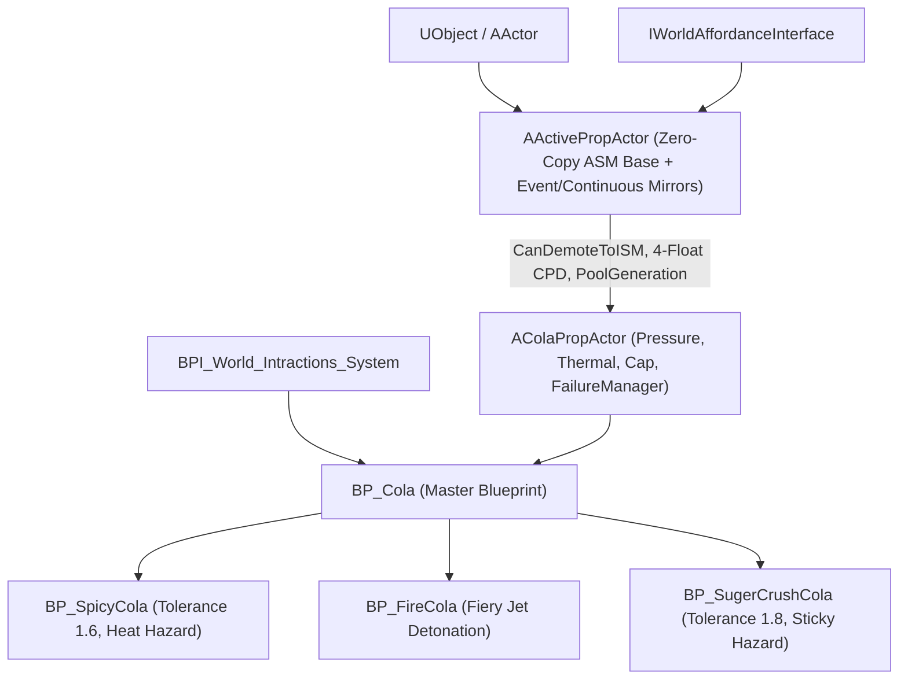
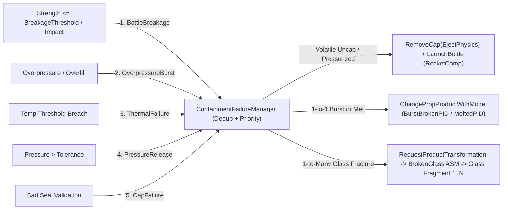

# BP_Cola & AColaPropActor — Technical Architecture & Gameplay Specification

**Project:** Midnight Fizz: Giant Thirst (*MarryByMidnight*)  
**Source Location:** [`ColaPropActor.h`](file:///c:/Users/PC/Documents/Unreal%20Projects/MarryByMidnight/Source/MarryByMidnight/Public/Props/ColaPropActor.h) & [`ColaPropActor.cpp`](file:///c:/Users/PC/Documents/Unreal%20Projects/MarryByMidnight/Source/MarryByMidnight/Private/Props/ColaPropActor.cpp)  
**Blueprint Class:** `/Game/Props/Colas/BP_Cola` (derives from [`AColaPropActor`](file:///c:/Users/PC/Documents/Unreal%20Projects/MarryByMidnight/Source/MarryByMidnight/Public/Props/ColaPropActor.h#L26))  
**Parent C++ Class:** [`AActivePropActor`](file:///c:/Users/PC/Documents/Unreal%20Projects/MarryByMidnight/Source/MarryByMidnight/Public/Props/InteractableProp.h#L32) : `AActor`, `IWorldAffordanceInterface`  
**Interface Implementations:** `IWorldAffordanceInterface`, `BPI_World_Intractions_System`  
**Companion Docs:** [`ISM_Data_Architecture.md`](file:///c:/Users/PC/Documents/Unreal%20Projects/MarryByMidnight/Docs/ISM_Data_Architecture.md) | [`ActivePropActor_ASM_Architecture.md`](file:///c:/Users/PC/Documents/Unreal%20Projects/MarryByMidnight/Docs/ActivePropActor_ASM_Architecture.md) | [`PropManager_ISM_ASM_Architecture.md`](file:///c:/Users/PC/Documents/Unreal%20Projects/MarryByMidnight/Docs/PropManager_ISM_ASM_Architecture.md) | [`Bottle_Damage_Transformation_and_Fragments.md`](file:///c:/Users/PC/Documents/Unreal%20Projects/MarryByMidnight/Docs/Bottle_Damage_Transformation_and_Fragments.md)

---

## 1. Executive Summary & Purpose

`AColaPropActor` is the authoritative native C++ base class governing all drinkable and volatile soda bottles in *Midnight Fizz: Giant Thirst*. Represented in content as `BP_Cola` and subclassed by specialized variants (`BP_SpicyCola`, `BP_FireCola`, `BP_SugerCrushCola`), this actor unifies the **Bottle Containment & Failure System** with the **zero-copy ISM <-> ASM pooling architecture**:

1. **Fractional Liquid Volume, Content Identity & Morph Targets:** Continuous fill tracking via `ContentLevel` (`0.0` empty, `1.0` normal capacity, up to `MaxOverfillLevel = 1.7` by default), paired with central `ContentID` lookups, driving `"EmptyLevel"` / `"OverfullLevel"` morph targets, 4-float Custom Primitive Data, and velocity-reactive Slot `1` liquid shaders (`UpdateBottleMaterial`).
2. **Separated Base vs. Interaction Pressure & Structural Integrity (`Strength`):** Resting `BasePressure = ContentLevel`, interaction agitation (`AccumulatedInteractionPressure`) scaled by `Content.PressureStrengthMultiplier / Product.PressureResistanceMultiplier` with `InteractionEventID` deduplication, plus monotonic persistent `Strength` (`0.0 .. MaxStrength`) separating permanent dents/cracks from recoverable `TemporaryDeformation`.
3. **Dual Thermal Solver & Equilibration Gate:** Multi-source exponential heat transfer solving both bottle shell (`CurrentTemperature`) and liquid (`ContentTemperature`), draining `Strength` above/below thermal thresholds, and gating ASM -> ISM demotion via [`CanDemoteToISM()`](file:///c:/Users/PC/Documents/Unreal%20Projects/MarryByMidnight/Docs/ActivePropActor_ASM_Architecture.md#L103) until shell and content equilibrate.
4. **Centralized Containment Failure Manager & Catastrophic Rocket Flight:** Prioritized server-authoritative failure handling (`BottleBreakage > OverpressureBurst > ThermalFailure > PressureRelease > CapFailure`), duplicate `FailureEventID` protection, erratic 3D zig-zag `URocketProjectileComponent` launches, hazard spawning, and PID conversion to `BurstBrokenProductID`.
5. **4-Stage Capping & 5-Mode Uncapping Lifecycle:** `AddCap` (`Validate -> Attach -> Close & Seal -> Auto/Event Validation` updating float `CapSealed` `0.0 .. 1.0`) and `RemoveCap` (`Twist`, `Pop`, `Break`, `Pull`, `Cut`) with `SafeOpenPressureThreshold` containment checks and `PoolGeneration`-safe cleanup timers.
6. **Precision Filling (`FillBottle(FillStrength, DeltaSeconds)`) & Decoupled Failures:** Frame-rate-independent flow with `FillSlowdownCurve`, `OverfillWarningThreshold`, strict return of exact accepted fractional portions, and decoupled `OverpressureBurst` vs. optional `bEnableOverfillFailure`.
7. **Commercial Economy & Quadratic Underfill Penalty:** Non-linear pricing calculations rewarding chilled full bottles and penalizing underfilled bottles scanned at checkout.

---

## 2. Class Hierarchy & Architecture Diagram



---

## 3. Component Architecture

| Component | Class Type | Role & Configuration |
| :--- | :--- | :--- |
| **`SkeletalMeshComponent`** | `USkeletalMeshComponent` | Visual mesh (e.g. `SKM_ColaBottel`). Hosts transient Slot `1` dynamic liquid material (`UMaterialInstanceDynamic`) only when `ContentID > 0 && ContentLevel > 0`, receives 4-float Custom Primitive Data, and drives `"EmptyLevel"` / `"OverfullLevel"` + deformation morph targets. |
| **`PropMesh`** | `UStaticMeshComponent` | Physics collision body for drop/collision impacts (`SetNotifyRigidBodyCollision(true)` bound to `HandleBottleComponentHit`) and static mesh visual fallback carrying the same 4-float Custom Primitive Data. |
| **`CapMeshComponent`** | `UStaticMeshComponent` | Detachable bottle cap (`BottleCap`) attached at neck socket `(0, 0, 170)`. Tracks attachment, closing alignment, and sealing state (`CapSealed` `0.0 .. 1.0`). When attached/sealed (`CapSealed > 0`), blocks filling and drinking. |
| **`RocketComp`** | `URocketProjectileComponent` | Erratic 3D zig-zag rocket flight simulation (`LaunchRocket`), ricochets, fuel depletion, and post-flight settling delegates. |
| **`PhysicsSimComponent`** | `UStaticMeshPhysicsSimulationComponent` | Manages physics sleep/wake transitions, `UnsettledDelay` (3.0s) timers, and settling handoffs to `UASMComponent` + `CanDemoteToISM()`. |
| **`DynamicMaterialInstance`** | `UMaterialInstanceDynamic` *(Transient)* | Created lazily on Slot `1` only for filled bottles (`ContentID > 0 && ContentLevel > 0`); cleared and original material restored in `ResetTransientPoolState()`. |
| **`DebugText`** | `UTextRenderComponent` | Development billboard text showing `ISID`, `PID`, `CID`, `ContentLevel`, `Temperature`, `Strength`, and `CapSealed`. |

---

## 4. Detailed Feature Breakdown & Implementation Mechanics

### 4.1 Liquid Identity (`ContentID`), `ContentLevel`, Morph Targets & 4-Float Shader Driving

Every bottle separates its **physical container product (`ProductID`)** from its **liquid flavor (`ContentID`)**:
- `ContentID == 0`: Empty container (no liquid shader parameters ticked, Slot `1` liquid material cleared).
- `ContentID > 0`: Looks up shared `FPropContentDefinition` from [`APropManager::ContentDefinitions`](file:///c:/Users/PC/Documents/Unreal%20Projects/MarryByMidnight/Docs/ISM_Data_Architecture.md#L146-L167) (`LiquidMaterial`, `LiquidColor`, `PressureStrengthMultiplier`, `BasePortionPrice`, `IdealServingTemperature`, taste/stimuli/expiry).

Liquid volume is tracked natively as continuous `EventData.ContentLevel` (mirrored to replicated `ColaLevel` in ASM — **never** floored to integers inside active gameplay):
- `0.0`: Empty (`RemainingPortions = 0`).
- `0.0 .. 1.0`: Partial to `NormalCapacity` (`1.0`).
- `> 1.0` up to `ProductDef->MaxOverfillLevel` (`1.7` default): Overfilled neck/headspace range.
- Fractional portion derivation on demand: $\text{RemainingPortions} = \text{ContentLevel} \times \text{MaxPortions}$.

#### Morph Targets (`UpdateMorphTargets`)
Drives both liquid fill level and reversible vs. permanent shell deformation (`TotalDeformation = TemporaryDeformation + (1.0 - Strength / MaxStrength)`):

$$\text{FoamRatio} = \text{MapRangeClamped}(\text{FoamPressure}, [0, 10], [0, 1])$$

$$\text{TotalVolume} = \text{ContentLevel} + \text{FoamRatio}$$

$$\text{EmptyLevel} = \text{Clamp}(1.0 - \text{TotalVolume}, 0.0, 1.0)$$

$$\text{OverfullLevel} = \text{Clamp}(\text{TotalVolume} - 1.0, 0.0, 1.0)$$

- While warming up (`bIsFirstActiveFrame || WarmupFramesRemaining > 0`), morph targets hard-snap to avoid residual deformation from the previous pooled bottle; afterward they smoothly `FInterpTo(..., 12.0f)`.

#### Unified 4-Float Custom Primitive Data & Dynamic Liquid Shader (`UpdateBottleMaterial`)
All ISM slots (`PerInstanceSMCustomData`) and active ASM mesh components (`SetCustomPrimitiveDataFloat`) expose **4 consistent floats**:
- **Slot `0`:** `ContentLevel` (`0.0 .. MaxOverfillLevel`)
- **Slot `1`:** `ExpiryAge` (`Clamp((WorldElapsedSeconds - CreationTime) / ExpiryLifetimeSec, 0.0, 1.0)`)
- **Slot `2`:** `Temperature` (raw `°C`, letting materials compute both frost `< 15°C` and heat shimmer/scorch `> 45°C`)
- **Slot `3`:** Normalized `Strength` (`Clamp(Strength / MaxStrength, 0.0, 1.0)`). Materials compute `DamageAlpha = 1.0 - Slot3`:
  - **Glass Bottles (`EBottleMaterialType::Glass`):** Drives crack opacity, normal intensity, and micro-fracture roughness via **`Lerp` nodes** until `Strength <= BreakageFailureThreshold` triggers fracture.
  - **Plastic Bottles (`EBottleMaterialType::Plastic`):** Drives permanent dents and body bends via **World Position Offset (WPO)** sampling a **Vertex Deformation Texture**, preserving dents natively when demoted back to ISM.

For Slot `1` `DynamicMaterialInstance` (created only when `ContentID > 0 && ContentLevel > 0`):
- `ScalarParameter "Liquid Level"` $\leftarrow \text{ContentLevel}$
- `ScalarParameter "Current Pressure"` $\leftarrow P_{\text{total}}$
- `ScalarParameter "Temperature"` $\leftarrow \text{ContentTemperature}$ *(or equilibrium `Temperature`)*
- `ScalarParameter "Age Strength"` $\leftarrow \text{ExpiryAge}$ *(shader freshness/spoilage factor from Slot `1`)*
- `ScalarParameter "Structural Strength"` $\leftarrow \frac{\text{Strength}}{\text{MaxStrength}}$ *(or direct shader read from CPD Slot `3` for permanent dents/cracks)*
- `ScalarParameter "Use Dynamic Values"` $\leftarrow 1.0$
- `VectorParameter "Object Velocity"` $\leftarrow \text{LinearVelocity}$ (clamped to max `3000 cm/s`)
- `VectorParameter "Object Angular Velocity"` $\leftarrow \text{AngularVelocity}$ (clamped to max `720 deg/s`)

---

### 4.2 Pressure System (`Base` vs `Interaction`), Impulse Dedup & Strength Degradation

To comply with `Bottle_Containment_&_Failure_System.txt`, pressure is strictly separated into persistent `BasePressure` and transient `AccumulatedInteractionPressure`:

$$P_{\text{base}} = \text{ContentLevel}$$

$$P_{\text{total}} = P_{\text{base}} + P_{\text{interaction}}$$

#### 1. Continuous Agitation & Drop Impulse Generation (`UpdateFoamPressure` / `HandleBottleComponentHit`)
- **Warmup, Transit & Teleport Guards (plus ISM Hit Bypass):** Normal `HandleBottleComponentHit` bypasses agitation during `WarmupFramesRemaining` (`20`), `HeldGracePeriod` (`0.5s`), rest interpolation, or jumps $> 200^2\text{ cm}^2$ / $Z < -50,000$. When promoted by an external ISM collision via [`SendISMHitByICIDToPropManager`](file:///c:/Users/PC/Documents/Unreal%20Projects/MarryByMidnight/Source/MarryByMidnight/Private/Props/InteractablePropManager.cpp#L263-L294) -> [`SetInstanceToUnsettled`](file:///c:/Users/PC/Documents/Unreal%20Projects/MarryByMidnight/Source/MarryByMidnight/Private/Props/InteractablePropManager.cpp#L6198-L6307), the **authoritative server (`HasAuthority()`)** invokes `ApplyInitialImpactFromPromotion(EffectiveImpulse, ...)` passing the **unclamped `EffectiveImpulse`** (bypassing both warmup and the `220.0f` `SafeImpulse` velocity clamp) so heavy impacts crack or shatter resting glass bottles reliably. *(Additional Phase B Fix: [`ColaPropActor.cpp#L163`](file:///c:/Users/PC/Documents/Unreal%20Projects/MarryByMidnight/Source/MarryByMidnight/Private/Props/ColaPropActor.cpp#L163) zeros local finite-difference velocities without overwriting replicated `FoamPressure` on clients, and [`ColaPropActor.cpp#L236-L237`](file:///c:/Users/PC/Documents/Unreal%20Projects/MarryByMidnight/Source/MarryByMidnight/Private/Props/ColaPropActor.cpp#L236-L237) removes the stray `bWasHeldLastFrame = true` overwrite.)*
- **Continuous Pressure Generation (when `Abs(DeltaJerk) > AgitationJerkThreshold` while held & attached):**
  $$\Delta P = \frac{\text{PressureGenerationRate} \times \Delta t \times \text{Content.PressureStrengthMultiplier}}{\text{Product.PressureResistanceMultiplier}}$$
- **One-Time Impulse (`HandleBottleComponentHit` / `ApplyInitialImpactFromPromotion`) with Server Deduplication:**
  $$\Delta P_{\text{impulse}} = \frac{\text{PressureImpulse} \times \text{Content.PressureStrengthMultiplier}}{\text{Product.PressureResistanceMultiplier}}$$
  Guarded on the server by unique `InteractionEventID` (`LastProcessedInteractionEventID`, `ProcessedInteractionEventIDs`, `LastImpulseTimestamp`, `ImpulseCooldown`) so duplicate physics hit callbacks within a frame never double-charge pressure impulses.
- **Stationary / Unheld Pressure Decay (`Decrease Pressure`):**
  $$P_{\text{interaction}} = \max(0.0,\ P_{\text{interaction}} - \text{PressureDecayRate} \times \Delta t)$$
  Decay **never** reduces $P_{\text{base}} = \text{ContentLevel}$ and **never** restores permanent `Strength` or permanent dents/cracks; only `TemporaryDeformation` eases back toward equilibrium.

#### 2. Two Immediate Pressure Release Modes (`ReleasePressure`)
- **Mode A (`ReleaseInteractionPressure`):** Instantly clears `AccumulatedInteractionPressure = 0.0` (e.g., careful micro-venting cap) while keeping $P_{\text{total}} = P_{\text{base}} = \text{ContentLevel}$.
- **Mode B (`FullPressureVent`):** Clears `AccumulatedInteractionPressure = 0.0` and vents sealed headspace to atmospheric equilibrium (`P_total = VentedBasePressure`, typically `0.0`), clearing pending impulse queues while preserving `Strength` and `ContentLevel` (unless spray/spill occurred).

#### 3. Structural Integrity (`Strength`) & Material Deformation Separation
- When $P_{\text{total}} > \text{ProductDef->PressureDamageThreshold}$:
  $$\Delta \text{Strength} = (P_{\text{total}} - \text{PressureDamageThreshold}) \times \text{StrengthDamageRate} \times \Delta t$$
  $$\text{Strength} = \max(0.0,\ \text{Strength} - \Delta \text{Strength})$$
- Extreme temperature (`< LowTempDamageThreshold` or `> HighTempDamageThreshold`) and high-energy impacts (`DamageEventID`-deduped) reduce the exact same persistent `EventData.Strength`.
- **Invariants:** Neither pressure decay, emptying content, nor cooling back to room temperature restores `Strength`. Only `RepairBottle()` (when `bSupportsRepair`) or `FullReset` restores `Strength`.
- If `Strength <= ProductDef->BreakageFailureThreshold` (default `0.0f`), `ContainmentFailureManager` immediately receives **`BottleBreakage`** (Priority 1, beating `PressureRelease` if both happen in the same tick).

---

### 4.3 Dual Thermal Solver (Bottle Shell vs. Liquid Contents)

While active in ASM, `AColaPropActor` simulates multi-source heat exchange across both the container shell (`CurrentTemperature`) and internal liquid (`ContentTemperature`):

$$Q = \sum_{i} G_i (T_i - T_{\text{shell}}) + P_{\text{direct}}, \qquad T_{\text{new}} = T_{\text{target}} + (T_{\text{prev}} - T_{\text{target}}) \cdot e^{-K \Delta t}$$

- Uses shared `WorldElapsedSeconds` (double precision) and a single shared `DeltaSeconds` across all active sources (`Ambient`, `Hot/Cold Contents`, `DirectHeating`/`IceBath`, gameplay heat inputs) so multi-source transfers never double-count elapsed time.
- **Thermal Tolerance & Damage:** Below `LowTempDamageThreshold` or above `HighTempDamageThreshold` monotonically drains `Strength`; breaching `[MinTemperatureThreshold, MaxTemperatureThreshold]` submits **`ThermalFailure`** to `ContainmentFailureManager`.
- **Equilibration Gate Before ISM Demotion:** `CanDemoteToISM()` returns `false` while `Abs(ContentTemperature - CurrentTemperature) > ThermalEquilibriumEpsilon`, keeping the bottle in ASM until shell and liquid converge so ISM stores one equilibrium `Temperature` safely.

---

### 4.4 Containment Failure Manager & Product Transformations (`LaunchBottle` / `Breakage`)

All failure conditions route through a single authoritative **`SubmitFailureRequest(FContainmentFailureRequest)`** entry point on the server (`FailureEventID`, `FailureType`, `Severity`, `Location`, `Direction`, `bReleaseContent`, `bReleasePressure`) instead of independent uncoordinated explosions:



- **Priority & Lockout:** `1. BottleBreakage > 2. OverpressureBurst > 3. ThermalFailure > 4. PressureRelease > 5. CapFailure > 6. Other`. Once an equal or higher priority failure is accepted (`bFailureExecutionInProgress` / `bFailureExecuted`), lower-priority or duplicate `FailureEventID` callbacks are ignored.
- **Ballistic Rocket Configuration (`LaunchBottle`):**
  1. **Cap Detonation:** `RemoveCap(EBottleCapRemovalType::Pop, 1.0f, ECapRemovalOperation::EjectPhysics)` detaches/ejects the cap (`+Up * 1500` impulse) and clears `CapType = 0`, `CapSealed = 0.0f`.
  2. **Flight Trajectory Setup:** `bEnableErraticPath = true`, `ZigZagMode = ERocketZigZagMode::Random3D`, `Min/MaxWaypointSpacing = 350..650 cm`, `Min/MaxPathDeviation = 35..90 deg`, `8` flight ricochets, `4` falling bounces.
  3. **Impulse Cone:** $25^\circ$ cone around local `UpVector`; Speed `Clamp(ContentLevel * 3500.0, 1500.0, 4500.0) cm/s`; Distance `Clamp(ContentLevel * 6000.0, 2000.0, 8000.0) cm`.
  4. **Hazard & Product Transformation ([`Bottle_Damage_Transformation_and_Fragments.md`](file:///c:/Users/PC/Documents/Unreal%20Projects/MarryByMidnight/Docs/Bottle_Damage_Transformation_and_Fragments.md)):** Spawns variant hazard puddles/clouds/jets (and ejects attached cap debris on shatter), then executes either:
     - **1-to-1 (`OverpressureBurst` / `ThermalFailure`):** Calls `ChangePropProductWithMode(BurstBrokenProductID / MeltedProductID, EPropProductResetMode::PreserveUniqueState)` keeping `ISID`, `CreationTime`, `Temperature`, and `ContentID`.
     - **1-to-Many (`BottleBreakage` on Glass):** Guards `BrokenProductID != ProductID`, retires `SourceISID` via `ReleaseInstanceToEmpty`, and invokes `RequestProductTransformation` -> `Broken Glass Bottle` (`ABrokenBottlePropActor`) -> `Glass Fragment 1..N` independent `FragISID` lifecycles.

---

### 4.5 Bottle Capping (`AddCap` 4 Stages) & Uncapping (`RemoveCap` 5 Modes)

Capping state in ISM/ASM is persisted cleanly via **`CapType` (`uint8` `EBottleCapType`)** and float **`CapSealed` (`0.0 .. 1.0`)** plus transient ASM validation states:

- **`AddCap` 4-Stage Pipeline:**
  1. **Stage 1 — Validate Cap:** Verify `EBottleCapType` compatibility (`CapType` bit) against `ProductDef->SupportedCapMask` and cap mesh validity.
  2. **Stage 2 — Attach Cap:** Activate/attach `CapMeshComponent` at neck socket `(0, 0, 170)`, align rotation, disable cap physics (`Attached`).
  3. **Stage 3 — Close & Seal (`FVector ActionDirection, float ActionStrength`):** Drive F1 torque/rotation toward `[TorqueSweetSpotMin, TorqueSweetSpotMax]` (`Closing` -> `Closed`).
  4. **Stage 4 — Validate & Lock (`AutoTrigger` retriggerable delay OR `EventTrigger`):** Evaluate final rotation, position, closing strength, and seal integrity -> either commit **`CapType`** + **`CapSealed = 1.0f`** (`Sealed`, syncing Event Delta) OR partial/failed seal (`0.01 .. 0.99` -> triggers **`CapFailure`** leakage).
- **`RemoveCap(EBottleCapRemovalType RemovalType, float RemovingStrength)` — 5 Modes (`Twist`, `Pop`, `Break`, `Pull`, `Cut`):**
  1. Checks `CapMeshComponent` is attached and `RemovalType` matches cap hardware (`Twist`, `Pop`, `Break`, `Pull`, `Cut`).
  2. **Containment Gate:** If `ContentLevel <= KINDA_SMALL_NUMBER`, skips containment check and removes cleanly. If `ContentLevel > 0.0f`, tests `bIsInSuitableContainmentEnvironment` AND `TotalPressure <= SafeOpenPressureThreshold`.
  3. Unsafe removal submits **`PressureRelease`** to `ContainmentFailureManager`; safe removal sets `CapType = 0`, `CapSealed = 0.0f`, emits Event Delta, and cleans up the ejected cap cleanly using **`PoolGeneration`-guarded timers** or standalone temporary debris *(fixing [`ColaPropActor.cpp#L423-L431`](file:///c:/Users/PC/Documents/Unreal%20Projects/MarryByMidnight/Source/MarryByMidnight/Private/Props/ColaPropActor.cpp#L423-L431) so pooled bottle reuse within 5 seconds never destroys the next bottle's cap)*.

---

### 4.6 Commercial Economy & Quadratic Underfill Penalty

When customers purchase cola bottles at `BP_CheckoutScanner`, `BasePrice` resolves from `ContentDef->BasePortionPrice * NumOfPortions` (falling back to `ProductDef->ConsumableProfile.Price`) and applies non-linear underfill penalty math:

#### Quadratic Penalty Formula (`CalculateUnderfillPenalty`)
$$\text{If } \text{ContentLevel} \ge \text{TargetFill}: \quad \text{Penalty} = 0.00$$

$$\text{If } \text{ContentLevel} < \text{TargetFill}: \quad \text{Penalty} = \text{BasePrice} \times (\text{TargetFill} - \text{ContentLevel})^2$$

#### Customer Payout Formula (`CalculateSalePayout`)
$$\text{Payout} = \max\left(0.0,\ \text{BasePrice} - \text{Penalty}\right)$$

#### Economic Penalty Curve Table (`BasePrice` = \$10.00, `TargetFill` = `1.0`)
| Fill Level (`ContentLevel`) | Fill Ratio | Underfill Difference | Penalty | Final Payout | Revenue Retained |
| :--- | :--- | :--- | :--- | :--- | :--- |
| **1.00 (Standard)** | 100% | 0.00 | \$0.00 | **\$10.00** | 100.0% |
| **0.90 (Slight Underfill)** | 90% | 0.10 | \$0.10 | **\$9.90** | 99.0% |
| **0.75 (3/4 Fill)** | 75% | 0.25 | \$0.625 | **\$9.38** | 93.8% |
| **0.50 (Half Fill)** | 50% | 0.50 | \$2.50 | **\$7.50** | 75.0% |
| **0.25 (Quarter Fill)** | 25% | 0.75 | \$5.625 | **\$4.38** | 43.8% |
| **0.10 (Near Empty)** | 10% | 0.90 | \$8.10 | **\$1.90** | 19.0% |
| **0.00 (Empty)** | 0% | 1.00 | \$10.00 | **\$0.00** | 0.0% |

---

### 4.7 Content Operations (`SetBottleContentType`, `FillBottle`, `RemoveBottleContent`) & Zero-Copy Pooling Cycle

1. **`SetBottleContentType(int32 NewContentID)`:** Pre-configures a bottle before filling when `ContentLevel <= 0.0f` and `NewContentID` is permitted by `ProductDef->SupportedContentIDs`. Binds Slot `1` material and pressure/thermal rules from `APropManager::ContentDefinitions` without changing `ContentLevel` or `CreationTime`.
2. **`float FillBottle(float FillStrength, float DeltaSeconds)` (Returns `AcceptedPortions`):**
   - Rejects if `CapSealed > 0.0f`, `FailureState >= Failing`, or `ContentID <= 0`.
   - Computes `RawFill = FillStrength * DeltaSeconds * SlowdownCurve(ContentLevel)`.
   - Clamps against `RemainingCapacity = MaxOverfillLevel - ContentLevel`; accepts `AcceptedFill` and returns `AcceptedPortions = AcceptedFill * NumOfPortions` so the dispenser subtracts only accepted volume.
   - Emits warning cue at `OverfillWarningThreshold`; above `1.0` adds compression pressure (`OverpressureBurst` occurs only at `PressureFailureThreshold`, while optional `bEnableOverfillFailure` handles hard capacity overflow independently).
3. **`RemoveBottleContent()` & `ConsumePortion()`:**
   - Instant reset (`RemoveBottleContent`) or gradual drinking (`ConsumePortion`) updates `ContentLevel`, keeps `Strength` & `CreationTime` intact, and when `ContentLevel <= 0.0f` on a reusable bottle converts PID cleanly via `ChangeProduct(EmptyBottleProductID, EPropProductResetMode::ContentReset)` rather than calling `ReleaseInstanceToEmpty(ISID)`.

```mermaid
sequenceDiagram
    participant ISM as UInteractableISMComponent (AtRest)
    participant PM as APropManager (Zero-Copy Registries)
    participant Cola as AColaPropActor (Pooled ASM)

    Note over ISM,PM: Resting ISM stores ONLY UniqueData (no shared copies) + 4-float GPU CPD
    PM->>Cola: Promote: ++PoolGeneration; ApplySharedDefs + EventData + ContinuousData
    Note over Cola: Restore ContentLevel float, CapMesh from CapSealed, Slot 1 MID if ContentLevel > 0
    Cola->>PM: EmitPropEventUpdate on Fill / Cap / Damage / Consume / ProductID swap
    Note over Cola: UASMComponent requests settle -> Checks Cola->CanDemoteToISM()
    alt Abs(ContentTemp - Temp) > Eps OR InteractionPressure > Eps OR Leaking OR ClosingTimer
        Cola-->>PM: Return false (Stay in ASM until normalized)
    else All Transient Simulation Settled
        Cola->>PM: WriteToISIDRecord (Preserve CreationTime; never floor ContentLevel)
        Cola->>Cola: ResetTransientPoolState() (++PoolGeneration, detach/clear Cap & Slot 1 MID)
        PM->>ISM: Restore slot at RestTransform & update 4-float GPU CPD
    end
```

---

## 5. Network Replication Breakdown

Under the split zero-copy architecture, persistent ISM/ASM fields sync through [`APropManager`](file:///c:/Users/PC/Documents/Unreal%20Projects/MarryByMidnight/Docs/PropManager_ISM_ASM_Architecture.md#L72-L91) (`Registry`, `Event` ordered by `EventSequence`, and `Continuous`), while live ASM gameplay variables replicate for active presentation:

| Property / Channel / RPC | Net Mode | Description |
| :--- | :--- | :--- |
| **`ProductDefinitions` & `ContentDefinitions`** | Initial Snapshot + On-Register Reliable Multicast | Central Category 1 registries; never duplicated per instance or resent per delta batch. |
| **Event Channel (`FPropEventSyncDelta`)** | Server -> Client Reliable (`EventSequence` Guard) | Syncs `ContentLevel`, `ContentID`, `CapType`, `CapSealed`, discrete `Strength`, `bIsGrabbable`, `CreationTime`, and `ProductID` transformations. |
| **Continuous Channel (`FPropContinuousSyncItem`)** | Server -> Client Unreliable Batch | Syncs `Temperature`, `LastUpdatedTime`, and optional thermal `Strength` drain; never mutates `CreationTime`. |
| **`ColaLevel` (ASM Mirror)** | `ReplicatedUsing = OnRep_ColaLevel` | Active mirror of `ContentLevel` while filling/drinking in ASM; drives morph targets and liquid material height. |
| **`FoamPressure` (ASM Transient)** | `ReplicatedUsing = OnRep_FoamPressure` | Active server-authoritative agitation foam (`0..10`); clients never overwrite it locally during Tick warmup. |
| **`CapState` & `CapSealed` (ASM Mirror)** | `ReplicatedUsing = OnRep_CapState` | Synchronizes live 4-stage torque closing, sealing validation, and 5-mode cap removal visuals. |
| **`FailureState` & `AcceptedFailureType`** | `ReplicatedUsing = OnRep_FailureState` | Synchronizes `ContainmentFailureManager` execution (`Normal` -> `Failing` -> `Broken`) so FX trigger once per `FailureEventID`. |
| **`LinearVelocity` / `AngularVelocity` / `State` / `bIsHeld` / `bIsActive`** | Replicated (`AActivePropActor`) | Slosh shader velocities and ASM pool activation/visibility transitions. |
| **`Server_ConsumePortion` / `Multicast_OnPortionConsumed`** | Server Reliable RPC / NetMulticast | Client consume requests and audio/UI broadcast. |

---

## 6. Cola Variants Comparison Table

| Property / Behavior | Standard (`BP_Cola`) | Sugar Crush (`BP_SugerCrushCola`) | Spicy / Fire (`BP_SpicyCola` / `BP_FireCola`) |
| :--- | :--- | :--- | :--- |
| **Data Asset / ContentID** | `DA_BasicCola` / `CID = 1` | `DA_SweetCola` / `CID = 2` | `DA_SpicyCola` / `CID = 3` |
| **Base Price** | \$2.50 - \$10.00 | \$3.25 | \$4.50 |
| **Max Overfill / Burst Tolerance** | `MaxOverfillLevel = 1.7` / `PressureFailureThreshold = 2.0` | `MaxOverfillLevel = 1.7` / `PressureFailureThreshold = 1.8` *(More Volatile)* | `MaxOverfillLevel = 1.7` / `PressureFailureThreshold = 1.6` *(Extremely Volatile)* |
| **Ideal Temperature** | $4.0^\circ\text{C}$ | $3.0^\circ\text{C}$ | $8.0^\circ\text{C}$ |
| **Agitation Jerk Threshold** | `1.5` | `1.2` | `1.0` |
| **Overfill Surge Multiplier** | `3.0` | `4.0` | `4.5` |
| **Detonation Hazard (`HazardType`)** | Ballistic unguided rocket | Sticky foam geyser (50% floor slow) | Scorching jet fire patches on counters |

---

## 7. C++ Header, Implementation Reference & Revision History

- Header File: [`ColaPropActor.h`](file:///c:/Users/PC/Documents/Unreal%20Projects/MarryByMidnight/Source/MarryByMidnight/Public/Props/ColaPropActor.h)
- Implementation File: [`ColaPropActor.cpp`](file:///c:/Users/PC/Documents/Unreal%20Projects/MarryByMidnight/Source/MarryByMidnight/Private/Props/ColaPropActor.cpp)
- Base Class: [`InteractableProp.h`](file:///c:/Users/PC/Documents/Unreal%20Projects/MarryByMidnight/Source/MarryByMidnight/Public/Props/InteractableProp.h)
- Rocket Component: [`RocketProjectileComponent.h`](file:///c:/Users/PC/Documents/Unreal%20Projects/MarryByMidnight/Source/MarryByMidnight/Public/Components/RocketProjectileComponent.h)

| Iteration | Focus Completed |
|---|---|
| **Iteration 1** | Aligned `BP_Cola` / `AColaPropActor` documentation with the zero-copy ISM <-> ASM architecture (`ContentLevel`, `ContentID`, `CapSealed`, `Strength`, 4-float CPD, split Event/Continuous channels) and full `Bottle_Containment_&_Failure_System.txt` specification (`AddCap` 4 stages, `RemoveCap` 5 modes, `FillBottle` fractional return, `ContainmentFailureManager`, `BurstBrokenProductID`). |
| **Iteration 2** | Audited pricing formulas, KaTeX `$` escaping (`\$` in tables), `CanDemoteToISM()` equilibration conditions, and exact Phase B bug fixes (`ColaPropActor.cpp#L163`, `L236-L237`, `L423-L431`, `L547-L609`). |
| **Iteration 3** | Replaced ASCII pooling/hierarchy diagrams with Mermaid diagrams and verified all clickable `file:///` links against source headers/implementations. |
| **Iteration 4** | Integrated [`Bottle_Damage_Transformation_and_Fragments.md`](file:///c:/Users/PC/Documents/Unreal%20Projects/MarryByMidnight/Docs/Bottle_Damage_Transformation_and_Fragments.md): specified Glass crack `Lerp` vs Plastic WPO Vertex Texture in `Slot 3`, added server-only `ApplyInitialImpactFromPromotion` bypass (`WarmupFramesRemaining` + unclamped `EffectiveImpulse`), separated 1-to-1 (`Burst`/`Melted`) vs 1-to-Many (`Broken Glass -> Glass Fragment 1..N`) transformations with recursion guard, and unified `CapType` / `SupportedCapMask` / `EBottleCapRemovalType`. |
