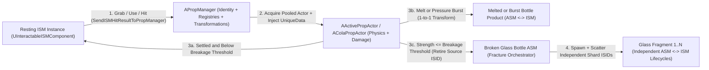
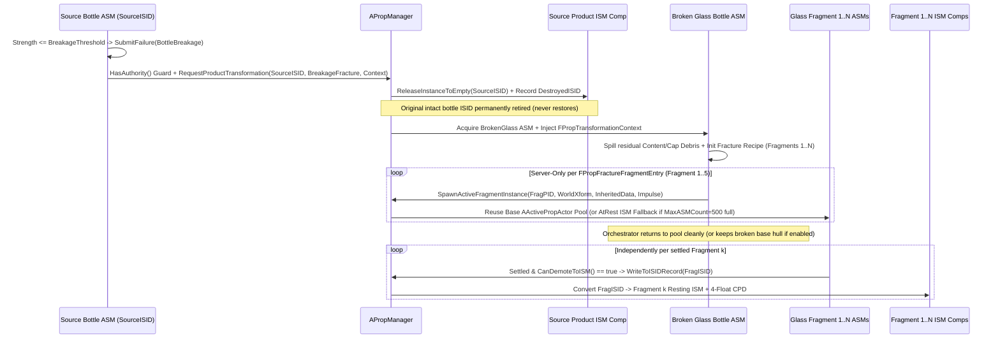
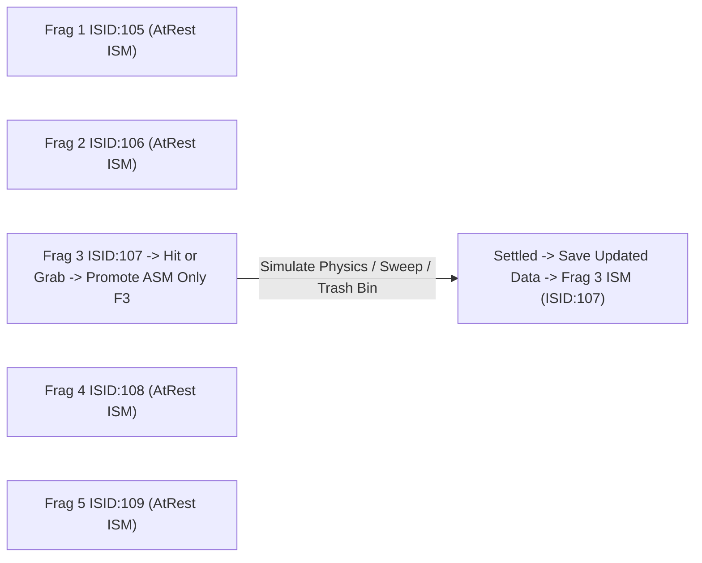

# Bottle Damage, Product Transformation & Fragment Lifecycle Architecture

**Project:** Midnight Fizz: Giant Thirst (*ColossalFizzCo*)  
**Primary C++ References (Read-Only Pending Phase B Sign-Off):**  
- [`InteractablePropDatabase.h`](file:///c:/Users/PC/Documents/Unreal%20Projects/ColossalFizzCo/Source/ColossalFizzCo/Public/Props/InteractablePropDatabase.h) — Product Definitions, Category 2 Unique Data, Save Schema  
- [`InteractablePropManager.h`](file:///c:/Users/PC/Documents/Unreal%20Projects/ColossalFizzCo/Source/ColossalFizzCo/Public/Props/InteractablePropManager.h) & [`InteractablePropManager.cpp`](file:///c:/Users/PC/Documents/Unreal%20Projects/ColossalFizzCo/Source/ColossalFizzCo/Private/Props/InteractablePropManager.cpp) — ISID Lifecycle, Hit Promotion, Product Conversion & Retirement  
- [`InteractableProp.h`](file:///c:/Users/PC/Documents/Unreal%20Projects/ColossalFizzCo/Source/ColossalFizzCo/Public/Props/InteractableProp.h) & [`ColaPropActor.h`](file:///c:/Users/PC/Documents/Unreal%20Projects/ColossalFizzCo/Source/ColossalFizzCo/Public/Props/ColaPropActor.h) — Active Prop Base & Volatile Cola Implementation  
- **Companion Docs:** [`ISM_Data_Architecture.md`](file:///c:/Users/PC/Documents/Unreal%20Projects/ColossalFizzCo/Docs/ISM_Data_Architecture.md) | [`ActivePropActor_ASM_Architecture.md`](file:///c:/Users/PC/Documents/Unreal%20Projects/ColossalFizzCo/Docs/ActivePropActor_ASM_Architecture.md) | [`PropManager_ISM_ASM_Architecture.md`](file:///c:/Users/PC/Documents/Unreal%20Projects/ColossalFizzCo/Docs/PropManager_ISM_ASM_Architecture.md) | [`BP_Cola_Technical_Documentation.md`](file:///c:/Users/PC/Documents/Unreal%20Projects/ColossalFizzCo/Docs/BP_Cola_Technical_Documentation.md)

---

## 1. Core Architecture Principle

> **Transformation Over Cosmetic Swap:** Breaking, bursting, or melting a bottle does **not** simply swap a material or toggle a visibility flag on the original product. It **transforms** the original bottle product (`ProductID`) into **one or more new products** (such as `Melted Glass Bottle`, `Burst Bottle`, or `Broken Glass Bottle` fracturing into `Glass Fragment 1..N`), each owning its own identity (`ProductID` & `ISID`), persistent data, GPU custom data, and independent `ISM <-> ASM` lifecycle.

### Division of Responsibilities



- **`APropManager`:** Owns shared `ProductDefinitions` / `ContentDefinitions`, permanent logical IDs (`ISID`), `UniqueDataByISID`, product retirements (`ReleaseInstanceToEmpty`), 1-to-1 / 1-to-Many product transformations, and resting ISM storage.
- **`AActivePropActor` / `AColaPropActor`:** Handles active rigid-body physics, impact/thermal/pressure damage accumulation, `CanDemoteToISM()` gating, and failure/transformation triggers.
- **GPU Per-Instance Custom Data (4 Floats):** Drives live visual damage (`Glass` crack `Lerp`, `Plastic` WPO dents), liquid height, freshness aging, and thermal frost/scorch consistently on both resting ISMs and active ASMs.

---

## 2. ISM -> ASM: Initial Interaction & Impact Promotion

Whenever a player interacts with a resting bottle or an external physical impact hits it, the bottle transitions from resting **ISM** to active **ASM** while preserving its permanent **`ISID`**:

1. **Interaction Trigger:** `RequestGrab`, `RequestUse`, `RequestConsume`, or `SetMeshInstanceToHeld` promotes the bottle into ASM (`EPropActivationReason::Grab` / `Interaction`).
2. **External Hit / Impact Trigger:** Projectile hits, character collisions, or thrown objects invoking [`APropManager::SendISMHitResultToPropManager`](file:///c:/Users/PC/Documents/Unreal%20Projects/ColossalFizzCo/Source/ColossalFizzCo/Private/Props/InteractablePropManager.cpp#L214-L294) route through `SendISMHitByICIDToPropManager` -> `SetMeshInstanceToUnsettled`, promoting the exact `ISID` into ASM (`EPropActivationReason::PhysicsImpulse` / `Drop`) and applying the impact impulse.
3. **State Hydration:** `APropManager` retrieves the bottle's persistent Category 2 data (`ContinuousData` + `EventData`) and Category 1 definitions (`ProductDef`, `ContentDef`) and initializes the pooled ASM actor (`InitializeFromISIDRecord`), restoring its exact resting `Strength`, `Temperature`, `CreationTime`, `ContentLevel`, `ContentID`, `CapType`, and `CapSealed`.
4. **Material-Specific Simulation Response:**
   - **Glass Bottle (`EBottleMaterialType::Glass`):** High-energy impacts reduce `EventData.Strength`; crack intensity rises on `Slot 3`. No plastic body bending occurs (`bCanCrack = true`, `bCanBend = false`, `bCanDent = false`).
   - **Plastic Bottle (`EBottleMaterialType::Plastic`):** Impacts reduce `EventData.Strength`, increasing permanent dent/bend deformation (`bCanInflate = true`, `bCanBend = true`, `bCanDent = true`).
   - **Thermal Exposure:** Hot or freezing zones step `Temperature`, `LastUpdatedTime`, and extreme-temperature `Strength` drain (`< LowTempDamageThreshold` or `> HighTempDamageThreshold`).

> [!IMPORTANT]
> **Pre-Authorized Phase B Bug/Gap To Address (`Warmup` & `SafeImpulse` Clamp Swallowing Initial ISM Hit):** Currently [`APropManager::SendISMHitByICIDToPropManager`](file:///c:/Users/PC/Documents/Unreal%20Projects/ColossalFizzCo/Source/ColossalFizzCo/Private/Props/InteractablePropManager.cpp#L263-L294) calls [`APropManager::SetInstanceToUnsettled`](file:///c:/Users/PC/Documents/Unreal%20Projects/ColossalFizzCo/Source/ColossalFizzCo/Private/Props/InteractablePropManager.cpp#L6198-L6307), which **(1)** clamps `HitImpulse` (`SafeImpulse`) to max size `220.0f` (`L6235-L6237`) and **(2)** promotes the actor with `WarmupFramesRemaining = 20`, during which [`AColaPropActor::HandleBottleComponentHit`](file:///c:/Users/PC/Documents/Unreal%20Projects/ColossalFizzCo/Source/ColossalFizzCo/Private/Props/ColaPropActor.cpp#L611-L620) exits early. Therefore, on **Authoritative Server (`HasAuthority()`) only**, `SendISMHitByICIDToPropManager` must invoke `PromotedASM->ApplyInitialImpactFromPromotion(EffectiveImpulse, ImpactPoint, HittingActor, FreshInteractionEventID)` passing the **unclamped `EffectiveImpulse`** right after promotion (while physics velocity kick still uses `SafeImpulse`). Clients continue predicting movement locally without computing damage or spawning client-side fragment `ISID`s.

---

## 3. GPU-Driven Visual Damage & Material Response

All material effects across resting ISM components (`PerInstanceSMCustomData`) and active ASM mesh components (`SetCustomPrimitiveDataFloat`) are driven by the exact same **4 Per-Instance Custom Data floats**:

| CPD Slot | Data Source | Value Range | Shared Shader Interpretation |
|---:|---|---|---|
| **`0`** | `EventData.ContentLevel` | `0.0 .. MaxOverfillLevel` | Liquid fill column height inside container + overfill bulge blend |
| **`1`** | Derived `ExpiryAge` | `0.0 .. 1.0` | Discoloration, aged turbidity, grunge, and material deterioration |
| **`2`** | `ContinuousData.Temperature` | Raw `°C` (`float`) | Frost/condensation mask (`< 15°C`) and heat shimmer/scorch (`> 45°C`) |
| **`3`** | `EventData.Strength / MaxStrength` | `0.0 .. 1.0` | Normalized integrity (`1.0` = pristine, `0.0` = failure). Materials compute `DamageAlpha = 1.0 - Slot3` |

### 3.1 Glass Bottle Visual Pipeline (`Crack Progression via Lerp`)
- **Persistent Scalar:** Each qualifying impact reduces `EventData.Strength` (`0 .. MaxStrength`), immediately refreshing `CPD Slot 3`.
- **Shader Evaluation:** The Glass Master Material computes `CrackAlpha = Clamp(1.0 - CustomPrimitiveData[3], 0.0, 1.0)` and drives crack visibility using **`Lerp` nodes** across Crack Normal Intensity, Roughness/Specularity micro-fractures, Crack Opacity/Refraction Distortion, and Crack Edge Mask.
- **Breakage Eligibility:** When `Strength <= ProductDef->BreakageFailureThreshold` (default `<= 0.0f`), the bottle does **not** return to its intact ISM mesh; instead it enters **Section 5 (Glass Bottle Breakage Transformation)**.

### 3.2 Plastic Bottle Visual Pipeline (`Permanent Deformation via WPO Vertex Texture`)
- **Persistent Scalar:** Each impact reduces `EventData.Strength` (`CPD Slot 3`) without fracturing the plastic container at normal impact levels.
- **Shader Evaluation:** The Plastic Master Material computes `DeformWeight = Clamp(1.0 - CustomPrimitiveData[3], 0.0, 1.0)` *(plus optional transient ASM elastic inflation scalar during active pressure)* and drives **World Position Offset (WPO)** by sampling a **Vertex Deformation Texture / Vector Displacement Texture (`VAT`)** scaled by `DeformWeight`.
- **Material-Native Persistence:** As `Strength` drops, dents, crinkles, and neck/wall bends progressively deform the mesh silhouette. Because `CPD Slot 3` is written to the resting `UInteractableISMComponent` on demotion, **all dents and bends stay visually preserved in ISM with zero skeletal bones**.

### 3.3 Other GPU Visual Channels
- **Temperature (`Slot 2`):** Drives frost buildup and icy roughness when chilled, and heat-haze / scorching discoloration when overheated.
- **Age (`Slot 1`):** Computed dynamically on batch updates and ASM ticks from immutable `EventData.CreationTime`; controls tint aging and grime without ever modifying `CreationTime`.
- **Content Level (`Slot 0`):** Drives liquid height & meniscus visibility (`Slot 0 == 0` disables liquid rendering cleanly).

---

## 4. ASM -> ISM: Returning a Damaged Bottle to Rest

Consider a player picking up a full Glass or Plastic Cola bottle, drinking all of its contents, throwing the empty bottle onto the floor, and watching it settle with damage above the failure threshold (`Strength > BreakageFailureThreshold`):

1. **ISM -> ASM (`Grab`):** Bottle promotes via `ISID`; `EventData` & `ContinuousData` hydrate the pooled ASM actor.
2. **Consumption (`ContentLevel -> 0`):** Each sip reduces `EventData.ContentLevel` (no integer portion quantization) and emits an Event Delta (`Slot 0` updates). Once `ContentLevel <= 0`, a reusable bottle converts to `EmptyBottleProductID` (`EPropProductResetMode::ContentReset`) retaining `ISID`, `CreationTime`, `Strength`, and `Temperature` *(if `CanDemoteToISM` / policy allows open empty demotion)*.
3. **Throw & Floor Impact:** Player throws the bottle (`State = InMotion`); `HandleBottleComponentHit` measures impact energy (deduped per frame/impulse), deducts `Strength`, updates `CPD Slot 3` (cracks appear on Glass / WPO dents appear on Plastic), and checks `Strength <= BreakageFailureThreshold`. Because `Strength` remains above failure threshold, the bottle stays intact and enters physics settling.
4. **Settling & Equilibration Gate (`CanDemoteToISM()`):** Once velocity falls below `LinearVelocityTolerance` and `AngularVelocityTolerance` for `UnsettledDelay`, `UASMComponent` calls `ActiveActor->CanDemoteToISM()` ensuring:
   - Not held, not in motion, not rocket-launching, not mid-cap-validation, not actively leaking/failing,
   - `AccumulatedInteractionPressure <= KINDA_SMALL_NUMBER`,
   - `Abs(ContentTemperature - CurrentTemperature) <= ThermalEquilibriumEpsilon`.
5. **Write-Back & ISM Restoration:** Before pooling, `WriteToISIDRecord` commits updated `UniqueData` and `ConvertASMToISM` updates the `EmptyBottle` ISM transform + pushes all **4 CPD floats** (`ContentLevel=0`, `ExpiryAge`, `Temperature`, `Strength/MaxStrength`) to GPU.

### How All Conceptual Bottle Properties Persist in Zero-Copy Storage

Reconciling every persistent concept required across `ASM <-> ISM` into the fixed **`48 B` Category 2 schema** (`0` wasted shared array copies; **see [`ISM_Data_Architecture.md` §2.3](file:///c:/Users/PC/Documents/Unreal%20Projects/ColossalFizzCo/Docs/ISM_Data_Architecture.md#L170-L215)**):

| Conceptual Property | Exact Persistence Mechanism Across `ASM -> ISM` | Bytes Cost |
|---|---|---:|
| **Content Level** | `EventData.ContentLevel` (`float`) -> GPU `Slot 0` | `4 B` |
| **Content Type** | `EventData.ContentID` (`int32`, keys shared `APropManager::ContentDefinitions`) + optional flavor `FilledProductIDByContentID` | `4 B` |
| **Creation Time & Age** | Immutable `EventData.CreationTime` (`double WorldElapsedSeconds`) -> dynamically computes `ExpiryAge` (`Slot 1`) | `8 B` |
| **Temperature** | `ContinuousData.Temperature` (`float`) + `ContinuousData.LastUpdatedTime` (`double`) -> GPU `Slot 2` | `12 B` |
| **Strength** | `EventData.Strength` (`float 0..MaxStrength`) -> GPU `Slot 3` | `4 B` |
| **Permanent Deformation (Plastic)** | Encoded directly inside `EventData.Strength` when `BottleMaterialType == Plastic`; Plastic shader samples `1 - Slot3` -> WPO Vertex Texture | `0 B` extra |
| **Crack Progression (Glass)** | Encoded directly inside `EventData.Strength` when `BottleMaterialType == Glass`; Glass shader samples `1 - Slot3` -> Crack `Lerp` | `0 B` extra |
| **Thermal Damage** | Extreme temperatures monotonically deduct the same persistent `EventData.Strength` (`ThermalFailure` transforms bottle on breach) | `0 B` extra |
| **Cap Type & Cap State / Seal Integrity** | **`EventData.CapType` (`uint8` `EBottleCapType`)** + **`EventData.CapSealed` (`float 0.0 .. 1.0`)** *(Note: `uint8 CapType` packs into existing 3-byte alignment padding next to `bool bIsGrabbable`, keeping `FPropEventUpdateData` exact **32 B**)* | `4 B` *(+`0 B` pad slot)* |
| **Resting Pressure & Failure State** | Resting `BasePressure == ContentLevel`; active interaction pressure drains before `CanDemoteToISM()`; structural/thermal/burst failures trigger **Product Transformation** | `0 B` extra |

---

## 5. Glass Bottle Breakage: 1-to-Many Product Transformation & Fragments

When an ASM Glass bottle (`SourceISID`) receives an impact (or thermal shock / pressure spike) reducing `Strength <= BreakageFailureThreshold`, the bottle breaks **instead** of returning to its intact ISM slot.



### Detailed Step-by-Step Sequence (Steps 1–10)

1. **Structural Failure Detection & Recursion Guard:** In `AColaPropActor::HandleBottleComponentHit` (or `ApplyInitialImpactFromPromotion` / `UpdateStructuralIntegrity`), the **authoritative server (`HasAuthority()`)** checks `Strength <= ProductDef->BreakageFailureThreshold` (default `0.0f`) and calls `SubmitFailureRequest(EContainmentFailureType::BottleBreakage)` *(Priority 1)*. **Loop Guard:** Transformation verifies `ProductDef->BrokenProductID > 0 && ProductDef->BrokenProductID != SourceProductID` (and `FractureFragments` entries never reference `SourceProductID` or trigger recursive fracture; if an individual fragment's `Strength` later hits `<= 0`, it simply calls `ReleaseInstanceToEmpty(FragISID)`).
2. **Breakage Event, Fluid/Cap Side-Effects & Context Capture:** `ContainmentFailureManager` locks the bottle (`FailureState = EContainmentFailureState::Broken`). If `ContentLevel > 0`, it spills/splashes residual fluid and spawns variant puddle/hazard decals (`EColaHazardType`); if `CapSealed > 0`, it ejects/detaches a loose cap debris mesh (or spawns a cap drop) instead of vanishing the cap silently. It then packages **`FPropTransformationContext`**:
   - `SourceISID`, `SourceProductID`, `SourceMaterialType` (`EBottleMaterialType`)
   - `WorldTransform`, `ImpactPoint`, `ImpactNormal`, `LinearVelocity`, `AngularVelocity`, deterministic `FractureSeed`
   - `InheritedUniqueData` (`Temperature`, `LastUpdatedTime`, `CreationTime`, `ContentID`, residual `ContentLevel`, `CapType`, `CapSealed`)
3. **Transformation Request to Prop Manager:** The bottle invokes `PropManager->RequestProductTransformation(SourceISID, EPropTransformationType::BreakageFracture, ProductDef->BrokenProductID, Context)`.
4. **Authoritative Retirement of `SourceISID`:** On the **server (`HasAuthority()` only — clients NEVER allocate fragment `ISID`s or retire records locally)**, `APropManager` executes:
   - [`ReleaseInstanceToEmpty(SourceISID)`](file:///c:/Users/PC/Documents/Unreal%20Projects/ColossalFizzCo/Source/ColossalFizzCo/Private/Props/InteractablePropManager.cpp#L2232-L2262) (returns `BottleASM` to pool after `ResetTransientPoolState()`, unregisters `ISID`, returns the ISM slot to `EmptyInstances`, queues `PendingReleasedToEmptyISIDs`, and appends `SourceISID` to `WorldSaveData.DestroyedISIDs`), so the intact original bottle **can never return** via pooled reuse, late network replication, or save-game reload.
5. **Acquire `Broken Glass Bottle` Orchestrator ASM:** `APropManager` acquires an ASM representing `BrokenProductID` (`ABrokenBottlePropActor`) at `Context.WorldTransform` and injects `Context`.
6. **Initialize Fracture Recipe:** `ABrokenBottlePropActor` reads `FractureFragments` (`TArray<FPropFractureFragmentEntry>`) from `ProductDefinitions[SourcePID]` (or `[BrokenPID]` fallback):
   - Computes exact shard world transforms via **`Context.WorldTransform * Entry.LocalSpawnTransform`** using `FractureSeed` deterministic angular/positional jitter for identical scatter trajectories.
   - Computes per-shard launch impulses (`Context.LinearVelocity * Entry.VelocityInheritance + ScatterDir * Speed` + radial torque).
7. **Apply Fragment Properties, Base-Pool Reuse & `MaxASMCount` Saturation Fallback:** Server invokes `SpawnActiveFragmentInstance(...)` per entry:
   - Each fragment receives its own `ProductID` (`Glass Fragment 1..5`), inherited thermal/age history (`CreationTime`, `Temperature`, `LastUpdatedTime`), `bIsGrabbable`, and clean fragment `Strength` (`100.0f` or `FragDef->DefaultUniqueData.EventData.Strength`) — never born already broken at `0`.
   - **Zero Class-Swap Hitch:** Fragment definitions leave `CustomActiveActorClass = nullptr`, so `UASMComponent` reuses pre-warmed base [`AActivePropActor`](file:///c:/Users/PC/Documents/Unreal%20Projects/ColossalFizzCo/Source/ColossalFizzCo/Public/Props/InteractableProp.h#L32) slots directly without actor destroy/respawn churn.
   - **Pool Saturation Guard (`MaxASMCount = 500`):** If bulk breakage (e.g., dropping a crate of 20 glass bottles = 100 shards at once) approaches [`MaxASMCount = 500`](file:///c:/Users/PC/Documents/Unreal%20Projects/ColossalFizzCo/Source/ColossalFizzCo/Public/Components/ASMComponent.h#L41-L43), excess shards trace directly down to the floor and spawn straight into `AtRest` ISM slots (`bFallbackToRestingISMIfPoolFull = true`), preventing silent shard loss.
8. **Fragment Simulation Until Settle:** Active fragment ASMs simulate physics via `PhysicsSimComponent` until linear/angular velocities drop below tolerance for `UnsettledDelay`.
9. **Conversion to Independent ISM Instances:** As **each** fragment reaches rest and passes `CanDemoteToISM()`, it demotes via `ConvertASMToISM` into **`UInteractableISMComponent`** belonging to its own `ProductID` (`Glass Fragment 1` batch, `Glass Fragment 2` batch, etc.), reusing `EmptyInstances` first and writing its 4-float GPU CPD (`Slot 1 = ExpiryAge`, `Slot 2 = Temperature`, `Slot 3 = FragmentStrength`).
10. **Orchestrator Completion (`bPersistBrokenHullAfterFracture`):** Once fracture spawning finishes:
    - *Pure Fracture Mode (`bPersistBrokenHullAfterFracture == false`):* `Broken Glass Bottle` orchestrator cleanly returns to the ASM pool without occupying a permanent `ISID` / ISM slot (100% replaced by `Glass Fragment 1..5`).
    - *Hull + Shards Mode (`bPersistBrokenHullAfterFracture == true`):* `BrokenProductID` registers its own `ISID` and settles to ISM alongside the fragments as the larger broken bottle base/neck piece.

### Fragment `ISID` Allocation Timing (`At Spawn` vs. `At Settle` — Open Design Choice)

| Mode | How It Works | Trade-Offs |
|---|---|---|
| **Option A — Allocate `FragISID` Immediately On Fracture Spawn *(Recommended)*** | `Broken Glass Bottle` ASM calls `PropManager->SpawnActiveFragmentInstance(FragPID, WorldXform, InheritedData, Impulse)` at fracture time; each fragment immediately holds its own `ISID` + pooled ASM (`State = Unsettled`) and demotes individually when settled. | **Best Co-Op & Save Safety:** Players can pick up, sweep, or kick any shard mid-slide without waiting for all 5 shards to stop; `SavePropDatabase` saves shards cleanly at any second; uses existing ASM replication. |
| **Option B — Transient Shard Actors Registered Only On Settle** | `ABrokenBottlePropActor` spawns local transient shard actors/components during the 1–3s scatter burst, then calls `PropManager->RegisterSettledFragments(...)` only once all shards stop moving to allocate `ISID`s directly into ISM. | Zero `ISID` churn if a fragment falls out-of-bounds before settling, **but** requires extra client RPC/actor plumbing to grab or replicate mid-slide shards before settle completes. |

---

## 6. Individual Fragment Lifecycle (`ISM <-> ASM` Per Shard)

Every fragment (`Glass Fragment 1` .. `Glass Fragment 5`) is an **independent `ProductID`** inside `APropManager::ProductDefinitions`:



- **Resting Memory Cost:** While resting on the shop floor, each shard is just one ISM instance transform + 4 GPU floats (plus optional `48 B` in `UniqueDataByISID` *only* if `bEnableInstanceUniqueData == true` on `Glass Fragment k` to preserve inherited temperature/age; purely decorative/sweepable shards with `bEnableInstanceUniqueData = false` pay **`0 B`** unique state!).
- **Single-Shard Activation:** If a player brushes with a broom, steps on, picks up, or throws **Fragment 3**, `PropManager` promotes **only Fragment 3's `ISID`** (`ISM -> ASM`). Sibling fragments `1, 2, 4, 5` remain completely untouched in their resting ISM batches with zero CPU cost!
- **Cleanup / Destruction:** When swept into a trash chute/bag or stepped/crushed to zero (`FragStrength <= 0`), cleanup calls `ReleaseInstanceToEmpty(FragISID)` / `DestroyPropInstance(FragISID)`, returning the fragment's ISM slot cleanly to `EmptyInstances` for the next broken bottle!

---

## 7. Other Product Transformations & Property Inheritance Matrix

The exact same transformation pipeline handles all bottle failure outcomes by registering dedicated target `ProductID` definitions in `ProductDefinitions`:

| Target Product Definition | Trigger Condition | Topology | Specific Behaviors & Persistent Inheritance |
|---|---|---|---|
| **`Broken Glass Bottle` + `Glass Fragment 1..N`** | Glass impact `Strength <= BreakageThreshold` (`BottleBreakage`) | **1-to-Many** (`Retire Source` -> `BrokenASM` -> `N` `FragISID`s) | Source `ISID` permanently retired; spills liquid/hazard; fragments inherit `Temperature`, `LastUpdatedTime`, `CreationTime`, `ContentID` (trace residue), `WorldTransform`, and split scatter velocity. |
| **`Melted Glass Bottle`** | Extreme heat `Temperature >= MaxTemperatureThreshold` (`ThermalFailure`) | **1-to-1** (`Same ISID`, `ChangePropProductWithMode(MeltedPID, PreserveUniqueState)`) *(or 1-to-1 Retire+Replace)* | Dedicated melted-blob/slumped glass static mesh (`ProductID = MeltedGlass`); inherits thermal history (`Temperature`, `LastUpdatedTime`), `CreationTime`, low deformed `Strength`, `ContentID` (boiled off -> `ContentLevel = 0`, `CapSealed = 0`); continues cooling ASM <-> ISM! |
| **`Burst Bottle`** | Headspace / overfill pressure `>= PressureFailureThreshold` (`OverpressureBurst`) | **1-to-1** (`ChangePropProductWithMode(BurstPID, PreserveUniqueState)`) *(or `BurstPID` + optional flying Cap/Fragments)* | Torn/blown-out bottle static mesh (plastic/metal/glass); inherits residual/splattered `ContentID`, `ContentLevel = 0` (unless trace foam), `Temperature`, `CreationTime`, `Strength = 0`, `CapType`, `CapSealed = 0`; settles as burst bottle or optionally spawns flying cap debris + shards. |
| **`Glass Fragment 1, 2, 3, 4, 5...`** | Spawned by `Broken Glass Bottle` fracture recipe | **Independent Child `ISID`s** | Individual shard meshes (`StaticMesh`), lightweight `PhysicsProfile` tolerances, sweepable/grabbable `InteractionProfile`, optional `UniqueData` carrying inherited `Temperature` & `CreationTime` back into ISM. |

### Exact Property Transfer Matrix

| Persistent Field | `Broken Glass` -> `Fragments 1..N` | `Melted Glass Bottle` (`1-to-1`) | `Burst Bottle` (`1-to-1`) |
|---|---|---|---|
| **`ISID`** | Source retired; each fragment gets **new `ISID`** | Keep `SourceISID` *(via `ChangePropProductWithMode`)* or issue new `ISID` | Keep `SourceISID` *(via `ChangePropProductWithMode`)* |
| **`ProductID`** | `Glass Fragment 1..N` (`FragDef->ProductID`) | `ProductDef->MeltedProductID` | `ProductDef->BurstBrokenProductID` |
| **`CreationTime`** | **Inherited** from original bottle | **Inherited** from original bottle | **Inherited** from original bottle |
| **`Temperature` & `LastUpdatedTime`** | **Inherited** from original bottle at fracture | **Inherited** from original bottle (continues cooling) | **Inherited** from original bottle |
| **`Strength`** | Fragment starts at `FragDef->DefaultStrength` (`100.0`, independent durability) | Clamped/damaged melt state (`<= 0` or `MeltedStrength`) -> `Slot 3` | Set to `0.0` (ruptured hull, non-reusable) -> `Slot 3` |
| **`ContentID` & `ContentLevel`** | Liquid spilled at fracture site; fragments get `ContentID = inherited` (for residue/hazard tag) or `0`, `ContentLevel = 0.0` | Boiled/evaporated (`ContentLevel = 0.0`, `ContentID` retained or `0`) | Content expelled/jetted on burst (`ContentLevel = 0.0`, `ContentID` retained for stain/hazard lookup) |
| **`CapType` & `CapSealed`** | `CapType = 0`, `CapSealed = 0.0` *(or cap spawned separately if `CapSealed > 0` before shatter!)* | Melted/unsealed (`CapSealed = 0.0` or fused) | Ejected on burst (`CapSealed = 0.0`, detached cap debris spawned) |

---

## 8. Proposed C++ Contracts (`[Needs Approval]` vs `[Pre-Authorized]`)

### 8.1 Database & Product Transformation Structs (`[Needs Approval]` — [`InteractablePropDatabase.h`](file:///c:/Users/PC/Documents/Unreal%20Projects/ColossalFizzCo/Source/ColossalFizzCo/Public/Props/InteractablePropDatabase.h))

```cpp
UENUM(BlueprintType)
enum class EPropTransformationType : uint8
{
    None,
    BreakageFracture,   // 1-to-Many: Retire SourceISID -> BrokenGlass ASM -> Glass Fragment 1..N ISIDs
    ThermalMelt,        // 1-to-1 (or 1-to-Many): Extreme heat -> MeltedGlassProductID
    OverpressureBurst   // 1-to-1 (or 1-to-Many): Overpressure rupture -> BurstBrokenProductID (+ optional shards)
};

USTRUCT(BlueprintType)
struct COLOSSALFIZZCO_API FPropFractureFragmentEntry
{
    GENERATED_BODY()

    UPROPERTY(EditAnywhere, BlueprintReadWrite, Category = "Fracture")
    int32 FragmentProductID = 0; // ProductID of Glass Fragment 1, 2, 3...

    UPROPERTY(EditAnywhere, BlueprintReadWrite, Category = "Fracture")
    FTransform LocalSpawnTransform = FTransform::Identity; // Offset relative to bottle root

    UPROPERTY(EditAnywhere, BlueprintReadWrite, Category = "Fracture")
    FVector LocalScatterDirection = FVector(0.0f, 0.0f, 1.0f);

    UPROPERTY(EditAnywhere, BlueprintReadWrite, Category = "Fracture", meta = (ClampMin = "0.0"))
    float MinImpulseSpeed = 120.0f;

    UPROPERTY(EditAnywhere, BlueprintReadWrite, Category = "Fracture", meta = (ClampMin = "0.0"))
    float MaxImpulseSpeed = 380.0f;

    UPROPERTY(EditAnywhere, BlueprintReadWrite, Category = "Fracture", meta = (ClampMin = "0.0", ClampMax = "1.0"))
    float VelocityInheritance = 0.65f;
};

USTRUCT(BlueprintType)
struct COLOSSALFIZZCO_API FPropTransformationContext
{
    GENERATED_BODY()

    UPROPERTY(BlueprintReadWrite) int32 SourceISID = 0;
    UPROPERTY(BlueprintReadWrite) int32 SourceProductID = 0;
    UPROPERTY(BlueprintReadWrite) EPropTransformationType TransformationType = EPropTransformationType::None;
    UPROPERTY(BlueprintReadWrite) uint8 SourceMaterialType = 0; // EBottleMaterialType
    UPROPERTY(BlueprintReadWrite) FTransform WorldTransform = FTransform::Identity;
    UPROPERTY(BlueprintReadWrite) FVector ImpactPoint = FVector::ZeroVector;
    UPROPERTY(BlueprintReadWrite) FVector ImpactNormal = FVector::UpVector;
    UPROPERTY(BlueprintReadWrite) FVector LinearVelocity = FVector::ZeroVector;
    UPROPERTY(BlueprintReadWrite) FVector AngularVelocity = FVector::ZeroVector;
    UPROPERTY(BlueprintReadWrite) uint32 FractureSeed = 0;
    UPROPERTY(BlueprintReadWrite) FPropInstanceUniqueData InheritedUniqueData;
};
```

Additional fields on **`FPropProductDefinition`** (`[Needs Approval]`):
- `float BreakageFailureThreshold = 0.0f;` *(Glass bottle breaks when `Strength <= BreakageFailureThreshold`)*
- `int32 BrokenProductID = 0;` *(ProductID of `Broken Glass Bottle` orchestrator/hull)*
- `int32 MeltedProductID = 0;` *(ProductID of `Melted Glass Bottle`)*
- *(existing proposed)* `int32 BurstBrokenProductID = 0;`
- `bool bPersistBrokenHullAfterFracture = false;` *(false = dissolve orchestrator cleanly into `Glass Fragment 1..N`; true = broken neck/base also keeps a resting ISM)*
- `TArray<FPropFractureFragmentEntry> FractureFragments;` *(Fragment ProductIDs + transforms + scatter speeds)*

Packing addition inside **`FPropEventUpdateData`** (`[Needs Approval]` — **0 extra bytes**, fits inside existing `bool` padding):
- `uint8 CapType = 0;` *(maps to `EBottleCapType` alongside `float CapSealed`)*

### 8.2 Prop Manager Transformation API (`[Needs Approval]` — [`InteractablePropManager.h`](file:///c:/Users/PC/Documents/Unreal%20Projects/ColossalFizzCo/Source/ColossalFizzCo/Public/Props/InteractablePropManager.h))

```cpp
// Executes 1-to-1 product transformation OR retires SourceISID and launches 1-to-Many fracture orchestrator ASM
UFUNCTION(BlueprintCallable, Category = "Prop Manager|Product Transformation")
bool RequestProductTransformation(
    int32 SourceISID,
    EPropTransformationType TransformType,
    int32 TargetProductID,
    const FPropTransformationContext& Context);

// Spawns an individual fragment (Glass Fragment 1..N) directly as an active pooled ASM with inherited properties & new ISID
// (or traces/places directly at AtRest ISM if active ASM pool approaches MaxASMCount = 500)
UFUNCTION(BlueprintCallable, Category = "Prop Manager|Product Transformation")
int32 SpawnActiveFragmentInstance(
    int32 FragmentProductID,
    const FTransform& WorldTransform,
    const FPropInstanceUniqueData& InheritedUniqueData,
    FVector LinearImpulse,
    FVector AngularImpulse,
    bool bFallbackToRestingISMIfPoolFull = true);
```

### 8.3 Active Orchestrator & Bottle Caller (`[Pre-Authorized]` — `AActivePropActor` Subclass Hierarchy)

```cpp
// Virtual entry hook on AActivePropActor (overridden on AColaPropActor) invoked server-side after ISM hit promotion
virtual void ApplyInitialImpactFromPromotion(
    FVector UnclampedImpulse,
    const FVector& ImpactPoint,
    AActor* HittingActor,
    uint32 InteractionEventID);

// Derived AActivePropActor class referenced by BrokenProductID's CustomActiveActorClass
UCLASS(Blueprintable)
class COLOSSALFIZZCO_API ABrokenBottlePropActor : public AActivePropActor
{
    GENERATED_BODY()
public:
    UFUNCTION(BlueprintNativeEvent, Category = "Prop|Fracture")
    void InitializeFractureFromContext(const FPropTransformationContext& Context, const TArray<FPropFractureFragmentEntry>& FragmentRecipes);
};
```

---

## 9. Open Edge-Case Decisions (Added to Pre-Phase-B Sign-Off)

In addition to Decisions 1–4 in [`ISM_Data_Architecture.md` §2.7](file:///c:/Users/PC/Documents/Unreal%20Projects/ColossalFizzCo/Docs/ISM_Data_Architecture.md#L367-L375), please confirm these **2 fracture-specific choices**:

5. **Fragment `ISID` Allocation Timing (`At Spawn` vs. `At Settle`):** Should `Broken Glass Bottle` allocate each fragment's permanent `ISID` **immediately at spawn** (`SpawnActiveFragmentInstance` — supports grabbing/sweeping shards mid-slide and mid-flight saves) or **only upon settling**? *(Recommended: Allocate `ISID` at spawn.)*
6. **Broken Bottle Orchestrator Lifecycle (`Pure Fragments` vs. `Broken Hull + Fragments`):** When `Glass Fragment 1..5` finish spawning, should `Broken Glass Bottle` despawn/pool completely (`100%` fragments on floor) OR also stay as a resting base/neck `Broken Glass Bottle` product alongside fragments `1..5` *(and if the bottle was capped before breaking, spawn the detached cap mesh/product separately)*?

---

## 10. Document Revision History

| Iteration | Focus Completed |
|---|---|
| **Iteration 1** | Authored standalone specification for GPU-driven Glass (`Lerp` crack) & Plastic (WPO Vertex Texture) damage, ASM <-> ISM persistence mapping (including zero-byte `CapType` packing), 1-to-Many `Broken Glass Bottle -> Glass Fragment 1..N` lifecycle, `Melted Glass` / `Burst` transformations, property inheritance matrix, and impact-warmup promotion gap. |
| **Iteration 2** | Hardened multiplayer authority (`HasAuthority()`-only damage on ISM promotion + server-only `FragISID` allocation + unclamped `EffectiveImpulse` vs `SafeImpulse`), added recursion guard (`BrokenProductID != ProductID`) against infinite shatter loops, documented cap ejection + hazard fluid spill side-effects, aligned `Entry.LocalSpawnTransform` & `bPersistBrokenHullAfterFracture`, and added `UASMComponent` base-pool saturation fallback (`AtRest` grounded shard fallback when approaching `MaxASMCount = 500`). |
