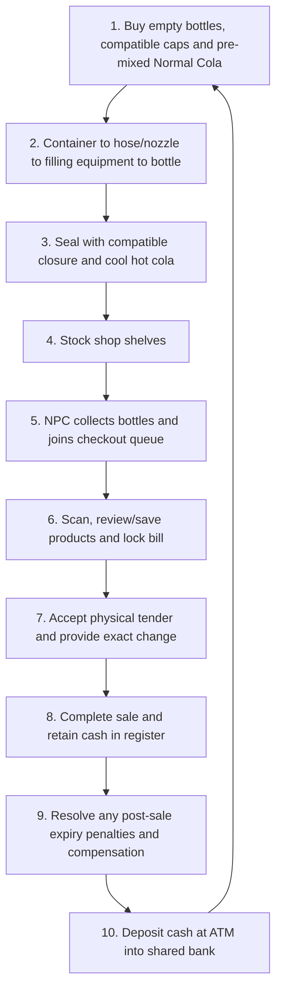

# Game Design Document (GDD) — Master
**Design Name:** Colossal Cola Co.

**Bottle dynamics update — 12–13 November 2026:** The designer approved separate
empty bottle and liquid mass, with **0.05 kg** as the editable plastic shell
default, **20 ml per portion** and per-content density. Total mass follows actual
remaining volume; this supersedes the previous 80 kg bottle tuning without
resizing any actor. Original projectile launches use server-seeded editable
distance/speed/direction/acceleration, with liquid depleted by travel progress and
physics handoff at apex or distance limit. Actual pressure drives locally smoothed
plastic morphs. Stable ASM/ISM identity, canonical state, cash and server authority
remain required. [Current implementation and limitations](Bottle_Systems_Update_2026-11-12.md)
distinguishes tested behavior from pending visual/remote and retained-actor reuse
acceptance. The generic mass policy for other prop classes remains unchanged.

**Current prototype rocket choice — 12 November 2026:** The designer approved
the original **BP_Cola Rocket Projectile Component flight** for now: tipping,
dragging and erratic projectile flight. This temporarily supersedes the earlier
Chaos-thrust powered-flight requirement for the prototype. Pressure thresholds,
managed caps, liquid/pressure accounting and stable ISIDs remain. The physics
mode is retained as an option. See [the implementation/validation record](Original_Bottle_Rocket_2026-11-12.md);
the older physical-flight tests do not accept the new default.

**Legacy Working Title:** Midnight Fizz: Giant Thirst (*MarryByMidnight Engine Build*)

**Genre:** Multiplayer Co-op / Physics-Based Factory Simulation / Time Management Comedy  
**Target Platform:** PC (Steam), Console  
**Target Audience:** Fans of *Overcooked*, *PlateUp!*, *Lethal Company*, *Deep Rock Galactic*, *Viscera Cleanup Detail*  

**Scale and mass decision — 11 November 2026:** The current NPC, player and Cola sizes in `/Game/FirstPerson/Lvl_FirstPerson` are approved and must remain unchanged. The player retains the existing default character size to preserve movement, collision, camera and interaction mechanics. The small-player feeling comes from the surrounding giant world. Earlier 25 cm player targets and fixed patron/player multipliers are superseded by Section 3. NPCs and movable actors use gameplay masses below the player's mass; visible size does not imply greater mass.

**Browser-chat reconciliation — 11 November 2026:** [Chat decisions and conflict register](Chat_Design_Decisions_2026-11-11.md) records the source evidence, new Normal Bulk Cola Container requirements, closure distinctions, art direction and unresolved details. Direct designer decisions take precedence over older assistant recaps. This is a design update, not a claim that the new container, cooling or corrected-scale prototype has been implemented or tested. Preserve the approved scanner, physical-cash/ATM and persistence rules. The eleven excluded legacy PSOs, including PSO_FoodContainer, remain outside current scope.

**Latest prototype scope — 11 November 2026, flight mode updated 12 November:** **Plastic Bottles + the five Normal Colas + Normal Caps (Manual Twist) only.** All other bottle materials, cola categories and cap types are excluded from the prototype. Hits, shaking, drops and physical impacts increase internal pressure; exceeding the bottle's maximum tolerance triggers a cola rocket release. The current powered-flight path is the original BP_Cola Rocket Projectile Component behavior, per the decision above; the fully physics-driven option is retained. See [the approved pressure-system scope and acceptance requirements](Prototype_Plastic_Bottle_Pressure_2026-11-11.md). This resolves the earlier prototype material/closure question in favor of plastic/manual twist without changing current bottle, player or NPC sizes. Other material/cap descriptions below are full-game reference only.

**Latest equipment decision — 11 November 2026:** [Equipment Design Specification](Equipment_Design_Specification.md) adds five planned categories; only the **Manual Wheel Rotator** is demo equipment from that catalog. Two players cooperate: one repeatedly presses **G** to hold the cap down with gradually declining effectiveness, while the other rotates it closed. No electricity is required. Cap Gun, Automatic Fill and Cap Machine, Pressure Regulator and Automatic Bottle Cleaner are full-game-only. Essential Normal bulk supply, hoses/dispenser and filling infrastructure remain in scope. [Equipment integration and conflicts](Equipment_Design_Integration_2026-11-11.md) flags input, transport, weight, decay/rotation and multiplayer-session details; this is a design addition, not implementation/test acceptance.

## Current Bottle-Contents Scope and Economy

The [Bottle Contents Catalog](Bottle_Contents_Catalog.md) is the current working taxonomy: **21 types**, comprising Normal (5), Toxic (4), Black Magic (4), Radioactive (4) and Explosive (4). The **demo includes only Lemonade, Mint, Sweet, Spicy and Zero Calories Cola**; all other categories remain future scope.

Approved Normal base-price relationship: **Lemonade < Mint < Sweet < Spicy = Zero Calories**. Spicy and Zero Calories are jointly most expensive. Numeric content prices and type-specific properties/effects are not approved by the catalog. Existing prototype numeric settings remain provisional.

The full-game price constraints, including Explosive Colas overlapping the Black Magic range, are recorded in the catalog. Preserve its partial ordering rather than inventing undefined price relationships. Older formula names, numeric formula tables and named effect descriptions elsewhere are proposals where they conflict with this catalog; they do not expand demo scope or approve effects.

---

## 1. Executive Summary & Vision

### 1.1 The High Concept
Players use the existing default-sized first-person character to operate a frantic, high-pressure cola bottling workshop in a world built primarily for colossal creatures. They feel small relative to the customers, counters, racks and surrounding structures; the player character itself is not resized into a 25 cm miniature.

Your customers are **towering Mountain Giants, sinister Bog Witches, ironbound Golems, and smaller woodland imps**. Cola bottles retain their approved size from `Lvl_FirstPerson`. Oversized production spaces create logistical challenges through distance, reach, awkward dimensions and teamwork, rather than an assumption that every giant object must outweigh the player.

### 1.2 Core Pillars
1. **Physics-Driven Production:**
   Manage hot, pressurized supply, filling, bottle condition and closure integrity. Shaking, impacts, temperature and pressure can create handling risks according to configured material/containment rules. Overfilling or leaving a bottle uncapped does not automatically trigger a timed explosion or rocket launch.
2. **The "David & Goliath" Scale Twist:**  
   Preserve the current player, NPC and Cola sizes from `Lvl_FirstPerson`. Scale and arrange most of the environment for giant customers, while the default-sized player remains visibly small by comparison. Transport equipment addresses distance, stability and handling; NPCs and movable props remain lighter than the player.
3. **Micro-Vehicles & Shop Logistics:**  
   To conquer the vast distances of the giant shop floor, players operate miniature motorized carts, forklifts, flatbed tuggers, and mobile capping rigs to haul massive bulk cylinders, transport crates of bottles, and close bottles on the move.
4. **Cooperative Production and Service:**
   Coordinate dispensing, compatible bottle sealing, cooling, shelf stocking and customer checkout. Manual, automatic and material-specific closures follow their own rules; a universal F1 torque minigame or capping deadline is not a demo requirement.
5. **Shared Prosperity & Shared Chaos:**  
   Multiplayer features a **100% shared shop, shared bank account, and shared inventory**. A teammate's mistake is everyone's disaster; a successful rush allows the crew to upgrade cylinders, buy faster forklift buggies, unlock automatic bottle washers, or procure exotic enchanted colas.

---

### 1.3 Art Direction

Use semi-realistic stylized 3D with **Victorian steampunk, dark fantasy and alchemy** influences. Machinery, bottle hardware and physical coins must remain functional and readable. The browser assistant's phrase “Stylized Victorian Alchemy” is a useful working descriptor, not separately approved branding. Concept-art descriptions do not authorize changing existing player, NPC or bottle sizes. Existing supplied assets remain the visual reference; generated images were not independently reviewed for this update.

## 2. The Core Gameplay Loop

### 2.1 Step-by-Step Breakdown

1. **Purchase supplies:** Keep the approved $0 starting shared bank, empty register and existing starter-stock count. Prototype supplies are empty plastic bottles, Normal manual twist caps and pre-mixed Normal Cola at configurable prototype supply costs. Existing prototype product/material settings and labels need alignment without changing bottle size or resetting identity/ownership. Raw-ingredient processing belongs to the full game.
2. **Fill bottles:** Route supply through the Normal Bulk Cola Container, hose/dispenser and separate filling-equipment stage. Transfer fractional quantities under server authority and deduct only accepted transfer. Preserve bottle identity, Strength/damage and container history; initialize the new liquid's own creation/expiry lifecycle.
3. **Seal and cool:** Two players operate the Manual Wheel Rotator to secure the Normal manual twist cap on the plastic bottle. One repeatedly presses G to apply downward holding force, whose effectiveness declines with time even under continued pressing; the other progressively rotates the cap closed. Insufficient holding before closure permits cola escape through existing pressure/leakage mechanics. Releasing hold after proper sealing does not reopen the cap. Cool the hot product toward its configured optimum temperature. There is no mandatory uncapped eruption countdown. Exact station inputs/tuning and practical cooling remain open; no new warm-product sale lock is implied.
4. **Stock shelves:** Place finished bottles on shop shelves using the existing Prop Manager and shelf services, at the approved bottle dimensions.
5. **Serve shopping NPCs:** Customers enter, find matching Normal Cola, collect physical bottles into their buckets and join the shared checkout queue.
6. **Scan and finalize:** Live scanner entries follow bottles in/out; Save retains entries, and individual ISIDs prevent duplicates. Players may remove/replace bottles before locking the bill. Group display rows while retaining per-bottle pricing and expiry data.
7. **Collect cash and give change:** Any teammate may continue the shared transaction. Physical $1/$2/$5/$10/$20/$50/$100 coins are finite. Incorrect change blocks completion. Prototype customers may round up tender only when real coins can supply change; otherwise they pay exactly. Keep detailed prices in cents and round only the aggregate bill to the nearest $1, half-dollar ties up.
8. **Complete and reinvest:** Successfully completed sales retain physical cash in the register. ATM deposits, not sale completion, credit the shared bank for those coins. Expired bottles sold trigger a once-only full-base-price penalty and either a full, fresh same-cola/same-capacity replacement or another base-price deduction. Record adjustments separately from the locked receipt; retain unpaid obligations. Use bank funds to purchase more supplies.
9. **Finish the visit:** The approved prototype returns the bucket, lets the customer leave, then recycles the NPC and retires purchased physical goods while retaining receipt/ownership history. Physical empty-bottle returns, washing infrastructure and further progression are later work, not a replacement for this prototype departure policy.

### 2.2 Normal Bulk Cola Container

The demo uses **one bulk container type**, the **Normal Bulk Cola Container**, for the five Normal flavors. Opening its valve immediately produces a powerful, high-pressure, fire-hose-like stream of hot cola. The source must not break from its own internal pressure. In the demo it needs **no electricity** and has **no progressive container heating**; hot liquid output remains enabled. Final capacity, flow, pressure and output temperature are not specified. The current 40-portion source is provisional configuration, not final balance.

The four-stage path is **container → flexible hose/dispenser nozzle → interchangeable bottle filling equipment → bottle(s)**. Glass-specific nozzles, four-bottle attachments and pressure-control pumps are later-design examples; their exact behaviors are not automatically demo requirements. Reuse the existing C++ liquid-transfer/Prop Manager services rather than creating a competing quantity or identity system. Handling uncaptured spray/spillage requires a defined policy.

For the full game, electricity-dependent container cooling, low-voltage consequences, progressive heating and a coal-fired steam generator are planned for later design. Additional bulk-container types are also deferred. Internal Cylinder/Tank asset names may remain for compatibility.

### 2.3 Pricing and Quality Boundary

At matching nominal capacity, the full-bottle base price comes from configured nominal portions and the fixed portion rate. Apply `Clamp(ContentLevel, 0, 1)` proportionally, then the approved symmetric temperature discount, capped at 20%, relative to the cola's configured optimum. Overfill has no extra selling value or larger expiry penalty. Bottle purchase cost and recycling value are separate; do not add a bottle-cost rebate. Underfill reduces revenue but does not guarantee a net loss under every configurable balance. Warm bottles remain subject to the approved discount rather than an invented rejection rule. See [scanner rules](Scanner_Checkout_Design_Update_2026-11-10.md).

### 2.4 Plastic Bottle Pressure and Rocket Prototype

Hits, shaking, drops and physical impacts increase internal pressure in the existing base/interaction pressure model. Each plastic bottle has a maximum pressure tolerance. **When `InternalPressure > MaximumPressureTolerance`, trigger pressure release and rocket propulsion from escaping cola.** The designer's 12 November prototype choice uses `BP_Cola`'s original Rocket Projectile Component flight, including its tipping/dragging/erratic movement and flight-plan synchronization. Keep the separate physics-thrust mode available for later development. Exhaustion of liquid/pressure ends powered movement through the component's falling handoff. This is not a glass-fragment event, an automatic pressure-release cap or a capping countdown. The prior fully physics-driven powered-flight requirement is temporarily superseded for the prototype.

The server owns pressure accumulation, threshold evaluation, release and authoritative rocket motion; preserve ISIDs and existing Prop Manager state/pooling/persistence rules. Required validation covers impact/shake/drop buildup, below/equal/above tolerance, oriented flight/collisions, duplicate-event protection, manual cap/content state, server/remote synchronization and repeated bottle reuse. Pressure gains, threshold values, sealed-cap escape mechanism, held/uncapped/empty cases and propulsion/discharge/end-state tuning remain open in the [prototype pressure specification](Prototype_Plastic_Bottle_Pressure_2026-11-11.md). These tests are required, not already passed.

### 2.5 Equipment Catalog and Cooperative Sealing

The complete [equipment specification](Equipment_Design_Specification.md) defines the following catalog. Suggested names are provisional; exact prices, dimensions/weights, operating speeds, voltages/power, pressure ranges and variant counts are not final.

| Equipment | Availability | Main requirements |
| --- | --- | --- |
| Manual Wheel Rotator | Demo and full game | Cheapest cap-closing option; large, extremely low portability; two players; manual power, no electricity. One player repeatedly presses G to hold the cap down, the other rotates it closed. Holding effectiveness deteriorates even with continued pressing. Carrier required to relocate; demo transport arrangement remains open. |
| Cap Gun | Full game only | Expensive, highly portable, handheld, one player; high-voltage electricity. F1 wheel-gun-inspired cap tightening; excessive torque can damage/break caps. |
| Automatic Fill and Cap Machine | Full game only | Most expensive current catalog type, very high voltage; grabbable hose-connected nozzles with separate fill and close inputs. Variant nozzle count changes size, portability, operating demand and throughput. Overfill/over-tightening use existing bottle/cap failures. |
| Pressure Regulator | Full game only | Raises or lowers supplied liquid pressure within variant limits. Fuel/electric versions; wider ranges cost more and can consume more energy. |
| Automatic Bottle Cleaner | Full game only | Cleans dirty bottles over several seconds, with capacity variants. Energy source/duration/capacities open. Cleaning does not repair Strength; reuse still requires empty, clean and Strength > 70%. |

Electrically powered machines expose **RequiredVoltage**, **PowerConsumption** and **OperatingPressureRange** (MinimumOperatingPressure/MaximumOperatingPressure, or not applicable when pressure is unused). Shared data also supports type/variant, price, portability, size, required players, energy source, applicable fuel consumption, capacity and operating speed. Manual equipment requires no electrical connection; rotator PowerConsumption is 0. Specific low-voltage effects remain deferred with the electrical system.

The rotator's time pressure is declining **holding effectiveness**, not an inevitable bottle eruption timer. Inadequate hold before closure permits leakage; the bottle's separately approved pressure-tolerance rule still governs its rocket reaction. Preserve the current bottle/player/NPC sizes, existing pressure/cap/liquid services and approved mass policy. Numeric weight and force/pressure conversion are unresolved. G already serves grab gestures, and carrier-required relocation touches deferred vehicles; both require integration decisions rather than silent key changes, a solo bypass or an assumed full vehicle implementation. See [the equipment conflict register and required tests](Equipment_Design_Integration_2026-11-11.md#5-conflicts-and-unresolved-dependencies).

---

## 3. The Scale Twist: Tiny People, Giant World

### 3.0 Approved Reference and Scale Categories

`/Game/FirstPerson/Lvl_FirstPerson` is the authoritative visual and spatial reference. Preserve the current NPC, player and Cola sizes, including their existing component transforms. Do not change the player to 25 cm, normalize giant props to human proportions, or reduce bottle/cap mesh geometry to make equipment fit. Prototype copies must match the approved reference rather than preserve accidental reduced transforms.

Measured reference values are verification aids, not instructions to resize an actor:

| Reference | Current measured size |
| :--- | :--- |
| Default player collision capsule | Approximately 192 cm tall, radius 34 cm, component scale 1 |
| Existing giant NPC collision capsule | Approximately 1,056 cm tall, radius 204 cm; existing character proportions preserved |
| `Cola1` static mesh | Approximately 190 cm tall and 75 cm wide at native mesh scale 1 |
| Existing reference bottles | Actor scale 1 in `Lvl_FirstPerson` |

**Giant-scale environment:** bottles and matching caps, cash and coins, scanners, checkout equipment and counters, storage/display racks, shop furniture, structures and most other environmental props. Use the reference bottles and giant characters to determine proportions, spacing and capacity.

**Player-scale exceptions:** player vehicles/cars, bottle-filling controls and equipment, cleaning equipment, specialized tools and machinery intended for direct player operation. Their controls, seats, grips and working positions fit the unchanged player while their hoses, mounts and delivery interfaces can reach giant bottles.

Provide appropriate ramps, stairs, walkways, loading positions and reachable controls. Adjust placement, clearance, collision, scan volumes, interaction points and sight lines to the approved object sizes. Preserve the default player camera and mechanics; solve accessibility in the equipment and environment instead of shrinking bottles or the character.

| Customer Archetype | Height / Scale | Personality & Demands | Failure Consequence |
| :--- | :--- | :--- | :--- |
| **Mountain Giant** | Authored giant scale using the approved level reference | Craves massive quantities of ice-cold Heavy Metal Colas. Impatient and heavy-handed. | Slams fists onto counter, launching players, bottles, and tools into the air. |
| **Bog Witch** | Authored patron scale; no fixed player-height multiplier | Demands exotic, cursed beverages (Spider Cola, Toxic Swamp Fizz). Cackles eerily. | Casts hexes on workstations, reversing conveyor belts or turning ice into hot magma. |
| **Stone Golem** | Authored giant scale using the approved level reference | Drinks high-viscosity, heavy-pressure colas. Cannot tolerate warm drinks. | Emits ground tremors that agitate all un-capped or un-settled bottles in the shop. |
| **Forest Goblin / Pixie** | Smaller authored archetype; final variant dimensions require separate authoring | Fast, hyperactive, demands rapid Sugar-Crush mini-bottles. | Jumps onto the counter, knocking bottles over or stealing loose caps. |

### 3.1 Countertop Navigation & Spatial Challenges
Because the environment is built for giants around the unchanged player:
- Bottling stations are elevated; players use kick-ladders, pneumatic lifts, and counter ramps.
- Any cooperative carrying or handling restrictions are explicit item mechanics based on grip, size or stability. They must not depend on a prop outweighing the player.
- Player tools fit the existing character. Hoses can reach giant fittings; tension limits and reactions are tuned independently of visible size.

### 3.2 Vast Workshop Navigation & Micro-Vehicle Logistics
The tavern workshop is large relative to the unchanged player. Vehicles improve traversal, bulk transport and throughput across counters, floors, cellars and serving tables; they are not justified by obsolete 25 cm character or overweight-cylinder assumptions.
- **The Vehicle Fleet:** The team uses motorized micro-machinery:
  - **Flatbed Mules / Karts:** Drivable transport karts with magnetized beds to securely carry crates of empty bottles, ice blocks, and finished products across the shop.
  - **Micro-Forklifts:** Player-sized hydraulic lifters used to transport, hoist and dock bulky Cola cylinders. Gameplay mass stays below the player baseline; final values are configurable tuning.
  - **The Mobile Capper Buggy:** A motorized cart equipped with an overhead pneumatic capping ram that allows a driver to speed down a line of filled bottles, torquing caps in rapid succession like an F1 pit-crew on wheels.
- **Logistical Hazards:** Speeding with a bed full of agitated bottles can cause bottles to tip over and detonate! Sharp turns, sudden braking, and collisions with teammates or loose caps introduce chaotic driving physics.

### 3.3 Gameplay Mass Is Independent of Visual Scale

- Preserve the player's current default movement/physics configuration as the reference mass. Do not resize or rebalance the player to accommodate giant scenery.
- NPCs and other movable/simulated actors must be lighter than the main player. For each such actor, the configured gameplay mass must satisfy `0 < ActorMass < PlayerReferenceMass`.
- Large meshes must not acquire excessive gameplay mass automatically from their scaled collision volume or realistic material density. Use explicit, configurable actor/product mass tuning where necessary.
- Static floors, walls, racks and fixed structures remain stationary collision geometry. A lower gameplay-mass rule does not make fixed scenery movable.
- Visual size, collision dimensions, gameplay mass, handling restrictions and thermal mass are separate concerns. This rule does not change capacity, liquid quantity, pressure, strength, temperature behavior or approved prices.
- The server owns physics and authoritative mass configuration. The same product/NPC configuration must survive spawning, pool reuse, ASM/ISM transitions, multiplayer synchronization and save/load without retaining a previous pooled actor's mass.
- Exact per-type mass values require tuning below the unchanged player baseline; obsolete 50–200 kg and 10x-player-mass targets are withdrawn. This is an approved design requirement, not a claim that all current assets already satisfy it.

---

## 4. Multiplayer Co-op Systems

### 4.1 Shared Architecture
- **Shared Bank and Finite Cash:** The server owns the shared bank, physical coin identities and transaction history. Physical sale cash remains in the register until ATM deposit. Withdrawals debit the bank and issue physical coins atomically; deposits credit once and retire/bank those coins. Never credit bank funds while leaving the same sale cash independently spendable. See [approved ATM accounting](ATM_Cash_Accounting_Proposal.md).
- **Shared Storage & Vehicle Pool:** Crates of empty bottles, gas tanks, caps, and vehicles are accessible by all teammates.
- **Shared Customer Anger Meter:** If orders back up, the tavern reputation plummets, causing giants to smash tables or walk out.

### 4.2 Natural Emergent Player Roles
While any player can perform any task, high efficiency requires spontaneous specialization:
1. **The Pumpmaster:** Operates the cola cylinders and fuel nozzles, mastering precision fill cutoffs.
2. **The Pit-Stop Capper / Mobile Mechanist:** Operates the stationary capping bench or pilots the Mobile Capper Buggy down assembly lines.
3. **The Logistics Driver / Forklift Pilot:** Hauls heavy bulk cylinders from delivery chutes, docks tanks, and transports bottle crates across the giant shop floor.
4. **The Cryo-Runner:** Manages ice supplies, dips bottles into coolers, and monitors temperature dials.
5. **The Cashier & Sanitizer:** Scans bottles, collects payments, loads bottles onto giant trays, and washes dirty returns.

---

## 5. Risk, Agitation & Disaster System

**Current authority:** The prototype uses [plastic/Normal Cola/manual twist caps only](Prototype_Plastic_Bottle_Pressure_2026-11-11.md). Interaction-generated internal pressure exceeding the plastic bottle's maximum tolerance triggers cola-powered, orientation-dependent rocket propulsion. Keep normalized base/interaction pressure and Strength separate. Overfill alone and cap timing are not automatic failure triggers. The numeric agitation schedule and named flavor disasters below are **historical proposals**, not approved balance or Normal-demo requirements. Toxic gas, spiders, hallucinations and other type-specific effects remain deferred; a Spicy label does not approve fire mechanics.

Soda bottles in *Midnight Fizz* possess a dynamic **Agitation Meter ($A$)**:
$$A \in [0.0, 100.0]$$

### 5.1 Agitation Triggers
- **Running while carrying:** $+5\,A/\text{sec}$
- **Jumping or falling from height:** $+25\,A$
- **Throwing or catching a bottle:** $+35\,A$
- **Bumping into furniture or dropped bottles:** $+15\,A$
- **Overfilling past 100%:** $+50\,A$ instantly

### 5.2 Catastrophic Failure Modes (When Agitation exceeds Threshold)
Depending on the Cola Formula contained inside:
1. **Ballistic Rocket Missile:** The cap blows off, propelling the bottle at extreme velocities around the tavern with dynamic bouncing, leaving fizz trails and knocking over players and stations.
2. **Violent Detonation:** The bottle shatters into flying shrapnel, creating sticky puddles that slow player movement.
3. **Structural Fragility:** The bottle remains intact but micro-fractured; any slight subsequent tap will instantly shatter it.
4. **Toxic Gas Cloud:** Green effervescent smoke erupts, causing players in the radius to cough, drop carried items, and lose screen visibility.
5. **Spider Swarm Infestation:** The bottle bursts into dozens of creepy crawlers that run across the counter, tangling hoses and startling players.
6. **Hangover / Dizzy Haze:** Releases psychedelic fumes that invert player movement controls and induce drunken ragdoll swaying.

---

## 6. Bottle Reusability & Stage Progression

Reuse requires **Strength > 70%, clean and completely empty**, plus material-specific opening/closure constraints. Preserve the bottle's physical history on refill. Caps cannot be recycled. Plastic is not categorically single-use: existing core design allows up to 40% recycling recovery. Glass cracks and shatters; plastic and metal dent/deform rather than automatically shattering. Metal is not an indestructible bolt-lock keg; the current can uses a welded lid, with 20% recycling recovery and unresolved reopening/intact-can reuse details.

| Material | Closure distinction |
| --- | --- |
| Plastic | Manual twist, auto-lock at full Content Level 1.0, or auto-lock plus limited pressure release; exact thresholds/rates remain tunable. |
| Glass | Hammer-installed cylindrical wooden stopper, or pressure-release cap **without full-bottle auto-lock**. No change to existing bottle size is authorized. |
| Metal can | Place compatible lid and weld; welding tools, timing, quality and reopening are not finalized. |

Only plastic and the Normal manual twist cap are included in the prototype. Other rows and automatic/pressure-release plastic variants remain full-game reference; glass fragments and welding are not prototype requirements. Future washing/return stations and additional vessel progression must be specified separately. The current prototype's approved departure recycling/retirement policy remains in place. See [core material/cap rules](Core_Gameplay_Design_Decisions.md#34-cap-types) and the [conflict register](Chat_Design_Decisions_2026-11-11.md#5-conflicts-and-disposition).

---

## 7. Win, Loss & Shift Progression

The following wider progression concepts remain future scope; this update does not make them requirements for accepting the Normal-only purchase/production/shopping/payment/reinvestment slice. Numeric serving temperatures do not replace each cola's configured optimum or the capped temperature discount.

- **Daily Quota:** Every day/shift has a target revenue quota and a set queue of giant customers.
- **Shift Rating (1 to 5 Stars):** Evaluated based on:
  - Fill accuracy (avoiding underfill loss).
  - Serving temperature (achieving the frosty $\le 4^\circ\text{C}$ sweet spot).
  - Order speed and zero shop damage.
- **Bankruptcy / Loss Condition:** Failing to make the daily rent payment or having your tavern completely trashed by rampaging giants results in game over.
