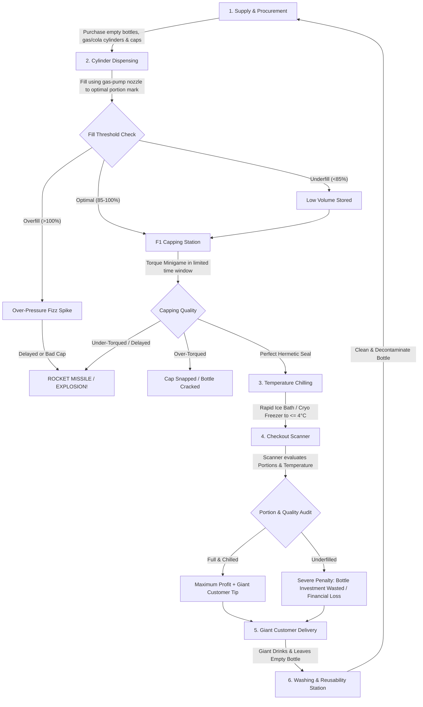

# Game Design Document (GDD) — Master
**Project Working Title:** Midnight Fizz: Giant Thirst (*MarryByMidnight Engine Build*)  
**Genre:** Multiplayer Co-op / Physics-Based Factory Simulation / Time Management Comedy  
**Target Platform:** PC (Steam), Console  
**Target Audience:** Fans of *Overcooked*, *PlateUp!*, *Lethal Company*, *Deep Rock Galactic*, *Viscera Cleanup Detail*  

---

## 1. Executive Summary & Vision

### 1.1 The High Concept
Players take on the role of miniature, knee-high soda artisans operating a frantic, high-pressure cola bottling workshop situated directly on the tavern counter of a realm populated by colossal creatures. 

Your customers are **towering Mountain Giants, sinister Bog Witches, ironbound Golems, and tiny woodland imps**. For these gargantuan patrons, a standard glass or metal cola bottle is a refreshing single-gulp elixir—but to the miniature player-characters, an empty bottle is an industrial monument requiring heavy teamwork, pulleys, pressurized gas nozzles, and F1-style precision capping.

### 1.2 Core Pillars
1. **Volatile Physics-Driven Production:**  
   Soda is not just liquid; it is volatile, carbonated rocket fuel. Filling too fast, shaking the bottle, or failing to torque the cap in time turns your merchandise into a high-speed ballistic missile that ricochets across the tavern, shatters shelves, or triggers hazardous disasters.
2. **The "David & Goliath" Scale Twist:**  
   Players are tiny (25 cm); the workshop and customers are colossal. A single tavern counter is the size of an airport runway. You cannot run long distances on foot carrying 50 kg metal cylinders—you need industrial micro-machinery.
3. **Micro-Vehicles & Shop Logistics:**  
   To conquer the vast distances of the giant shop floor, players operate miniature motorized carts, forklifts, flatbed tuggers, and mobile capping rigs to haul massive bulk cylinders, transport crates of bottles, and close bottles on the move.
4. **Synchronized F1 Pit-Stop Teamwork:**  
   Bottling is a high-speed assembly line: dispensing the right amount of fizz, slamming and torquing the cap before the pressure spike blows, chilling the beverage to frosty perfection, and scanning it for value.
5. **Shared Prosperity & Shared Chaos:**  
   Multiplayer features a **100% shared shop, shared bank account, and shared inventory**. A teammate's mistake is everyone's disaster; a successful rush allows the crew to upgrade cylinders, buy faster forklift buggies, unlock automatic bottle washers, or procure exotic enchanted colas.

---

## 2. The Core Gameplay Loop

### 2.1 Step-by-Step Breakdown
1. **Procurement & Heavy Transport:** The team spends funds from the shared vault to order crates of empty bottles, replacement cap boxes, and colossal high-pressure Cola Cylinders. Because cylinders weigh 10x player mass, players drive **Miniature Forklifts or Flatbed Mules** to haul cylinders from the freight elevator into the dispensing manifold docks.
2. **Dispensing:** Players carry a fuel-station style pump nozzle to the bottle opening. Holding the trigger pumps carbonated liquid into the bottle. Releasing too early creates an underfilled bottle; releasing too late causes a volatile pressure surge.
3. **F1-Style Capping (Stationary or Mobile Machine):** Once filled, a carbonation countdown begins. Players have seconds to cap the bottle. This can be done via:
   - **Stationary Capping Bench:** Manual pneumatic wrench with F1-style torque meter.
   - **Mobile Capper Machine / Buggy:** A drivable vehicle equipped with an overhead hydraulic torque ram that drives directly to bottle lines to seal bottles in rapid succession.
   - *Outcome:* Over-torquing shatters bottles/caps; under-torquing or delays trigger ballistic rocket blowouts!
4. **Transport & Chilling:** Bottles are loaded onto flatbed carts to quickly traverse the vast counter to the ice troughs or cryo-freezers ($\le 4^\circ\text{C}$).
5. **Scanner & Checkout:** The bottle is transported to the electronic checkout scanner. The scanner measures volume portions, temperature, and bottle integrity.
   - **Economic Rule:** Fixed bottle price reduced by underfilling. If a bottle is underfilled, the sale value drops below the cost of the empty bottle, wasting your investment!
6. **Giant Delivery:** Place the finished bottle on the Customer Pickup Pedestal or load it into a counter crane. The giant reaches down, grabs the drink, chugs it, and drops the empty bottle onto the return chute.
7. **Washing & Sanitation:** Dirty bottles returned by giants are hauled via cart to the wash basin to clean off slobber, venom, and sticky syrups for reuse.

---

## 3. The Scale Twist: Tiny People, Giant World

| Customer Archetype | Height / Scale | Personality & Demands | Failure Consequence |
| :--- | :--- | :--- | :--- |
| **Mountain Giant** | $12\times$ Player Height | Craves massive quantities of ice-cold Heavy Metal Colas. Impatient and heavy-handed. | Slams fists onto counter, launching players, bottles, and tools into the air. |
| **Bog Witch** | $8\times$ Player Height | Demands exotic, cursed beverages (Spider Cola, Toxic Swamp Fizz). Cackles eerily. | Casts hexes on workstations, reversing conveyor belts or turning ice into hot magma. |
| **Stone Golem** | $10\times$ Player Height | Drinks high-viscosity, heavy-pressure colas. Cannot tolerate warm drinks. | Emits ground tremors that agitate all un-capped or un-settled bottles in the shop. |
| **Forest Goblin / Pixie** | $1.5\times$ Player Height | Fast, hyperactive, demands rapid Sugar-Crush mini-bottles. | Jumps onto the counter, knocking bottles over or stealing loose caps. |

### Countertop Navigation
### 3.1 Countertop Navigation & Spatial Challenges
Because the players are miniature:
- Bottling stations are elevated; players use kick-ladders, pneumatic lifts, and counter ramps.
- Carrying full metal bottles requires two players cooperating, or a single player rolling it along the floor.
- Large tools (like the gas-pump nozzle) feature a heavy physical hose that can wrap around legs or pull players off ledges if stretched too far.

### 3.2 Vast Workshop Navigation & Micro-Vehicle Logistics
Because the tavern workshop is gargantuan relative to the 25 cm players (spanning hundreds of virtual meters across counters, bar floorings, cellars, and serving tables), traveling on foot with heavy cargo is unfeasible during rush hours.
- **The Vehicle Fleet:** The team uses motorized micro-machinery:
  - **Flatbed Mules / Karts:** Drivable transport karts with magnetized beds to securely carry crates of empty bottles, ice blocks, and finished products across the shop.
  - **Micro-Forklifts:** Specialized hydraulic lifters used to transport, hoist, and dock the massive 50–200 kg high-pressure Cola Cylinders into the dispensing manifolds.
  - **The Mobile Capper Buggy:** A motorized cart equipped with an overhead pneumatic capping ram that allows a driver to speed down a line of filled bottles, torquing caps in rapid succession like an F1 pit-crew on wheels.
- **Logistical Hazards:** Speeding with a bed full of agitated bottles can cause bottles to tip over and detonate! Sharp turns, sudden braking, and collisions with teammates or loose caps introduce chaotic driving physics.

---

## 4. Multiplayer Co-op Systems

### 4.1 Shared Architecture
- **Shared Shop Vault:** All income from sales and all expenditure on supplies comes from a unified team wallet. No individual greedy hoarding.
- **Shared Storage & Vehicle Pool:** Crates of empty bottles, gas tanks, caps, and vehicles are accessible by all teammates.
- **Shared Customer Anger Meter:** If orders back up, the tavern reputation plummets, causing giants to smash tables or walk out.

### 4.2 Natural Emergent Player Roles
While any player can perform any task, high efficiency requires spontaneous specialization:
1. **The Pumpmaster:** Operates the cola cylinders and fuel nozzles, mastering precision fill cutoffs.
2. **The Pit-Stop Capper / Mobile Mechanist:** Operates the stationary capping bench or pilots the Mobile Capper Buggy down assembly lines.
3. **The Logistics Driver / Forklift Pilot:** Hauls heavy bulk cylinders from delivery chutes, docks tanks, and transports bottle crates across the giant shop floor.
4. **The Cryo-Runner:** Manages ice supplies, dips bottles into coolers, and monitors temperature dials.
5. **The Cashier & Sanitizer:** Scans bottles, collects payments, loads bottles onto giant trays, and washes dirty returns.

---

## 5. Risk, Agitation & Disaster System

Soda bottles in *Midnight Fizz* possess a dynamic **Agitation Meter ($A$)**:
$$A \in [0.0, 100.0]$$

### 5.1 Agitation Triggers
- **Running while carrying:** $+5\,A/\text{sec}$
- **Jumping or falling from height:** $+25\,A$
- **Throwing or catching a bottle:** $+35\,A$
- **Bumping into furniture or dropped bottles:** $+15\,A$
- **Overfilling past 100%:** $+50\,A$ instantly

### 5.2 Catastrophic Failure Modes (When Agitation exceeds Threshold)
Depending on the Cola Formula contained inside:
1. **Ballistic Rocket Missile:** The cap blows off, propelling the bottle at extreme velocities around the tavern with dynamic bouncing, leaving fizz trails and knocking over players and stations.
2. **Violent Detonation:** The bottle shatters into flying shrapnel, creating sticky puddles that slow player movement.
3. **Structural Fragility:** The bottle remains intact but micro-fractured; any slight subsequent tap will instantly shatter it.
4. **Toxic Gas Cloud:** Green effervescent smoke erupts, causing players in the radius to cough, drop carried items, and lose screen visibility.
5. **Spider Swarm Infestation:** The bottle bursts into dozens of creepy crawlers that run across the counter, tangling hoses and startling players.
6. **Hangover / Dizzy Haze:** Releases psychedelic fumes that invert player movement controls and induce drunken ragdoll swaying.

---

## 6. Bottle Reusability & Stage Progression

Not all bottles are disposable:
- **Early Game (Disposable Plastic):** Cheap, crushable, single-use. Cannot be recycled; thrown into the incinerator after use.
- **Mid Game (Standard Glass):** Reusable! Giants return empty glass bottles, but they come back soiled with dried soda or monster slobber. Reusing without washing causes the scanner to reject the drink as "contaminated."
- **Late Game (Reinforced Metal & Runed Vessels):** Indestructible containers that survive high-pressure volatile colas. They require dedicated chemical degreasers and ultrasonic scrubbers before refilling.

---

## 7. Win, Loss & Shift Progression

- **Daily Quota:** Every day/shift has a target revenue quota and a set queue of giant customers.
- **Shift Rating (1 to 5 Stars):** Evaluated based on:
  - Fill accuracy (avoiding underfill loss).
  - Serving temperature (achieving the frosty $\le 4^\circ\text{C}$ sweet spot).
  - Order speed and zero shop damage.
- **Bankruptcy / Loss Condition:** Failing to make the daily rent payment or having your tavern completely trashed by rampaging giants results in game over.
