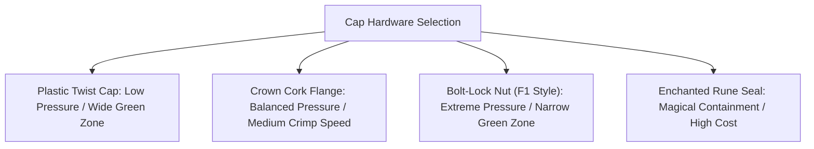

# Items, Colas & Hazards Catalog

This catalog outlines all physical bottle types, capping hardware, liquid cola formulas, agitation reactions, and giant customer demographics for **Midnight Fizz: Giant Thirst**.

---

## 1. Bottle Types & Material Properties

Because players are tiny, empty bottles represent significant physical structures. Different materials have distinct weight, durability, pressure capacity, and reusability characteristics.

| Bottle Material | In-Game Asset | Weight (Carry Speed) | Max Safe Pressure | Durability & Breakage | Thermal Speed | Reusability Tier |
| :--- | :--- | :--- | :--- | :--- | :--- | :--- |
| **Standard Glass** | `BP_GlassBottle` | Medium (100% speed) | $45\text{ PSI}$ | **Shatters** on hard impact or over-torquing. Leaves hazardous glass shards on floor. | Medium | **High:** Washable and reusable across multiple shifts. |
| **Recycled Plastic**| `BP_PlastickBottel`| Light (115% speed) | $30\text{ PSI}$ | **Crushes & Bounces.** Cannot shatter. High elastic rebound during rocket launches. | Slow | **Low:** Single-use in early stages; melts near heat/fire cola. |
| **Heavy Metal Keg** | `BP_MetalCanister` | Heavy (75% speed / 2-player lift)| $120\text{ PSI}$ | **Indestructible.** Never shatters. Can bludgeon players if it rockets into them. | Very Fast | **Permanent:** Never degrades; requires heavy grease-cleaning. |
| **Enchanted Stone Urn**| `BP_StoneUrn` | Very Heavy (60% speed) | $90\text{ PSI}$ | **Rigid Stone.** Immune to chemical corrosion and acid. Opaque fill level. | Extremely Slow | **High:** Absorbs magical stains; requires holy water rinse. |

---

## 2. Cap Types & Mechanical Features

Caps seal the carbonation inside the bottle. Each cap type has a specific mechanical strength, torque tolerance, and specialized utility.



### 2.1 Cap Characteristics Table
| Cap Model | Material / Style | Pressure Rating | F1 Torque Sweet Spot | Special Mechanical Feature | Recommended Pairings |
| :--- | :--- | :--- | :--- | :--- | :--- |
| **Plastic Twist Cap** | Polyethylene Screw | Up to $32\text{ PSI}$ | **Wide (35% – 70%)** | Very forgiving to torque. If stripped, slips without shattering the bottle. | Plastic Bottles, Basic Cola, Sweet Cola |
| **Crown Cork Flange** | Crimped Tinplate | Up to $50\text{ PSI}$ | **Medium (45% – 75%)** | Standard tavern cap. Requires sharp downward crimp motion. | Glass Bottles, Normal Cola, Sugar Crush |
| **Bolt-Lock Hex Nut** | Threaded Brass / Steel | Up to $110\text{ PSI}$ | **Narrow (55% – 70%)** | Modeled on F1 wheel nuts. Highest pressure ceiling; over-torquing snaps bottle necks. | Metal Kegs, Fire/Spicy Cola, Toxic Cola |
| **Enchanted Rune Seal**| Runed Obsidian Disk | Up to $85\text{ PSI}$ | **Magical Timing Pulse** | Automatically neutralizes hazardous side-effects (absorbs spiders/poison). | Cursed Colas (Spider, Swamp, Hangover) |

---

## 3. Cola Formulas & Flavor Profiles

Colas differ not only in taste and price, but in carbonation rate, volatility, and catastrophic hazards when agitated.

```
       [ Basic Fizz ]          [ Sugar Crush ]          [ Spicy / Fire ]
     Standard Volatility      Hyper Carbonation        Thermal Combustion

       [ Toxic Swamp ]          [ Spider Nest ]         [ Hangover Haze ]
      Poison Gas Cloud        Arachnid Infestation      Inverted Controls
```

### 3.1 Detailed Formula Matrix
| Cola Formula | Base Retail ($/Portion) | Carbonation Speed | Agitation Multiplier | Ideal Temp | Catastrophic Failure Effect |
| :--- | :--- | :--- | :--- | :--- | :--- |
| **Basic Classic Cola** (`DA_BasicCola`) | $\$2.50$ | $1.0\times$ | $1.0\times$ | $4.0^\circ\text{C}$ | **Foam Geyser / Classic Rocket:** Bounces erratically around shop, knocking down bottles. |
| **Sugar Crush Cola** (`DA_SweetCola`) | $\$3.25$ | $1.8\times$ | $1.7\times$ | $3.0^\circ\text{C}$ | **Sticky Explosion:** Covers the floor in thick syrup; player movement speed reduced by $50\%$ until mopped. |
| **Spicy / Fire Cola** (`DA_SpicyCola` / `BP_FireCola`) | $\$4.50$ | $1.4\times$ | $2.2\times$ | $8.0^\circ\text{C}$ | **Thermal Jet Detonation:** Shoots flame trails as it flies. Sets wooden crates on fire and triggers sprinkler systems. |
| **Toxic Swamp Fizz** (`DA_ToxicCola`) | $\$4.00$ | $1.2\times$ | $1.5\times$ | $1.0^\circ\text{C}$ | **Poison Cloud:** Releases a dense green mist ($4\text{m radius}$). Players inside cough, drop carried items, and take damage. |
| **Spider Nest Cola** (`DA_SpiderCola`) | $\$5.50$ | $1.5\times$ | $2.5\times$ | $2.0^\circ\text{C}$ | **Arachnid Swarm:** Spawns 12–20 tiny spiders that scurry across counters, stealing bottle caps and dragging hoses! |
| **Hangover Haze Cola** (`DA_HangoverCola`) | $\$3.75$ | $0.9\times$ | $1.2\times$ | $4.0^\circ\text{C}$ | **Drunken Stumble:** Emits purple vapors. Inverts player WASD / Stick inputs and blurs camera for $8\text{ seconds}$. |
| **Cryo-Frost Soda** (`DA_CryoCola`) | $\$4.75$ | $1.1\times$ | $1.3\times$ | $-2.0^\circ\text{C}$ | **Flash Freeze:** Explodes in frost shockwave; instantly freezes puddles and encases hit players in ice blocks for $4\text{s}$. |

---

## 4. Shaking, Agitation & Mishap System

### 4.1 How Agitation ($A$) Accumulates
Every bottle tracks internal agitation from $0.0$ to $100.0$:
- **Running / Sprinting with bottle:** $+4.0\,A/\text{sec}$
- **Throwing or tossing bottle:** $+30.0\,A$
- **Catching bottle mid-air:** $+15.0\,A$
- **Dropping bottle onto floor / counter:** $+40.0\,A$
- **Carrying bottle on vibrating conveyor belt:** $+8.0\,A/\text{sec}$
- **Natural Settling Rate (Resting undisturbed):** $-6.0\,A/\text{sec}$

### 4.2 Agitation State Thresholds
1. **Calm ($A < 30.0$):** Stable. Standard liquid behavior.
2. **Bubbling ($30.0 \le A < 65.0$):** Audible fizzing inside; subtle mesh rattling; cap hiss.
3. **Violent Fizz ($65.0 \le A < 90.0$):** Violent screen shake when held; pressure gauge in the red; cork bulging.
4. **Critical Detonation ($A \ge 90.0$):** If held or impacted, the bottle triggers its **Catastrophic Failure Mode**!

---

## 5. Customer Demographics & The Scale Twist

Because customers are enormous fantasy beings, the tavern counter is designed as their bar, while for players, it is a massive industrial terrain.

```
       +-------------------------------------------------------------+
       |                  [ GIANT CUSTOMER HEAD ]                    |
       |                (Eyes looking down at counter)               |
       +-------------------------------------------------------------+
                                       |
                   [ Giant Arm & Colossal Hand ]
                                       |
    ===================================v=================================  <-- BAR TOP
       [ Serving Pedestal ]         [ Checkout Scanner ]      [ Ramps ]
         (Giant grabs here)         (Tiny players scan)
         
          o o  <-- Miniature Players (25 cm tall)
    =====================================================================  <-- FLOOR / SHELF
```

### 5.1 Patron Roster

#### 1. The Mountain Giant
- **Physical Scale:** $12\times$ Player Height ($300\text{ cm}$).
- **Behavior:** Boisterous, bangs heavy stone tankards, demands high volume ($4\times$ portions in Metal Kegs).
- **Preferred Colas:** Spicy/Fire Cola, Basic Classic. Must be ice-cold.
- **Wrath Mechanic:** If impatient, slams fist onto the counter, causing a physical shockwave that bounces all loose props into the air.

#### 2. The Bog Witch
- **Physical Scale:** $8\times$ Player Height ($200\text{ cm}$).
- **Behavior:** Sneering, hunched, accompanied by a hovering raven. Demands bizarre and forbidden concoctions.
- **Preferred Colas:** Spider Nest Cola, Toxic Swamp Fizz.
- **Wrath Mechanic:** Cackles and casts a hex on workstations (e.g., inverts conveyor directions or disables the freezer for 15 seconds).

#### 3. The Iron Golem
- **Physical Scale:** $10\times$ Player Height ($250\text{ cm}$).
- **Behavior:** Slow, metallic groaning speech, zero tolerance for temperature errors.
- **Preferred Colas:** Super-chilled Heavy Metal Colas.
- **Wrath Mechanic:** Emits an electromagnetic pulse that disrupts electronic checkout scanners and conveyor belts.

#### 4. The Counter Pixie / Goblin Swarm
- **Physical Scale:** $1.5\times$ Player Height ($35\text{ cm}$).
- **Behavior:** Small, agile, erratic. Slips directly onto the counter rather than staying on the customer side.
- **Preferred Colas:** Sugar Crush in Plastic Mini-Bottles.
- **Wrath Mechanic:** If ignored, runs around the counter knocking over bottles and tossing caps into the trash.

---

## 6. Shop Vehicles & Machinery Fleet

To overcome the colossal scale of the shop floor and transport heavy industrial inventory, players can unlock, purchase, and drive specialized micro-vehicles.

```
+-----------------------------------------------------------------------------------------+
|                                  SHOP VEHICLE FLEET                                     |
+--------------------------+------------------------------+-------------------------------+
|  "The Fizz-Mule"         |  "The Micro-Forklift"        |  "The Mobile Capper Buggy"    |
|  High-Speed Cargo Hauler |  Heavy Cylinder Manifold Rig |  Drive-By Pneumatic Press     |
|  Holds 12 Bottles/Crates |  Lifts 200kg Colossal Tanks  |  Rapid F1 Torque on the Move  |
+--------------------------+------------------------------+-------------------------------+
```

### 6.1 Vehicle Specifications Table
| Vehicle Model | Blueprint Asset | Top Speed | Cargo Slots / Payload | Fuel / Power Source | Primary Function | Unique Hazard |
| :--- | :--- | :--- | :--- | :--- | :--- | :--- |
| **Fizz-Mule Flatbed** | `BP_Vehicle_FizzMule` | $750\text{ cm/s}$ | $2\text{ Large Crates}$ (12 Bottles total) or 1 Ice Block | Electric Battery (Recharge at Dock) | Rapid transit of bottles, ice, and players across long counters. | Flinging cargo off the bed during un-magnetized drift turns. |
| **Micro-Forklift** | `BP_Vehicle_Forklift` | $400\text{ cm/s}$ | $1\text{ Bulk Cylinder}$ ($50 - 200\text{ kg}$) | Pneumatic Steam Piston | Hoisting cylinders from freight elevator onto dispensing docks. | Front-heavy tipping hazard when carrying heavy cylinders with forks raised high. |
| **Mobile Capper Buggy** | `BP_Vehicle_CapperBuggy` | $550\text{ cm/s}$ | $1\text{ Driver} + 1\text{ Hopper}$ (30 Caps) | Pressurized CO2 Cylinder | Drive-by mechanized capping of bottle assembly lines. | Bumping bottles with bumper triggers immediate bottle tipping and rocket bursts. |

### 6.2 Vehicle Hazards & Driving Mishaps
- **High-Speed Roll-Over:** Taking high-speed ramps with raised forks or a full cargo bed can flip the vehicle onto its side, spilling toxic or agitated bottles onto the shop floor.
- **Bumping Bottle Lines:** Striking an uncapped bottle with vehicle tires launches the bottle as a low-altitude missile.
- **Battery Depletion:** Electric vehicles left running without docking at a charging pad will stall in the middle of traffic routes, creating bottlenecks for teammates.
- **Steam Boiler Overheat:** Forklifts continuously holding heavy cylinders at max height build steam heat, eventually releasing a scalding burst that blows miniature players backward.

