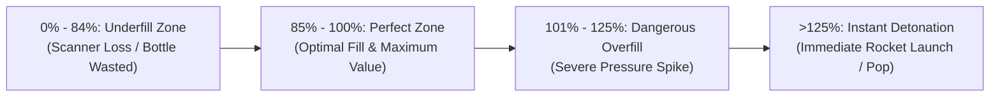

# Mechanics, Tools & Workstations Specification

This document provides technical design specifications for the interactive stations, player-operated tools, mathematical formulas, and physical interaction mechanics in **Midnight Fizz: Giant Thirst**.

---

## 1. Station 1: Cola Cylinder & Gas-Pump Dispenser Nozzle

The Cola Cylinder is the primary bulk reservoir of pressurized carbonated syrup, and the Dispenser Nozzle is the physical hand-tool used by players to fill empty bottles.

```
 [ Large Pressurized Cylinder ] 
           |  (Flexible Physics Hose)
           v
   [ Gas-Pump Nozzle ] ====> [ Empty Bottle Clamped on Base ]
```

### 1.1 Physical Components & Setup
- **The Cola Cylinder:** A colossal, industrial pressurized keg containing bulk cola (50 to 200 portions). Because of the players' miniature size (25 cm), a full cylinder is a massive 100 kg industrial asset delivered at the cargo freight bay. **Players cannot carry cylinders by hand**; they must use the **Micro-Forklift** or **Fizz-Mule** to transport and hoist the cylinder onto the station's docking manifold.
- **The Dispenser Nozzle:** A portable handheld nozzle modeled after a commercial fuel/gas pump handle with a mechanical squeeze-trigger. Connected to the cylinder dock via a simulated `UCableComponent` / Physics Constraint hose.
- **Physics Hose Mechanics:** The hose has a maximum stretch radius (e.g., 350 Unreal Units). Pulling past this limit drags the nozzle out of the player's hands or trips running teammates. Cylinders can also be mounted on mobile vehicle flatbeds for mobile filling!

### 1.2 Dispensing Flow & Fill Mechanics
- **Interaction:** The player holds the nozzle with primary interaction (`E` or Gamepad `X`), inserts it into the bottle neck, and holds the secondary action (`Left Mouse Button` / `Right Trigger`) to depress the squeeze lever.
- **Fill Rate:** Liquid fills at a rate of **25% volume per second**.
- **Internal Pressure Curve:** As the bottle reaches capacity, carbonation pressure climbs exponentially:



### 1.3 Fill Threshold Table
| Fill Range | Status | Pressure ($PSI$) | Scanner Result | Consequence |
| :--- | :--- | :--- | :--- | :--- |
| **$0\% - 49\%$** | Severely Underfilled | $0 - 5$ | **0 Portions ($0 Value)** | Bottle cost completely wasted. Customer rejects drink outright. |
| **$50\% - 84\%$** | Underfilled | $6 - 20$ | **1–3 Portions (Heavy Penalty)** | Payout is lower than the cost of buying the empty bottle! Net financial loss. |
| **$85\% - 100\%$** | **Optimal Fill** | $21 - 32$ | **4 Full Portions (Full Value)** | Perfect pour. Yields bonus tip if capped properly. |
| **$101\% - 125\%$** | Overfilled (Volatile) | $33 - 65$ | **Full (If Capped)** | Agitation accumulates $3\times$ faster. Capping timer reduced by 50%. |
| **$> 125\%$** | Over-Pressurized Blowout | $> 65$ | **N/A (Destroyed)** | **Instant Rocket Launch!** The bottle launches off the counter without a cap, spraying liquid everywhere. |

---

## 2. Station 2: Capping Station & F1 Wheel-Nut Timing/Torque Mechanic

Once a bottle is filled, the unsealed carbonation creates a ticking time-bomb. Players have a narrow window to place a cap and torque it down using the specialized pneumatic capping wrench—modeled directly after the high-stress **Formula 1 wheel-nut pit-stop gun**.

```
                [ Pneumatic / Mechanical Torque Wrench ]
                                   |
                                   v  (Spinning Nut Gun)
             [ Cap ]  =======>  [ Bottle Neck ]
```

### 2.1 The Urgent Timing Window
- As soon as the dispenser nozzle is removed, a **Cap Urgency Countdown** begins:
  - *Standard Cola:* $5.0\text{ seconds}$ to apply cap.
  - *High-Fizz / Sugar-Crush Cola:* $3.0\text{ seconds}$.
  - *Fire / Spicy Cola:* $2.5\text{ seconds}$.
- **Delay Expiration:** If the countdown hits $0.0\text{s}$, the internal fizz bursts out of the neck, launching the bottle as an unguided rocket.

### 2.2 The Torque Minigame
When the player mounts the capping gun onto the bottle neck and activates it:
1. A **Circular Torque Dial / Moving Bar** appears on screen or in-world (Diegetic HUD above the capping rig).
2. A torque needle begins accelerating rapidly through three sectors: **Loose (Blue) $\rightarrow$ Ideal Torque (Green) $\rightarrow$ Over-Torqued (Red)**.
3. The player must release the torque trigger within the **Green Sweet Spot**.

```
[  BLUE: Under-Torque (0-40%)  |  GREEN: Perfect Seal (41-75%)  |  RED: Over-Torque (76-100%)  ]
```

### 2.3 Capping Outcomes Matrix
| Torque Result | Needle Position | Cap Integrity | Physical Outcome |
| :--- | :--- | :--- | :--- |
| **Under-Torqued** (Too Loose) | Blue (0% – 40%) | Weak Seal ($< 15\text{ Nm}$) | Cap pops off after a short delay or upon the slightest shake. The bottle turns into an erratic rocket. |
| **Perfect Seal** (F1 Sweet Spot) | **Green (41% – 75%)** | **Hermetic Seal** | Perfect seal. Bottle can withstand standard handling, shaking thresholds, and temperature changes. |
| **Over-Torqued** (Too Tight) | Red (76% – 100%) | Structural Failure ($> 60\text{ Nm}$) | **Cap snaps or bottle neck fractures!** Glass bottles shatter instantly, while metal caps strip their threads and leak violently. |

### 2.4 Cola-Specific Failure Reactions
If capping fails (blown off by delay, popped off by under-torquing, or broken by over-torquing), the bottle triggers its unique chemical reaction:
- **Basic Cola:** High-speed foam rocket that bounces off walls.
- **Spicy / Fire Cola:** Fiery backblast that leaves scorching flames on the workstation.
- **Toxic Swamp Cola:** Releases a lingering green toxic gas cloud that blinds and slows players.
- **Spider Nest Cola:** Bursts open and unleashes crawling spiders that run across the counters and jam tools.
- **Hangover Cola:** Emits dizzy vapor causing player controls to invert for 8 seconds.

### 2.5 Alternative Tool: The Mobile Capper Buggy (Drive-by Capping)
In addition to the stationary capping workbench, the team can deploy the **Mobile Capper Buggy**:
- **Operation:** A player drives a motorized cart equipped with an overhead pneumatic press down a line of freshly filled bottles sitting on floor crates or conveyor belts.
- **Drive-By Torque Action:** The driver lines up the crosshair over the bottle neck and taps the torque pedal (`Spacebar` / Handbrake). 
- **Advantage:** Eliminates the need to carry heavy bottles one by one across the giant room to the stationary bench.
- **Risk:** Requires precise vehicle alignment; hitting a bottle with the cart bumper knocks it over, instantly launching it as an unsealed rocket!

---

## 3. Station 3: Chilling & Temperature Management

Giant customers refuse to drink lukewarm soda. Coldness is a critical quality attribute synchronized with `UInteractablePropDataAsset::ConsumableTemperature`.

### 3.1 Temperature Dynamics
- **Ambient Shop Temperature:** $22.0^\circ\text{C}$.
- **Target Serving Temperature:** $\le 4.0^\circ\text{C}$ (Ideal: $2.0^\circ\text{C} - 4.0^\circ\text{C}$).
- **Thermal Decay (Newton's Law of Cooling):**
  $$\frac{dT}{dt} = -k \cdot (T_{bottle} - T_{ambient})$$
  Where $k$ is the thermal conductivity of the bottle material (e.g., Metal cools and warms quickly; Glass warms slowly).

### 3.2 Cooling Equipment
1. **The Crushed Ice Trough:**
   - Low-tech, passive cooler.
   - Players haul blocks of ice from the cellar into the trough.
   - Cools submerged bottles at **$-1.5^\circ\text{C}/\text{second}$**. Holds up to 6 bottles.
2. **The Blast Freezer / Cryo-Chamber:**
   - Advanced high-speed machine.
   - Cools bottles to $2.0^\circ\text{C}$ in **$3.0\text{ seconds}$**.
   - Risk: Leaving a bottle in the blast freezer for $> 10\text{ seconds}$ causes the liquid to freeze and expand, shattering the bottle!

### 3.3 Customer Temperature Multipliers
- **Frosty ($\le 4.0^\circ\text{C}$):** $1.2\times$ Payout Multiplier + "Brain Freeze" Giant Tip.
- **Chilled ($4.1^\circ\text{C} - 10.0^\circ\text{C}$):** $1.0\times$ Standard Payout.
- **Lukewarm ($10.1^\circ\text{C} - 18.0^\circ\text{C}$):** $0.6\times$ Payout Penalty + Giant Grunts in Disgust.
- **Warm / Hot ($> 18.0^\circ\text{C}$):** $0.2\times$ Payout or outright customer rejection.

---

## 4. Station 4: Checkout Scanner & Pricing Engine

The Checkout Scanner is an automated laser scanning scale mounted at the serving counter. When a bottle is placed on the scanning platter, it evaluates liquid fill portion, temperature, and bottle integrity to calculate the customer bill.

```
       [ Optical & Portion Scanner ]
                    |
                    v
   [ Scanning Platter: Bottle Placed ]  ===> [ Digital Readout Screen ]
                                             "Portions: 3/4"
                                             "Temp: 3.5 C"
                                             "Total Bill: $3.25"
```

### 4.1 The Underfill Economic Rule
The user requirement dictates:
> *"edit the scanner to check number of remaining portion and mult the price and add to total bill. So if cola is less, the bottle price will go to waste."*

To achieve this, the scanner formula guarantees that **an underfilled bottle results in a net financial loss**, penalizing sloppy dispensing.

### 4.2 Scanner Pricing Formulas

Let:
- $C_{bottle}$: Base purchase cost of the empty bottle (e.g., $\$4.00$ for glass).
- $P_{portion}$: Retail price per portion of the cola liquid (e.g., $\$3.00$ per portion).
- $N_{target}$: Target number of portions in a full bottle (e.g., $4\text{ portions}$).
- $N_{actual}$: Detected portions currently inside the bottle ($0 \le N_{actual} \le N_{target}$).
- $M_{temp}$: Temperature satisfaction multiplier ($1.2\times$ if cold, $0.5\times$ if warm).

#### The Bill Formula
$$\text{PortionRevenue} = N_{actual} \times P_{portion} \times M_{temp}$$

$$\text{BottleRebate} = 
\begin{cases} 
C_{bottle} & \text{if } N_{actual} = N_{target} \text{ (Full Bottle)} \\
C_{bottle} \times \left(\frac{N_{actual}}{N_{target}}\right)^2 & \text{if } N_{actual} < N_{target} \text{ (Underfill Quadratic Penalty)} 
\end{cases}$$

$$\text{TotalBill} = \text{PortionRevenue} + \text{BottleRebate}$$

#### The Net Profit / Loss Calculation
$$\text{NetProfit} = \text{TotalBill} - (C_{bottle} + C_{cola\_cost})$$

### 4.3 Practical Economic Example Table
*Assumptions: Glass Bottle Cost $C_{bottle} = \$4.00$, Cola Cost = $\$2.00$ ($4\times \$0.50$). Full Value = 4 portions $\times \$3.00 = \$12.00$ liquid. Total full price = $\$16.00$.*

| Fill Status | Portions ($N_{actual}$) | Portion Revenue ($M_{temp}=1.0$) | Bottle Value Returned | Total Bill to Customer | Total Cost Invested | **Net Profit / Loss** |
| :--- | :--- | :--- | :--- | :--- | :--- | :--- |
| **Full (Perfect)** | **4 / 4** | $\$12.00$ | $\$4.00$ | **$\$16.00$** | $\$6.00$ | **$+\$10.00$ (Big Profit)** |
| **Slight Underfill**| **3 / 4** | $\$9.00$ | $\$2.25$ | **$\$11.25$** | $\$6.00$ | **$+\$5.25$ (Mediocre)** |
| **Half Empty** | **2 / 4** | $\$6.00$ | $\$1.00$ | **$\$7.00$** | $\$6.00$ | **$+\$1.00$ (Barely Break-Even)** |
| **Severe Underfill**| **1 / 4** | $\$3.00$ | $\$0.25$ | **$\$3.25$** | $\$6.00$ | **$-\$2.75$ (NET LOSS - Bottle Wasted)** |
| **Empty / Dregs** | **0 / 4** | $\$0.00$ | $\$0.00$ | **$\$0.00$** | $\$6.00$ | **$-\$6.00$ (TOTAL LOSS)** |

> **Design Takeaway:** If a player fills only 1 portion out of 4, the bottle price goes completely to waste, generating an outright loss of $-\$2.75$ on that order!

---

## 5. Station 5: Bottle Cleaning & Decontamination Station

When giant customers finish their beverages, they slam the empties onto the return conveyor chute. Empty bottles can be recycled and reused, but they are returned dirty and unfit for immediate refilling.

```
 [ Giant Return Chute ] ===> [ Soaking Basin ] ===> [ Rotary Scrub Brush ] ===> [ Clean Rack ]
```

### 5.1 Bottle Cleanliness States
1. **Pristine / New:** Directly from an unboxed crate. Ready to fill.
2. **Dirty (Normal):** Covered in sticky dried syrup residues. If filled without washing, the scanner applies a $50\%$ "Contaminated" deduction.
3. **Hazardous / Infested:**
   - *Slime-Coated:* Returned by Witches or Swamp Golems. Slippery; slips out of player hands when grabbed.
   - *Spider Egg Infested:* Returned from Spider Nest Cola. If refilled without sterilizing, it spawns spiders upon filling.

### 5.2 Cleaning Workflow & Tools
- **The Scrub Sink:** Contains warm soapy water and a foot-pedal operated rotating bristle brush.
- **Workflow:**
  1. Player dumps the empty bottle into the sink.
  2. Player presses the foot pedal to spin the rotary brush for **$2.5\text{ seconds}$**.
  3. Clean bubbles pop, and the bottle changes material from `M_DirtyGlass` to `M_PristineGlass`.
  4. Place on the clean drying rack for the dispenser operator.

---

## 6. Station 6: Shop Vehicles & Material Handling Machines

Because the tavern workshop is gigantic and the player characters are knee-high ($25\text{ cm}$), traversing the counters on foot while carrying bulky objects is too slow. The shop features a fleet of drivable micro-vehicles and material handling machines.

```
       [ Micro-Forklift ]                   [ Fizz-Mule Flatbed ]
    Hoists 100kg Cylinders               Transports Crates & Bottles
    Docks into Manifolds                  2-Player Co-op Drivable
              \                                     /
               +-----------------------------------+
               |    [ Mobile Capper Buggy ]        |
               | Drives down bottle lines to torque|
               +-----------------------------------+
```

### 6.1 The Fizz-Mule (Flatbed Logistics Kart)
- **Role:** High-speed transport across the long tavern counter.
- **Capacity:** Flatbed holds up to 2 bottle crates (12 bottles total) or 1 bulk ice block or 1 empty cylinder.
- **Controls:** Standard driving (WASD / Left Stick for throttle & steering; Handbrake for drifting).
- **Passenger Seat:** Supports a second player standing on the bed to load/unload items on the move!
- **Cargo Clamping:** Features a magnetic lock switch (`F` key) that prevents crates from sliding off during turns. If the player forgets to engage the magnet, sharp turns fling cargo off the bed!

### 6.2 The Micro-Forklift (Heavy Cylinder Hoist)
- **Role:** Material handling for the colossal $50 - 200\text{ kg}$ Cola Cylinders.
- **Hydraulic Lift:** Uses dedicated controls (`Q` to lower forks, `E` to raise forks).
- **Cylinder Manifold Docking:** 
  1. Driver approaches the freight delivery bay and slides forks beneath the cylinder pallet.
  2. Driver raises the forks and navigates through the workshop to the Dispenser Station.
  3. Driver aligns the cylinder over the manifold dock and lowers the forks.
  4. A loud pneumatic *clunk-hiss* locks the cylinder into the shop's liquid line.

### 6.3 The Mobile Capper Buggy ("The Pit-Stop Machine")
- **Role:** High-efficiency mechanized capping for mass-production lines.
- **Mechanism:** Fitted with a roof-mounted pneumatic capping piston and an automated cap feed chute.
- **Workflow:** 
  1. The team fills an entire row of 6 bottles on the counter.
  2. The Capper Buggy drives along the row.
  3. As the buggy passes over each bottle neck, the driver presses the torque stomp-pedal (`Spacebar`).
  4. The hydraulic arm slams down, spins the nut with F1 pneumatic torque, and retracts in $0.4\text{ seconds}$.
- **Skill Test:** Requires steady throttle control. Driving too fast misses the bottle neck; driving too close can sideswipe bottles and shatter them!

### 6.4 Vehicle Handling Dynamics & Transit Agitation
Driving vehicles introduces unique physical gameplay and risks:
- **Transit Agitation:** Driving smoothly on flat counter surfaces adds only $+1.0\,A/\text{sec}$ to carried bottles.
- **Drifting / Sharp Turns:** Adds $+12.0\,A$ to all bottles on the flatbed.
- **Bumping & Crashes:** Crashing into walls, barrels, or teammates causes a violent impact ($+35.0\,A$), risking immediate bottle detonation in the cargo bed!
- **Ramp Traversal:** Ramps connect the lower floor, barstools, and high serving counters. Vehicles with heavy loads must maintain momentum to make it up steep inclines.

