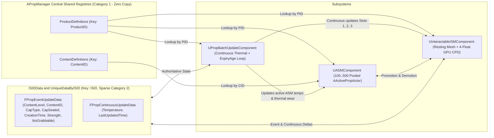

# `APropManager` & ISM <-> ASM Subsystem Architecture

**Project:** Midnight Fizz: Giant Thirst (*MarryByMidnight*)  
**Scope Notice (`[Needs Approval]` Gate):** Edits to `APropManager`, `UASMComponent`, `UInteractableISMComponent`, `UPropBatchUpdateComponent`, `InteractablePropDatabase.h/.cpp`, and `InteractablePropDataAsset.h` require explicit user approval before C++ implementation begins (see **Section 8**).

**Verified C++ Sources:**
- [`InteractablePropManager.h`](file:///c:/Users/PC/Documents/Unreal%20Projects/MarryByMidnight/Source/MarryByMidnight/Public/Props/InteractablePropManager.h) & [`InteractablePropManager.cpp`](file:///c:/Users/PC/Documents/Unreal%20Projects/MarryByMidnight/Source/MarryByMidnight/Private/Props/InteractablePropManager.cpp)
- [`ASMComponent.h`](file:///c:/Users/PC/Documents/Unreal%20Projects/MarryByMidnight/Source/MarryByMidnight/Public/Components/ASMComponent.h) & [`ASMComponent.cpp`](file:///c:/Users/PC/Documents/Unreal%20Projects/MarryByMidnight/Source/MarryByMidnight/Private/Components/ASMComponent.cpp)
- [`InteractableInstancedStaticMeshComponent.h`](file:///c:/Users/PC/Documents/Unreal%20Projects/MarryByMidnight/Source/MarryByMidnight/Public/Components/InteractableInstancedStaticMeshComponent.h) & [`InteractableInstancedStaticMeshComponent.cpp`](file:///c:/Users/PC/Documents/Unreal%20Projects/MarryByMidnight/Source/MarryByMidnight/Private/Components/InteractableInstancedStaticMeshComponent.cpp)
- [`PropBatchUpdateComponent.h`](file:///c:/Users/PC/Documents/Unreal%20Projects/MarryByMidnight/Source/MarryByMidnight/Public/Components/PropBatchUpdateComponent.h) & [`PropBatchUpdateComponent.cpp`](file:///c:/Users/PC/Documents/Unreal%20Projects/MarryByMidnight/Source/MarryByMidnight/Private/Components/PropBatchUpdateComponent.cpp)

**Companion Docs:** [`ISM_Data_Architecture.md`](file:///c:/Users/PC/Documents/Unreal%20Projects/MarryByMidnight/Docs/ISM_Data_Architecture.md) | [`ActivePropActor_ASM_Architecture.md`](file:///c:/Users/PC/Documents/Unreal%20Projects/MarryByMidnight/Docs/ActivePropActor_ASM_Architecture.md) | [`Bottle_Damage_Transformation_and_Fragments.md`](file:///c:/Users/PC/Documents/Unreal%20Projects/MarryByMidnight/Docs/Bottle_Damage_Transformation_and_Fragments.md)

---

## 1. System Topology & Single Source of Truth



### Core Responsibilities
- **`APropManager` (Server Authority):** Owns `ProductDefinitions`, `ContentDefinitions`, `ISIDData`, monotonic persistent `double WorldElapsedSeconds` clock, `ChangePropProductWithMode` 1-to-1 conversions, `RequestProductTransformation` / `SpawnActiveFragmentInstance` 1-to-Many fracture flows, and split replication channels (`Registry` vs `Event` vs `Continuous`).
- **`UInteractableISMComponent`:** Renders resting ISM slots, maintains bidirectional `ISID <-> ISMI` mappings and `EmptyInstances`, stores minimal unique runtime records (no `PropDatabase` bloat), and pushes **4 floats** per instance (`0=ContentLevel`, `1=ExpiryAge`, `2=Temperature`, `3=Strength`).
- **`UPropBatchUpdateComponent`:** Unified owner of **Continuous Update Data** across **both** resting ISMs and active ASMs (replaces duplicate loops [`UpdateDistributedASMs`](file:///c:/Users/PC/Documents/Unreal%20Projects/MarryByMidnight/Source/MarryByMidnight/Private/Components/ASMComponent.cpp#L1176-L1215) and [`ProcessTimestampedThermalUpdates`](file:///c:/Users/PC/Documents/Unreal%20Projects/MarryByMidnight/Source/MarryByMidnight/Private/Props/InteractablePropManager.cpp#L8323-L8389)).
- **`UASMComponent`:** Manages the dynamic `100..500` pool of `AActivePropActor` units, enforces `CanDemoteToISM()` during settling sweeps, and flushes/restores unique data cleanly across `PromoteRecordToASM` and `DemoteRecordFromASM`.

---

## 2. Zero-Copy Shared Registries & Deprecation of Duplicated Copies

Today, the codebase copies shared product specs in four places:
1. [`UInteractableISMComponent::PropDatabase`](file:///c:/Users/PC/Documents/Unreal%20Projects/MarryByMidnight/Source/MarryByMidnight/Public/Components/InteractableInstancedStaticMeshComponent.h#L101-L102) duplicates `FInteractablePropData` (heap arrays, `FText`, mesh pointers) on every single ISM slot (`AddInstanceWithISID`, `ReuseOrAddInstanceWithISID`, `SyncDatabaseWithInstanceCount`).
2. [`UInteractableISMComponent::IISMDB`](file:///c:/Users/PC/Documents/Unreal%20Projects/MarryByMidnight/Source/MarryByMidnight/Public/Components/InteractableInstancedStaticMeshComponent.h#L51-L52) replicates an entire `FPropProductDefinition` per component instead of looking up `ProductID` in `APropManager`.
3. [`FPropBulkUpdateBatch::ProductDefinitions`](file:///c:/Users/PC/Documents/Unreal%20Projects/MarryByMidnight/Source/MarryByMidnight/Public/Props/InteractablePropDatabase.h#L1020) embeds full `FPropProductDefinition` arrays in runtime delta batches ([`BuildBulkUpdateBatch`](file:///c:/Users/PC/Documents/Unreal%20Projects/MarryByMidnight/Source/MarryByMidnight/Private/Props/InteractablePropManager.cpp#L7083) & [`SendInstanceDelta`](file:///c:/Users/PC/Documents/Unreal%20Projects/MarryByMidnight/Source/MarryByMidnight/Private/Props/InteractablePropManager.cpp#L7120)).
4. [`AActivePropActor`](file:///c:/Users/PC/Documents/Unreal%20Projects/MarryByMidnight/Source/MarryByMidnight/Private/Props/InteractableProp.cpp#L451-L473) copies `StimuliPerPortion`, `ExpiryStimulusProfile`, `TasteProfile`, etc. onto all `100..500` pooled actors.

### Target Zero-Copy Refactor Plan
- **Central Registries (`APropManager`):** Maintain `ProductDefinitions` and new `ContentDefinitions` (`RegisterContentDefinition`, `FindContentDefinition`) centrally on `APropManager`.
- **On-Join / On-Register Sync:** Replicate `ProductDefinitions` and `ContentDefinitions` **only** during initial client snapshot (`BuildInitialPropSnapshot`) and via `Multicast_RegisterProductDefinition` / `Multicast_RegisterContentDefinition` whenever a brand-new runtime PID/CID is registered. Runtime instance delta packets carry only `int32 ProductID` and `int32 ContentID`.
- **Component & Legacy Bridge Cleanup:**
  - Deprecate `UInteractableISMComponent::PropDatabase` and remove replicated `IISMDB` copy. [`UInteractableISMComponent::GetPropDataForInstance`](file:///c:/Users/PC/Documents/Unreal%20Projects/MarryByMidnight/Source/MarryByMidnight/Private/Components/InteractableInstancedStaticMeshComponent.cpp#L1191-L1199) and [`APropManager::CanInteractWithMesh`](file:///c:/Users/PC/Documents/Unreal%20Projects/MarryByMidnight/Source/MarryByMidnight/Private/Props/InteractablePropManager.cpp#L8102-L8150) assemble an ephemeral `FInteractablePropData` on stack memory only when explicitly queried by UI/scanners, referencing `FindProductDefinition` + `FindContentDefinition` + `FindUniqueData`.
  - Gate per-instance storage sparsely via `APropManager::UniqueDataByISID` (`TMap<int32, FPropInstanceUniqueData>`) allocated **only** when `ProductDef->bEnableInstanceUniqueData == true`; static props pay `0 bytes` for Category 2 state.

---

## 3. Split Network & Runtime Flow (Hot Continuous vs. Reliable Event)

Splitting update paths keeps thermal ambient ticks tiny and prevents stale ticks from clobbering discrete actions:

### Channel A — Continuous Update Sync (`FPropContinuousSyncItem`, Unreliable Batched Multicast)
- **Trigger:** Server `UPropBatchUpdateComponent::ProcessBatchUpdate` ticks items where `bEnableInstanceUniqueData && bEnableContinuousUpdateData`.
- **Payload (`24 B` struct / `12–16 B` net-serialized per item):** `ISID` (`int32`), `Temperature` (`float`), quantized/relative `LastUpdatedTime` offset from packet `double BaseWorldSeconds`, plus optional `ThermalStrength` (`float` written only if `bHasThermalStrengthUpdate == true` via `NetSerialize`).
- **Invariants:** Never includes `ContentLevel`, `ContentID`, `CapSealed`, `CreationTime`, `bIsGrabbable`, or `ProductID`. Updates `ContinuousData` on record/ISM/ASM and refreshes GPU `Slots 1, 2` (and `3` if thermal damage occurred).
- **Pre-Event Stale Packet Guard:** Clients discard any Continuous packet whose `BatchBaseWorldSeconds + TimeOffset` is older than the instance's latest reliable Event timestamp (`LastDiscreteEventTime`), preventing unordered unreliable thermal packets from rolling back a recent fill/heat/reset event.

### Channel B — Event Update Sync (`FPropEventSyncDelta`, Reliable / `EventSequence` Ordered)
- **Trigger:** Discrete gameplay mutations via `APropManager::SubmitInstanceEventUpdate(InISID, EventDelta, EPropEventDirtyMask)`:
  - Fill / Pour / Consume (`ContentLevel`, `ContentID`, `EventSequence`, GPU `Slot 0`)
  - Cap Add / Seal / Remove (`CapType`, `CapSealed`, `EventSequence`)
  - Impact Damage / Repair (`Strength`, `EventSequence`, GPU `Slot 3`)
  - Lock / Unlock (`bIsGrabbable`, `EventSequence`)
  - Fresh Spawn / Full Reset (`CreationTime`, `EventSequence`, GPU `Slot 1`)
  - Product Transformation (`ProductID`, `EventSequence`, `EPropProductResetMode`: `ContentReset`, `PreserveUniqueState`, `FullReset`, OR server-authoritative 1-to-Many `BreakageFracture` retiring `SourceISID` -> spawning `FragISID`s)
- **Out-of-Order & Client-Prediction Reconciliation:** When a client fast-promotes locally via [`MakeISMToASM`](file:///c:/Users/PC/Documents/Unreal%20Projects/MarryByMidnight/Source/MarryByMidnight/Public/Props/InteractablePropManager.h#L693), the predicted actor caches `PredictedEventSequence` and `bPendingServerPromoteAck = true`. Incoming reliable Event packets with `Incoming.EventSequence >= Local.EventSequence` (or `Incoming.Version > Local.Version`) authoritatively update `UniqueDataByISID` and forward `OnApplyEventData` to any active ASM without snapping locally predicted hand-held transforms.

---

## 4. Unified `UPropBatchUpdateComponent` Thermal, Damage & Expiry Loop

Currently, three separate code paths partially update temperature:
- [`APropManager::Tick`](file:///c:/Users/PC/Documents/Unreal%20Projects/MarryByMidnight/Source/MarryByMidnight/Private/Props/InteractablePropManager.cpp#L173-L186) calls `UpdateDistributedProps` -> `UASMComponent::UpdateDistributedASMs` (which multiplies `DeltaSeconds * ASMActors.Num()` even for parked inactive slots!),
- [`APropManager::ProcessTimestampedThermalUpdates`](file:///c:/Users/PC/Documents/Unreal%20Projects/MarryByMidnight/Source/MarryByMidnight/Private/Props/InteractablePropManager.cpp#L8323-L8389) (skips diffs `< 1` minute and fails to update GPU data),
- [`UPropBatchUpdateComponent::ProcessBatchUpdate`](file:///c:/Users/PC/Documents/Unreal%20Projects/MarryByMidnight/Source/MarryByMidnight/Private/Components/PropBatchUpdateComponent.cpp#L34-L134) (only broadcasts spatial batches; [`SetInstanceTemperature`](file:///c:/Users/PC/Documents/Unreal%20Projects/MarryByMidnight/Source/MarryByMidnight/Private/Components/PropBatchUpdateComponent.cpp#L146-L149) early-returns if already within `0.05°C`).

### Unified Pipeline Specification
1. **Single Authoritative Sweeper:** Consolidate resting ISM and idle ASM thermal/expiry sweeps inside `UPropBatchUpdateComponent::ProcessBatchUpdate` (with double-precision `WorldElapsedSeconds`), deprecating duplicate loops in `UASMComponent::UpdateDistributedASMs` and `ProcessTimestampedThermalUpdates`.
2. **Per-Item Execution (for products with `bEnableInstanceUniqueData && bEnableContinuousUpdateData`):**
   - Compute `DeltaTSeconds = Manager->WorldElapsedSeconds - ContinuousData.LastUpdatedTime`. Skip if `<= 0`.
   - Resolve target temperature `T_env` from registered thermal zone volumes / `AmbientTemperature` and effective transfer rate `K` (`ProductDef->ThermalConductivity`, `ThermalMass`, `HeatingRateMultiplier` / `CoolingRateMultiplier`).
   - Update `ContinuousData.Temperature = T_env + (T_prev - T_env) * FMath::Exp(-K * DeltaTSeconds)`.
   - **Always update `ContinuousData.LastUpdatedTime = Manager->WorldElapsedSeconds`** even when `|T_new - T_env| <= 0.05°C`, preventing stale catch-up spikes when moved into a freezer or heater later!
   - **Extreme Thermal Wear & Resting Failure:** If `Temperature > HighTempDamageThreshold` or `Temperature < LowTempDamageThreshold`, compute thermal `Strength` drain. If `[MinTemperatureThreshold, MaxTemperatureThreshold]` is breached or `Strength <= BreakageFailureThreshold`, emit **`ThermalFailure` / `BottleBreakage`** -> `ChangePropProductWithMode(MeltedProductID, EPropProductResetMode::PreserveUniqueState)` (for melt) or `RequestProductTransformation(ISID, BreakageFracture, BrokenProductID, Context)` (or `BurstBrokenProductID` if burst configured).
   - **Mandatory GPU Slot Refresh:** Compute `ExpiryAge = Clamp((WorldElapsedSeconds - EventData.CreationTime) / (ExpiryLifetimeMinutes * 60.0), 0.0, 1.0)` and push **`Slot 1 (ExpiryAge)`**, **`Slot 2 (Temperature)`** (and **`Slot 3 (Strength)`** if thermal wear changed) via `UInteractableISMComponent::SetCustomDataValue` or `AActivePropActor::UpdateMaterialCustomPrimitiveData`.

---

## 5. `ChangePropProduct` Modes, Fracture Transformations & Initial Hit Promotion

[`APropManager::ChangePropProduct`](file:///c:/Users/PC/Documents/Unreal%20Projects/MarryByMidnight/Source/MarryByMidnight/Private/Props/InteractablePropManager.cpp#L2423-L2510) currently resets `CreationMinute` whenever `bResetRuntimeData == true` and leaves the old C++/BP actor class alive if `NewDef->CustomActiveActorClass` differs (for instance, intact bottle -> broken/burst/melted mesh class).

### 5.1 Replace `bool bResetRuntimeData` With `EPropProductResetMode`
Keep backward-compatible overload delegating to the enum:
- **`PreserveUniqueState`:** Used for Fill+Seal (`EmptyBottle -> FilledCola`) and 1-to-1 Containment Failure (`ColaBottle -> BurstBottle` / `MeltedGlass`). Preserves `ISID`, **`CreationTime`**, `Strength`, `Temperature`, `LastUpdatedTime`, `ContentLevel`, `ContentID`, `CapType`, `CapSealed` (and increments `EventSequence` + `Version`).
- **`ContentReset`:** Emptying/washing (`FilledCola -> EmptyBottle`). Clears `ContentLevel = 0.0f`, `ContentID = 0`, `CapType = 0`, `CapSealed = 0.0f`, while **preserving `CreationTime`**, `Strength`, and `Temperature`.
- **`FullReset`:** Explicit new-item spawn / debug recycle ONLY. Resets all `ContinuousData` & `EventData` to `NewDef->DefaultUniqueData` and stamps a new `CreationTime = WorldElapsedSeconds`.

### 5.2 Safe Actor Subclass Swap (`CustomActiveActorClass` Mismatch) & Socket Preservation
If `ActiveActor` is active during `ChangePropProductWithMode` and `NewDef->CustomActiveActorClass != ActiveActor->GetClass()`:
1. Guard `NewProductID <= 0` (no `BurstBrokenProductID` / `MeltedProductID` configured): leave in broken `Strength = 0` static disabled state or `ReleaseInstanceToEmpty(ISID)` cleanly without crashing.
2. Snapshot `CurrentTransform`, `LinearVelocity`, `AngularVelocity`, `State`, `InteractionState`, `InteractionOwner`, `USceneComponent* AttachParent = GetRootComponent()->GetAttachParent()`, and `FName AttachSocket = GetAttachSocketName()`.
3. Call `ActiveActor->OnBeforePoolDeactivate()`, return old actor to `UASMComponent` pool, acquire new actor of `NewDef->CustomActiveActorClass` via `UASMComponent::AcquireActiveActor(NewProductID)`.
4. Rebind `ISID <-> ASMID` in `UASMComponent`, initialize with updated `Record` (`CreationTime` preserved), restore physics velocities or re-attach to `AttachParent` + `AttachSocket` (`InteractionOwner`) seamlessly on the same frame!

### 5.3 1-to-Many Fracture (`RequestProductTransformation`), Fragment Spawning & Initial ISM Hit Bypass
Detailed end-to-end rules live in [`Bottle_Damage_Transformation_and_Fragments.md`](file:///c:/Users/PC/Documents/Unreal%20Projects/MarryByMidnight/Docs/Bottle_Damage_Transformation_and_Fragments.md); at the `APropManager` layer:
- **Authoritative Fracture Entry (`RequestProductTransformation`, `HasAuthority()` only):** Validates `TargetProductID > 0 && TargetProductID != SourceProductID` (prevents infinite recursion), retires `SourceISID` via [`ReleaseInstanceToEmpty(SourceISID)`](file:///c:/Users/PC/Documents/Unreal%20Projects/MarryByMidnight/Source/MarryByMidnight/Private/Props/InteractablePropManager.cpp#L2232-L2262) (`WorldSaveData.DestroyedISIDs` + `PendingReleasedToEmptyISIDs`), and promotes/acquires `BrokenProductID` (`ABrokenBottlePropActor`) injected with `FPropTransformationContext`.
- **Independent Shard Spawning (`SpawnActiveFragmentInstance`):** Allocates a new server `FragISID` per `Glass Fragment 1..N` (`CreationTime` + `Temperature` + `LastUpdatedTime` inherited, `FragStrength` reset cleanly to fragment default), reusing base pre-warmed `AActivePropActor` slots (`CustomActiveActorClass == nullptr`, zero class-swap hitch). If active ASMs approach [`MaxASMCount = 500`](file:///c:/Users/PC/Documents/Unreal%20Projects/MarryByMidnight/Source/MarryByMidnight/Public/Components/ASMComponent.h#L41-L43), excess shards trace straight down to floor rest in `AtRest` ISM (`bFallbackToRestingISMIfPoolFull`).
- **Initial ISM Hit Promotion Hook ([`SendISMHitByICIDToPropManager`](file:///c:/Users/PC/Documents/Unreal%20Projects/MarryByMidnight/Source/MarryByMidnight/Private/Props/InteractablePropManager.cpp#L263-L294) -> [`SetInstanceToUnsettled`](file:///c:/Users/PC/Documents/Unreal%20Projects/MarryByMidnight/Source/MarryByMidnight/Private/Props/InteractablePropManager.cpp#L6198-L6307)):** On **server (`HasAuthority()`) only**, immediately after promoting an ISM prop on external hit, invoke `PromotedASM->ApplyInitialImpactFromPromotion(EffectiveImpulse, ImpactPoint, HittingActor, FreshInteractionEventID)` using the **unclamped `EffectiveImpulse`** (while physics launch keeps using `SafeImpulse` clamped at `<= 220.0f`), so lethal impacts shatter resting glass bottles reliably instead of being dropped by `WarmupFramesRemaining = 20`.

---

## 6. ASM <-> ISM Promotion & Demotion Gate (`CanDemoteToISM()`)

Current settling checks ([`UASMComponent::CheckSettlingQueue`](file:///c:/Users/PC/Documents/Unreal%20Projects/MarryByMidnight/Source/MarryByMidnight/Private/Components/ASMComponent.cpp#L1281-L1284), [`ProcessSettlingQueueAsync`](file:///c:/Users/PC/Documents/Unreal%20Projects/MarryByMidnight/Source/MarryByMidnight/Private/Components/ASMComponent.cpp#L1380-L1383), [`APropManager::ConvertASMToISM`](file:///c:/Users/PC/Documents/Unreal%20Projects/MarryByMidnight/Source/MarryByMidnight/Private/Props/InteractablePropManager.cpp#L2873-L2898)) only verify velocity, `Held`/`InMotion`, and rocket state.

**Required Addition (`[Needs Approval]`):** Both settling sweeps and `ConvertASMToISM` must query `ActiveActor->CanDemoteToISM()`. If `false` (for example, cold soda inside a hot bottle or bottle still sizzling with high `AccumulatedInteractionPressure`), keep the actor in ASM (`Settling`/resting physics) and automatically re-evaluate once `ActiveActor` notifies equilibrium or on the next sweep!

---

## 7. Monotonic World Clock (`WorldElapsedSeconds`) Replacing `uint16` Minutes

[`APropManager::GetCurrentWorldMinutes()`](file:///c:/Users/PC/Documents/Unreal%20Projects/MarryByMidnight/Source/MarryByMidnight/Private/Props/InteractablePropManager.cpp#L326-L333) truncates `World->GetTimeSeconds() / 60.0f` into `uint16` and resets to `0` on every level load — corrupting both `(Current - Creation)` expiry calculations after loading a save and sub-second thermal equilibrium steps (`Bottle_Containment_&_Failure_System.txt#L1230`).

**Target Clock (`[Needs Approval]`):**
- Add `UPROPERTY(Replicated) double WorldElapsedSeconds = 0.0;` on `APropManager`, initialized from `WorldSaveData.WorldElapsedSeconds` on load and advanced smoothly in `APropManager::Tick(DeltaSeconds)` (with periodic replication / client extrapolation).
- Keep `GetCurrentWorldMinutes()` as a pure compatibility wrapper returning `FMath::FloorToInt(WorldElapsedSeconds / 60.0)` while all thermal and expiry math runs in double seconds.

---

## 8. Proposals Requiring User Approval Before C++ Edits

Per your instruction (*"if you change any thing on prop manager side for ISM data other thing that i have told oyu ask me first"*), **no C++ files have been edited yet**. The items below exceed the pre-authorized `AActivePropActor` scope and await your explicit sign-off before Phase B begins:

1. **Database & Struct Refactor ([`InteractablePropDatabase.h/.cpp`](file:///c:/Users/PC/Documents/Unreal%20Projects/MarryByMidnight/Source/MarryByMidnight/Public/Props/InteractablePropDatabase.h), [`InteractablePropDataAsset.h`](file:///c:/Users/PC/Documents/Unreal%20Projects/MarryByMidnight/Source/MarryByMidnight/Public/Props/InteractablePropDataAsset.h)):**
   - Add `bEnableInstanceUniqueData` and `bEnableContinuousUpdateData` toggles, shared bottle/cap/thermal/conversion fields (`BreakageFailureThreshold`, `BrokenProductID`, `MeltedProductID`, `BurstBrokenProductID`, `bPersistBrokenHullAfterFracture`, `FractureFragments`) to `FPropProductDefinition` & `UInteractablePropDataAsset`, and new `FPropContentDefinition` (`ContentDefinitions`) registry + `EPropTransformationType` / `FPropFractureFragmentEntry` / `FPropTransformationContext`.
   - Add `FPropInstanceUniqueData` (`FPropContinuousUpdateData` + `FPropEventUpdateData` with zero-byte `uint8 CapType`) onto `FISIDRuntimeIndex` and bump `FPropWorldSaveData::SchemaVersion = 2` with `SchemaVersion 1 -> 2` load migration.
2. **Zero-Copy Shared Storage Cleanup ([`InteractableInstancedStaticMeshComponent.h/.cpp`](file:///c:/Users/PC/Documents/Unreal%20Projects/MarryByMidnight/Source/MarryByMidnight/Public/Components/InteractableInstancedStaticMeshComponent.h)):**
   - Remove per-slot `PropDatabase` array duplication and remove replicated `IISMDB` copy; switch `UpdateInstanceCustomData` from `3` to **`4` floats** (`0=ContentLevel`, `1=ExpiryAge`, `2=Temperature`, `3=Strength`).
3. **Unified Continuous Update & Demotion Gate ([`PropBatchUpdateComponent.h/.cpp`](file:///c:/Users/PC/Documents/Unreal%20Projects/MarryByMidnight/Source/MarryByMidnight/Public/Components/PropBatchUpdateComponent.h), [`ASMComponent.cpp`](file:///c:/Users/PC/Documents/Unreal%20Projects/MarryByMidnight/Source/MarryByMidnight/Private/Components/ASMComponent.cpp)):**
   - Centralize exponential thermal solver, continuous thermal `Strength` drain, and mandatory GPU `Slot 1 (ExpiryAge)` updates in `UPropBatchUpdateComponent` (replacing duplicate `UpdateDistributedASMs` / `ProcessTimestampedThermalUpdates`).
   - Add `CanDemoteToISM()` gate inside `UASMComponent::CheckSettlingQueue`, `ProcessSettlingQueueAsync`, and `APropManager::ConvertASMToISM`.
4. **Prop Manager Orchestration ([`InteractablePropManager.h/.cpp`](file:///c:/Users/PC/Documents/Unreal%20Projects/MarryByMidnight/Source/MarryByMidnight/Public/Props/InteractablePropManager.h)):**
   - Replicate `ProductDefinitions` & `ContentDefinitions` once on join/register (removing per-batch `ProductDefinitions` from `FPropBulkUpdateBatch`), add split `Continuous` vs `Event` sync channels, add persisted `double WorldElapsedSeconds` clock, upgrade `ChangePropProduct` with `EPropProductResetMode` + safe actor-class respawn preserving socket attachment and `CreationTime`, add `RequestProductTransformation` & `SpawnActiveFragmentInstance` (with `MaxASMCount = 500` `AtRest` fallback), and invoke server-only `ApplyInitialImpactFromPromotion` inside `SendISMHitByICIDToPropManager`.

### 8.1 Open Edge-Case Decisions Awaiting Your Sign-Off
Please confirm your preference on these **6 design points** *(see [`ISM_Data_Architecture.md` §2.7](file:///c:/Users/PC/Documents/Unreal%20Projects/MarryByMidnight/Docs/ISM_Data_Architecture.md#L367-L375) and [`Bottle_Damage_Transformation_and_Fragments.md` §9](file:///c:/Users/PC/Documents/Unreal%20Projects/MarryByMidnight/Docs/Bottle_Damage_Transformation_and_Fragments.md#L333-L338))* before Phase B C++ edits begin:
1. **Uncapped Partial Bottles (`CapSealed == 0 && ContentLevel > 0`):** Allow ISM demotion once settled, or hold uncapped filled bottles in ASM until capped/emptied?
2. **Resting ISM Liquid Flavor Visuals:** Route distinct liquid flavors to per-flavor `FilledProductIDByContentID` ISM batches (preserving exact liquid color/label per flavor), or use a shared generic filled glass PID?
3. **Resting ISM Extreme-Temperature Failure:** Silently convert `ISID -> BurstBrokenProductID` / `MeltedProductID` in ISM inside `UPropBatchUpdateComponent`, or briefly promote via `MakeISMToASM` for 3D shatter/spill VFX?
4. **SaveGame `SchemaVersion 1 -> 2` Migration:** Retain automatic upgrade loader for existing `SchemaVersion = 1` save files, or start cleanly at `SchemaVersion = 2`?
5. **Fragment `ISID` Allocation Timing (`At Spawn` vs. `At Settle`):** Allocate each shard's `FragISID` immediately at spawn (`SpawnActiveFragmentInstance`, supporting mid-slide pickups and saves) or only after shards settle?
6. **Broken Bottle Orchestrator Lifecycle (`Pure Fragments` vs. `Broken Hull + Fragments`):** Dissolve `Broken Glass Bottle` cleanly once `Glass Fragment 1..5` spawn (`100%` fragments), or also keep a resting broken hull (`bPersistBrokenHullAfterFracture`) alongside detached cap debris?

---

## 9. Proposed C++ Header Contracts (`[Needs Approval]`)

Targeting [`InteractablePropDatabase.h`](file:///c:/Users/PC/Documents/Unreal%20Projects/MarryByMidnight/Source/MarryByMidnight/Public/Props/InteractablePropDatabase.h), [`InteractablePropManager.h`](file:///c:/Users/PC/Documents/Unreal%20Projects/MarryByMidnight/Source/MarryByMidnight/Public/Props/InteractablePropManager.h), [`ASMComponent.h`](file:///c:/Users/PC/Documents/Unreal%20Projects/MarryByMidnight/Source/MarryByMidnight/Public/Components/ASMComponent.h), [`PropBatchUpdateComponent.h`](file:///c:/Users/PC/Documents/Unreal%20Projects/MarryByMidnight/Source/MarryByMidnight/Public/Components/PropBatchUpdateComponent.h), and [`InteractableInstancedStaticMeshComponent.h`](file:///c:/Users/PC/Documents/Unreal%20Projects/MarryByMidnight/Source/MarryByMidnight/Public/Components/InteractableInstancedStaticMeshComponent.h):

```cpp
UENUM(BlueprintType)
enum class EPropProductResetMode : uint8
{
    PreserveUniqueState, // Keep Event + Continuous unique data & CreationTime (e.g. Empty -> Filled, Bottle -> BurstBroken / Melted)
    ContentReset,        // Zero ContentLevel/ContentID/CapType/CapSealed; preserve CreationTime, Strength, Temperature
    FullReset            // Reset all Event + Continuous unique fields to NewDef->DefaultUniqueData + fresh CreationTime
};

UENUM(BlueprintType, meta = (Bitflags, UseEnumValuesAsMaskValuesInEditor = "true"))
enum class EPropEventDirtyMask : uint8
{
    None         = 0       UMETA(Hidden),
    ContentLevel = 1 << 0,
    ContentID    = 1 << 1,
    Strength     = 1 << 2,
    CapSealed    = 1 << 3,
    CreationTime = 1 << 4,
    Grabbable    = 1 << 5,
    ProductID    = 1 << 6,
    CapType      = 1 << 7 // Uses spare bit 7 of existing 1-byte uint8 bitmask (0 extra header bytes)
};
ENUM_CLASS_FLAGS(EPropEventDirtyMask);

// Channel A: Unreliable Continuous Sync Item (sent inside batch with double BaseWorldSeconds)
USTRUCT()
struct MARRYBYMIDNIGHT_API FPropContinuousSyncItem
{
    GENERATED_BODY()
    UPROPERTY() int32 ISID = 0;
    UPROPERTY() float Temperature = 21.0f;
    UPROPERTY() float RelativeTimeOffset = 0.0f; // LastUpdatedTime - BatchBaseWorldSeconds
    UPROPERTY() float ThermalStrength = 100.0f;  // Serialized only when bHasThermalStrengthUpdate == true
    UPROPERTY() bool bHasThermalStrengthUpdate = false;
    bool NetSerialize(FArchive& Ar, class UPackageMap* Map, bool& bOutSuccess);
};

// Channel B: Reliable Event Sync Delta (only dirty discrete fields serialized via NetSerialize)
USTRUCT(BlueprintType)
struct MARRYBYMIDNIGHT_API FPropEventSyncDelta
{
    GENERATED_BODY()
    UPROPERTY(BlueprintReadWrite) int32 ISID = 0;
    UPROPERTY(BlueprintReadWrite) uint32 EventSequence = 1;
    UPROPERTY(BlueprintReadWrite) uint8 DirtyMask = 0;
    UPROPERTY(BlueprintReadWrite) float ContentLevel = 0.0f;
    UPROPERTY(BlueprintReadWrite) int32 ContentID = 0;
    UPROPERTY(BlueprintReadWrite) float Strength = 100.0f;
    UPROPERTY(BlueprintReadWrite) float CapSealed = 0.0f;
    UPROPERTY(BlueprintReadWrite) double CreationTime = 0.0;
    UPROPERTY(BlueprintReadWrite) bool bIsGrabbable = true;
    UPROPERTY(BlueprintReadWrite) uint8 CapType = 0;
    UPROPERTY(BlueprintReadWrite) int32 NewProductID = 0;
    bool NetSerialize(FArchive& Ar, class UPackageMap* Map, bool& bOutSuccess);
};
```

### Subsystem Signatures (`[Needs Approval]`)
```cpp
// --- APropManager (InteractablePropManager.h) ---
UPROPERTY(EditAnywhere, BlueprintReadWrite, Category = "Prop Manager|Database")
TMap<int32, FPropContentDefinition> ContentDefinitions; // Category 1B liquid specs

UPROPERTY(Transient, VisibleAnywhere, BlueprintReadOnly, Category = "Prop Manager|Registry")
TMap<int32, FPropInstanceUniqueData> UniqueDataByISID; // Sparse Category 2 (0 B if bEnableInstanceUniqueData == false)

UPROPERTY(Replicated, VisibleAnywhere, BlueprintReadOnly, Category = "Prop Manager|Time")
double WorldElapsedSeconds = 0.0;

UFUNCTION(BlueprintCallable, Category = "Prop Manager|Database")
bool RegisterContentDefinition(const FPropContentDefinition& InDefinition);
const FPropContentDefinition* FindContentDefinition(int32 InContentID) const;

FPropInstanceUniqueData* FindUniqueData(int32 InISID);
const FPropInstanceUniqueData* FindUniqueData(int32 InISID) const;

UFUNCTION(BlueprintCallable, Category = "Prop Manager|Product Conversion")
bool ChangePropProductWithMode(int32 InISID, int32 NewProductID, EPropProductResetMode ResetMode);

UFUNCTION(BlueprintCallable, Category = "Prop Manager|Product Transformation")
bool RequestProductTransformation(int32 SourceISID, EPropTransformationType TransformType, int32 TargetProductID, const FPropTransformationContext& Context);

UFUNCTION(BlueprintCallable, Category = "Prop Manager|Product Transformation")
int32 SpawnActiveFragmentInstance(int32 FragmentProductID, const FTransform& WorldTransform, const FPropInstanceUniqueData& InheritedUniqueData, FVector LinearImpulse, FVector AngularImpulse, bool bFallbackToRestingISMIfPoolFull = true);

UFUNCTION(BlueprintCallable, Category = "Prop Manager|Replication")
bool SubmitInstanceEventUpdate(int32 InISID, const FPropEventSyncDelta& Delta);

UFUNCTION(NetMulticast, Reliable, Category = "Prop Manager|Database")
void Multicast_RegisterProductDefinition(const FPropProductDefinition& NewDef);

UFUNCTION(NetMulticast, Reliable, Category = "Prop Manager|Database")
void Multicast_RegisterContentDefinition(const FPropContentDefinition& NewDef);

UFUNCTION(NetMulticast, Reliable, Category = "Prop Manager|Replication")
void Multicast_SyncEventDeltaBatch(const TArray<FPropEventSyncDelta>& EventDeltas);

UFUNCTION(NetMulticast, Unreliable, Category = "Prop Manager|Replication")
void Multicast_SyncContinuousBatch(double BaseWorldSeconds, const TArray<FPropContinuousSyncItem>& Items);

// --- UInteractableISMComponent (InteractableInstancedStaticMeshComponent.h) ---
// Remove replicated FPropProductDefinition IISMDB and TArray<FInteractablePropData> PropDatabase;
// Set NumCustomDataFloats = 4 in constructor / OnRegister:
//   Slot 0 = ContentLevel, Slot 1 = ExpiryAge, Slot 2 = Temperature, Slot 3 = Strength / MaxStrength
void UpdateInstanceCustomData(int32 InISMI, const FISIDRuntimeIndex* Record, const FPropInstanceUniqueData* UniqueData, const FPropProductDefinition* ProductDef, const FPropContentDefinition* ContentDef, double WorldSeconds, bool bMarkRenderStateDirty = true);

// --- UASMComponent (ASMComponent.h) & UPropBatchUpdateComponent (PropBatchUpdateComponent.h) ---
// CheckSettlingQueue / ProcessSettlingQueueAsync & APropManager::ConvertASMToISM call:
//   if (PropOwner && !PropOwner->CanDemoteToISM()) continue / return false;
// Deprecate UpdateDistributedASMs() & ProcessTimestampedThermalUpdates(); run single exponential solver inside ProcessBatchUpdate().
```

---

## 10. Revision History

| Iteration | Focus Completed |
|---|---|
| **Iteration 1** | Documented central dual registries, deprecation of `PropDatabase`/`IISMDB`/`ProductDefinitions` per-batch resends, split Continuous vs Event network channels, unified `UPropBatchUpdateComponent`, `CanDemoteToISM()` gate, `ChangePropProduct` reset modes, `WorldElapsedSeconds` clock, and `[Needs Approval]` boundary list. |
| **Iteration 2** | Fixed Mermaid topology syntax (`<...>` / `&` / `<->`), specified `UniqueDataByISID` sparse `0 B` static-prop allocation, hardened `EventSequence` + `LastDiscreteEventTime` stale-packet reconciliation for client-predicted `MakeISMToASM`, safe socket preservation across `CustomActiveActorClass` swap (`BurstBrokenProductID <= 0` guard), on-demand stack synthesis in `CanInteractWithMesh` & `GetPropDataForInstance`, and added Section 8.1 edge-case decisions. |
| **Iteration 3** | Added full `[Needs Approval]` C++ contracts (`EPropProductResetMode`, `EPropEventDirtyMask`, `FPropContinuousSyncItem`, `FPropEventSyncDelta`, `APropManager` / `UASMComponent` / `UInteractableISMComponent` / `UPropBatchUpdateComponent` APIs) and verified all clickable line links against current headers and implementations. |
| **Iteration 4** | Integrated [`Bottle_Damage_Transformation_and_Fragments.md`](file:///c:/Users/PC/Documents/Unreal%20Projects/MarryByMidnight/Docs/Bottle_Damage_Transformation_and_Fragments.md): added `EPropEventDirtyMask::CapType = 1 << 7` + `FPropEventSyncDelta::CapType`, documented `RequestProductTransformation` & `SpawnActiveFragmentInstance` (base-pool reuse + `MaxASMCount = 500` `AtRest` fallback), added server-only `ApplyInitialImpactFromPromotion` with unclamped `EffectiveImpulse`, and added Decisions 5–6 to Section 8.1. |
