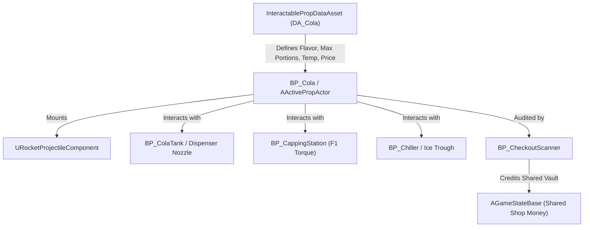

# Technical Implementation & Unreal Engine 5 Architecture Plan

**Latest equipment requirement — 11 November 2026:** [Equipment Design Specification](Equipment_Design_Specification.md) and [equipment integration/conflicts](Equipment_Design_Integration_2026-11-11.md) select the two-player Manual Wheel Rotator as the only demo type from that catalog. Extend shared C++ bottle/cap/liquid/pressure interaction services, with server-authoritative operator roles, G-press holding contributions, declining holding effectiveness, rotation progress, sealing and leakage. Do not count current direct CloseCap APIs/tests as acceptance of this new station. Shared equipment data covers voltage/power/operating-pressure range and applicable variant/price/portability/players/energy/capacity fields; advanced powered/fuel machines remain full-game-only. G-versus-grab routing, transport, mass/tuning and session cancellation/persistence require resolution before dependent implementation. No schema change or runtime implementation is established by this documentation update.

> [!IMPORTANT]
> **Architecture Alignment Notice (Superseded Data & Pooling Details):** Section 1.2 (`FPropPackedRuntimeData` 64-bit portion/minute packing, integer `RemainingPortions`, `EBottleCapState` packed bits, and single-use destruction on empty) and `FBottleRuntimeState` below reflect an earlier prototype draft. They are superseded by the zero-copy Continuous vs. Event architecture defined in [`ISM_Data_Architecture.md`](file:///c:/Users/PC/Documents/Unreal%20Projects/MarryByMidnight/Docs/ISM_Data_Architecture.md), [`ActivePropActor_ASM_Architecture.md`](file:///c:/Users/PC/Documents/Unreal%20Projects/MarryByMidnight/Docs/ActivePropActor_ASM_Architecture.md), [`PropManager_ISM_ASM_Architecture.md`](file:///c:/Users/PC/Documents/Unreal%20Projects/MarryByMidnight/Docs/PropManager_ISM_ASM_Architecture.md), and [`BP_Cola_Technical_Documentation.md`](file:///c:/Users/PC/Documents/Unreal%20Projects/MarryByMidnight/Docs/BP_Cola_Technical_Documentation.md). Workstation/HUD proposals in Sections 3–5 apply only where consistent with the current Normal-only scope and latest approved mechanics; older class names, countdowns and numeric examples are not evidence of current implementation.

**11 November chat integration and subsequent prototype restriction:** [Current requirements and conflicts](Chat_Design_Decisions_2026-11-11.md) define the Normal Bulk Cola Container and separate filling-equipment stage. [Plastic Bottle Pressure System](Prototype_Plastic_Bottle_Pressure_2026-11-11.md) now selects plastic bottles, the five Normal Colas and Normal manual twist caps exclusively. Hits/shaking/drops/impacts increase pressure; exceeding the bottle's tolerance triggers cola-powered physics-driven rocket motion influenced by orientation/forces. Prefer existing C++ Prop Manager, bottle pressure/rocket, liquid/filling/cap/scanner/cash services; Blueprints supply adapters/art where needed. Preserve current player/NPC/bottle sizes, ISIDs, replication and persistence. The earlier glass/twist-cap choice is resolved to plastic, but asset/material/label alignment is pending. Pressure gains/tolerance, sealed-cap escape and held/empty/uncapped/end-state behavior need definition and tests. Hot source output/cooling also remain unaccepted. Power, coal generation, other liquids/materials/caps/fragments and excluded legacy PSOs are outside prototype scope.

This document details how the game design specifications map directly onto the Unreal Engine 5 C++ architecture, Blueprint assets, and multiplayer systems already present in the **MarryByMidnight** codebase.

---

## 1. Architecture Overview & Asset Mapping

The project already contains an Active Static Mesh (ASM) and Prop Management framework, as well as an advanced `URocketProjectileComponent` designed for physics-driven missile simulation.



### 1.1 Existing Codebase Reference
| Subsystem / Class | Location in Project | Role in Midnight Fizz GDD |
| :--- | :--- | :--- |
| **`AActivePropActor`** | `Source/.../Props/InteractableProp.h` | Base class for physical interactive bottles in the world. Handles ASM pooling, state replication, and grabbing. |
| **`URocketProjectileComponent`**| `Source/.../Components/RocketProjectileComponent.h` | Drives erratic rocket flight, corkscrew zig-zags, bounces, tipping, and spent falling when bottles detonate! |
| **`UInteractablePropDataAsset`**| `Source/.../Props/InteractablePropDataAsset.h` | Stores base data: `Price`, `NumOfPortions`, `ConsumableTemperature`, `bEnableTemperatureUpdate`, taste entries. |
| **`BP_ColaTank`** | `Content/Assest/Blueprints/BP_ColaTank.uasset` | High-pressure cylinder station with fuel-pump style dispenser nozzle and physics hose. |
| **`BP_Cola`** | `Content/Props/Colas/BP_Cola.uasset` | Master physical bottle blueprint implementing filling, capping, shaking, and chilling logic. |
| **`DA_BasicCola`, `DA_SpicyCola`, etc.** | `Content/Assest/DataAssets/` | Specific cola configuration data assets containing portion prices and volatility parameters. |

### 1.2 Core ISM <-> ASM Architecture & Data Retention Pipeline

The project relies on a high-performance **Instanced Static Mesh (ISM) $\leftrightarrow$ Active Static Mesh (ASM)** dual-representation architecture managed by `APropManager` and `UASMComponent`. In a massive tavern workshop containing hundreds of bottles, caps, and crates, keeping hundreds of ticking `AActor` instances active would cripple multiplayer performance.

```
       [ RESTING / STORED BOTTLE ]                           [ ACTIVE BOTTLE ]
     Instanced Static Mesh (ISM)        Promote (Grab/Fill/Fly)     Active Prop Actor (ASM)
      Zero-tick, batched render  ===========================>  BP_Cola with physics & logic
     Data stored in ISID Record  <===========================   Pooled in UASMComponent
                                   Demote (Settled / AtRest)
```

#### 1. Lifecycle Transitions
1. **At Rest on Shelf / Crate (ISM Representation):**
   - The bottle is rendered as an instance inside an `UInteractableISMComponent` (`ISMI` slot index).
   - Zero CPU tick cost.
   - All state is authoritatively preserved in `APropManager::ISIDData` keyed by its permanent `ISID`.
2. **Promotion to ASM (`PromoteInstanceToASM`):**
   - **Trigger Conditions:** Player grabs the bottle (`SetMeshInstanceToHeld`), dispenser nozzle begins filling, capping wrench engages, vehicle bumper bumps it, or a Giant's table-slam delivers a physics impulse (`SetMeshInstanceToInMotion`).
   - **Execution:** `APropManager` draws an idle `BP_Cola` (`AActivePropActor`) from the pre-warmed actor pool in `UASMComponent`, places it at the gameplay transform, initializes its `ISID`, restores its packed runtime data, and moves the corresponding ISM slot off-screen to `ResetTransform`.
3. **Active Gameplay Simulation (ASM):**
   - While held or flying, `BP_Cola` executes real-time liquid filling, F1 torque mechanics, agitation accumulation, temperature exchange, and `URocketProjectileComponent` flight.
4. **Demotion to ISM (`DemoteActorToISM`):**
   - **Trigger Condition:** When a bottle is placed onto a shelf, dropped in a crate, or rests on a counter and its velocity drops below tolerance (`LinearVelocityTolerance <= 10.0 cm/s`, `AngularVelocityTolerance <= 15.0 deg/s`) for `UnsettledDelay = 3.0s`.
   - **Execution:** `APropManager` copies `BP_Cola`'s updated transform, portions, temperature, and cap state back into `ISIDData`, moves the ISM instance to the final resting transform, disables the `BP_Cola` actor, and parks it back in `EmptyASMIDs`.

#### 2. Bit-Level Runtime Data Preservation (Packing Schema)
When demoting from ASM to ISM, data must survive without allocating new memory. We utilize `FPropPackedRuntimeData` (64-bit word) and `FPropInteractionRuntimeData`:

```
+------------------------------------------------------------------------------------------------+
|                       64-BIT PACKED WORD (FPropPackedRuntimeData)                              |
+-------------------+--------------------+--------------------+--------------------+-------------+
| Bits [0..15]      | Bits [16..31]      | Bits [32..39]      | Bits [40..51]      | Bit [52]    |
| CreationMinute    | LastUpdatedMinute  | RemainingPortions  | Quantized Temp     | bGrabbable  |
| (uint16)          | (uint16)           | (uint8: 0..255)    | (12-bit float)     | (1-bit)     |
+-------------------+--------------------+--------------------+--------------------+-------------+
| Bits [56..58] (3 bits SchemaFlags): EBottleCapState (Uncapped, Loose, Sealed, Broken)          |
| Bits [59..60] (2 bits SchemaFlags): EBottleCleanliness (Pristine, Sticky, Toxic, Spider)       |
+------------------------------------------------------------------------------------------------+
```

* **Preserving Portions:** `RemainingPortions` (Bits 32..39) directly records the liquid volume from the Dispenser Nozzle. An underfilled 1-portion bottle retains its portion count even if stored in an ISM crate for days!
* **Preserving Temperature:** `Temperature` (Bits 40..51) records the exact chilled temperature ($0.1^\circ\text{C}$ resolution). Chilled bottles placed on counter shelves continue cooling or warming during background batch updates (`UPropBatchUpdateComponent`).
* **Preserving Cap State:** Stored inside `SchemaFlags` (Bits 56..58). A loose, under-torqued bottle sitting as an ISM will remember its unstable seal when picked up again!

#### 3. Product Conversion (Empty Bottle -> Full Cola)
When an empty bottle is filled with cola liquid at Station 1:
- The system calls `APropManager::ConvertProductToNewProduct(InISID, NewColaProductID)`.
- This changes the logical product definition from `DA_EmptyBottle` to `DA_BasicCola` (or `DA_SpicyCola`, etc.), updating materials, max portions, price, and volatility while preserving the same permanent `ISID` identity!

#### 4. Destruction & Recycling
- If a bottle shatters or explodes: `RemoveInstance(InISID)` frees its physical `ISMI` slot to `EmptyInstances`.
- When new empty bottles are unboxed from supply crates, `APropManager` reuses slots in `EmptyInstances` first before allocating new instances, preventing memory fragmentation.

## 2. Core Data Structures & Enumerations

To support all design mechanics, the following types should be configured in C++ or Blueprint:

### 2.1 Enumerations
```cpp
// Bottle Capping Lifecycle
UENUM(BlueprintType)
enum class EBottleCapState : uint8
{
    Uncapped        UMETA(DisplayName = "Uncapped / Open"),
    CappingInProgress UMETA(DisplayName = "Capping In Progress"),
    LooseSealed     UMETA(DisplayName = "Loose / Under-Torqued (Pop Risk)"),
    PerfectSealed   UMETA(DisplayName = "Hermetically Sealed (Ideal)"),
    OverTorqued     UMETA(DisplayName = "Over-Torqued / Broken Neck")
};

// Cleanliness & Reusability
UENUM(BlueprintType)
enum class EBottleCleanliness : uint8
{
    PristineClean   UMETA(DisplayName = "Pristine / Clean"),
    SyrupSticky     UMETA(DisplayName = "Syrup Stained (Requires Wash)"),
    ToxicContaminated UMETA(DisplayName = "Toxic Slime (Requires Chemical Bath)"),
    SpiderInfested  UMETA(DisplayName = "Spider Nest (Requires Sterilization)")
};

// Bottle Material Classification
UENUM(BlueprintType)
enum class EBottleMaterialType : uint8
{
    Glass           UMETA(DisplayName = "Standard Glass"),
    Plastic         UMETA(DisplayName = "Elastic Plastic"),
    HeavyMetal      UMETA(DisplayName = "Reinforced Metal Keg"),
    EnchantedStone  UMETA(DisplayName = "Enchanted Stone Urn")
};
```

### 2.2 Dynamic Bottle Runtime Data
Added to `AActivePropActor` or stored within `FPropInteractionRuntimeData`:
```cpp
USTRUCT(BlueprintType)
struct FBottleRuntimeState
{
    GENERATED_BODY()

    UPROPERTY(EditAnywhere, BlueprintReadWrite)
    float CurrentFillVolume = 0.0f; // 0.0 to 1.0 (or >1.0 for overfill)

    UPROPERTY(EditAnywhere, BlueprintReadWrite)
    int32 CurrentPortions = 0; // Quantized integer portions (e.g. 0 to 4)

    UPROPERTY(EditAnywhere, BlueprintReadWrite)
    float InternalPressurePSI = 0.0f; // Dynamic carbonation pressure

    UPROPERTY(EditAnywhere, BlueprintReadWrite)
    float AgitationLevel = 0.0f; // 0.0 to 100.0 (shaking meter)

    UPROPERTY(EditAnywhere, BlueprintReadWrite)
    float TemperatureCelsius = 22.0f; // Ambient room temp initially

    UPROPERTY(EditAnywhere, BlueprintReadWrite)
    EBottleCapState CapState = EBottleCapState::Uncapped;

    UPROPERTY(EditAnywhere, BlueprintReadWrite)
    EBottleCleanliness Cleanliness = EBottleCleanliness::PristineClean;

    UPROPERTY(EditAnywhere, BlueprintReadWrite)
    float CapCountdownTimer = 0.0f; // Time left before unsealed eruption
};
```

---

## 3. Workstation Blueprint Implementations

### 3.1 Normal Bulk Cola Container → Hose/Dispenser → Filling Equipment → Bottle

- The design/UI name is **Normal Bulk Cola Container**; existing Cylinder/Tank class names need not be renamed. Reuse current product/content definitions and source/target ISIDs.
- Opening the source valve produces high-pressure hot cola. Demo source behavior must not fail from its own internal pressure and must not depend on electricity or progressive container heating. Final temperatures, source capacity and pressure/flow settings remain open.
- Route supply through a hose/dispenser and a **separate compatible filling-equipment stage** before the bottle. Specific four-bottle heads, pumps, nozzle compatibility and hose constraints need later design; no particular Blueprint component arrangement is mandated by the chat.
- `UBottleFillingComponent`, `UShopProductionStationComponent` and Prop Manager's liquid-transfer path already provide shared native foundations. Extend/reuse them after resolving the missing interactions rather than implementing independent Blueprint content arithmetic or replacing them with legacy station prototypes.
- Server validation governs connections, source availability, target capacity/condition, liquid identity, fractional accepted quantities and source deductions. Preserve container history and initialize the new liquid's own age/expiry. Use existing shared state/visual publication and persistent ISID/pooling paths.
- Do not floor liquid quantities into integer portions, force an explosion above 1.25, or start a mandatory eruption countdown. Material pressure tolerance and structural/containment behavior remain authoritative.
- Uncaptured spray/spill accounting and the hot-bottle cooling workflow require explicit definitions. Visual effects must not manufacture or silently erase quantity. Prior service tests alone do not accept physical spray, hose control, practical cooling or giant-scale interaction.
- Full-game electrical cooling, low-voltage heating, coal generation and additional bulk-container types remain deferred. Do not add power dependencies to the Normal demo.

### 3.2 Manual Wheel Rotator — Shared Native Cooperative Sealing

- Prototype path: plastic bottle + Normal manual twist cap + two cooperating operators. Manual power; RequiredVoltage not applicable and PowerConsumption 0. Essential source/hose/filling services remain available without any full-game machine.
- Server validates two distinct operators' access/roles, bottle/cap ISIDs, input contributions and session state. One operator repeatedly presses G for downward holding force; its effectiveness declines with time despite continued pressing. The other rotates toward closure. Exact sampling, decay, force/pressure relationship, rotation input/rate and state transitions remain open.
- Insufficient hold before closure invokes shared leakage/pressure behavior with correct liquid accounting. Once properly sealed, releasing hold does not reopen the cap. Continue to use the existing pressure-threshold rocket rule, not a forced timeout or duplicated bottle physics.
- Reuse existing bottle/cap/liquid/identity services and practical player-sized operator positions around the unchanged bottles. Handle G/grab input context, operator contention, cancel/disconnect/rejoin and cleanup without bypassing the two-player design. Proposed major class/replication/save changes still require review under existing approvals.
- Exact station dimensions/weight, carrier/delivery availability and equipment-session save/reset policy remain open. Keep approved below-player gameplay masses; a carrier restriction is a handling rule, not an instruction to change player size or infer extreme rigid-body mass.
- Required acceptance: two real operators including a remote client, hold/decay/rotation success and failure, post-seal hold release, no unintended G grab/drop, correct leaked quantity/IDs, pressure-rocket integration, no electrical dependency, and the repeated Normal business loop. No such station-specific runtime tests were performed for this documentation task.

#### Historical BP_CappingStation / F1 Gun Proposal — Full Game Only

**Historical/future equipment proposal:** prototype sealing is a Normal manual twist cap on plastic only. Glass stopper/pressure caps, welded lids, automatic plastic variants and the gun/torque mechanics below are not prototype requirements. The earlier material/closure choice is resolved to plastic; runtime material/settings/labels still need alignment. The mandatory timer is withdrawn. Reuse compatible existing bottle/rocket C++ behavior for the specified pressure-threshold reaction rather than creating a second pressure or movement authority.

The new full-game Cap Gun and Automatic Fill and Cap Machine specifications govern their actual power, controls and failure requirements; this historical diagram/tuning does not override them.

- **Components:**
  - Base clamp socket (holds bottle upright).
  - Pneumatic capping gun arm (pivoting mechanical arm).
  - Diegetic 3D Widget Component (`WBP_TorqueDial`).
- **Timing & Torque Mechanics:**
  - Placing a filled bottle in a clamp does not start a mandatory eruption countdown.
  - Player interacts with the capping gun to start torque rotation.
  - `WBP_TorqueDial` sweeps a needle:
    - *Under-Torque Window (0.0 - 0.40):* Loose seal.
    - *Green Window (0.41 - 0.75):* Perfect seal. Triggers satisfying air-wrench sound (`SFX_PneumaticGun_Tight`).
    - *Over-Torque Window (0.76 - 1.0):* Over-tightened. Plays snap sound (`SFX_GlassCrack` or `SFX_BoltStrip`).
  - Any leak, release or launch depends on configured pressure/force/containment conditions, not a five-second deadline.

### 3.3 URocketProjectileComponent Activation
The existing `URocketProjectileComponent` in the project is used to execute chaotic rocket flights:
```cpp
void ABP_Cola::LaunchAsRocket(FVector LaunchDirection, float ThrustStrength)
{
    if (RocketComponent)
    {
        // Uncap or blow the cap off
        CapState = EBottleCapState::Uncapped;
        
        // Enable physics simulation on bottle mesh
        MeshComponent->SetSimulatePhysics(true);
        
        // Configure flight parameters from formula
        RocketComponent->LaunchSpeed = ThrustStrength;
        RocketComponent->ZigZagMode = ERocketZigZagMode::Corkscrew;
        RocketComponent->FuelDuration = FMath::RandRange(4.0f, 8.0f);
        
        // Trigger launch sequence
        RocketComponent->LaunchRocketWithDirection(LaunchDirection);
        
        // Play jet fizz audio and spawn foam particle emitter
        PlayFizzAudio();
        SpawnFizzTrailVFX();
    }
}
```

### 3.4 BP_CheckoutScanner (The Value & Loss Calculation)
**Superseded pseudocode retained for history:** the code and `AddSharedMoney` call below must not be implemented. They conflict with approved fractional/clamped content pricing, the maximum 20% temperature discount, no bottle rebate and physical-cash/ATM accounting. Reuse `UShopScannerComponent`, `UShopCheckoutComponent`, physical-cash/register and shared-bank services instead. The server locks the invoice, validates finite tender/exact change, records expiry adjustments separately and credits bank funds only through ATM deposit. See [scanner rules](Scanner_Checkout_Design_Update_2026-11-10.md) and [ATM accounting](ATM_Cash_Accounting_Proposal.md).

- **Platter Overlap:** Detects `BP_Cola` placed on the scanner scale.
- **Formula Execution:**
  ```cpp
  float CalculateBottleBill(const ABP_Cola* Bottle)
  {
      float BaseEmptyBottleCost = Bottle->GetBottleCost(); // e.g. $4.00
      float PricePerPortion = Bottle->PropDataAsset->Price; // e.g. $3.00
      int32 ActualPortions = Bottle->CurrentPortions; // 0 to 4
      int32 MaxPortions = Bottle->PropDataAsset->NumOfPortions; // 4
      
      // Temperature Multiplier
      float TempMultiplier = 1.0f;
      if (Bottle->TemperatureCelsius <= 4.0f) TempMultiplier = 1.2f;
      else if (Bottle->TemperatureCelsius > 18.0f) TempMultiplier = 0.5f;

      // Portion liquid revenue
      float PortionRevenue = ActualPortions * PricePerPortion * TempMultiplier;

      // Underfill penalty calculation:
      float BottleRebate = 0.0f;
      if (ActualPortions == MaxPortions)
      {
          BottleRebate = BaseEmptyBottleCost; // Full bottle value retained
      }
      else
      {
          // Quadratic underfill penalty: underfilled bottle loses its value!
          float FillRatio = (float)ActualPortions / (float)MaxPortions;
          BottleRebate = BaseEmptyBottleCost * (FillRatio * FillRatio);
      }

      float TotalBill = PortionRevenue + BottleRebate;
      return TotalBill;
  }
  ```
- **Updating Shared Money:**
  When scanned and approved, scanner calls:
  `AMidnightGameState->AddSharedMoney(TotalBill);`
  The updated balance immediately replicates to all connected players via `OnRep_SharedMoney()`.

### 3.5 Shop Vehicles & Material Handling Machines Architecture
To support movement and bulk handling across the giant-scale shop, vehicles are implemented as physical pawn actors. Vehicles and their controls fit the unchanged default player; current NPC and Cola sizes follow `Lvl_FirstPerson`. The [approved scale/mass policy](GDD_Master.md#33-gameplay-mass-is-independent-of-visual-scale) replaces earlier 25 cm player and 100 kg cylinder assumptions. Movable actors and NPCs must use gameplay masses below the player baseline. Apply configured mass consistently when spawning/promoting/resetting pooled actors; do not derive gameplay mass from giant mesh volume or confuse it with thermal mass. This policy requires implementation and tuning validation; this design update alone does not establish that current assets comply.

```cpp
UCLASS(BlueprintType, Blueprintable)
class MARRYBYMIDNIGHT_API AShopVehiclePawn : public APawn
{
    GENERATED_BODY()

public:
    AShopVehiclePawn();

    /** Vehicle physics & movement component (Chaos or custom arcade wheeled movement) */
    UPROPERTY(VisibleAnywhere, BlueprintReadOnly, Category = "Vehicle")
    TObjectPtr<USkeletalMeshComponent> VehicleMesh;

    /** Seat component where the miniature player character attaches */
    UPROPERTY(VisibleAnywhere, BlueprintReadOnly, Category = "Vehicle")
    TObjectPtr<USceneComponent> DriverSeatSocket;

    /** Array of snap sockets for carrying bottle crates or ice blocks */
    UPROPERTY(VisibleAnywhere, BlueprintReadOnly, Category = "Cargo")
    TArray<TObjectPtr<USceneComponent>> CargoBedSockets;

    /** Magnetic clamp state to hold crates firmly during drift turns */
    UPROPERTY(ReplicatedUsing = OnRep_CargoMagnet, EditAnywhere, BlueprintReadWrite, Category = "Cargo")
    bool bCargoMagnetActive = true;

    UFUNCTION()
    void OnRep_CargoMagnet();

    /** Mounts/Dismounts a player character into the driver seat */
    UFUNCTION(BlueprintCallable, Server, Reliable, Category = "Vehicle")
    void Server_EnterVehicle(ACharacter* PlayerCharacter);

    UFUNCTION(BlueprintCallable, Server, Reliable, Category = "Vehicle")
    void Server_ExitVehicle();
};
```

#### Specialized Vehicle Subclasses:
1. **`BP_Vehicle_Forklift`:**
   - Implements vertical hydraulic mast using a driven Timeline or `UPhysicsConstraintComponent` targeting the fork Z-offset.
   - Detects `BP_ColaCylinder` pallet rails, snapping the tank when forks are elevated.
   - Docking: Overlapping `BP_CylinderManifoldDock` unlocks the cylinder and attaches it to the tavern gas lines.
2. **`BP_Vehicle_CapperBuggy`:**
   - Mounts an overhead pneumatic cylinder and downward sphere sweep trace.
   - When the driver presses `Spacebar`, a downward raytrace detects the nearest `BP_Cola`, executing the torque timing sequence and playing the pneumatic impact sound!

---

## 4. Multiplayer Replication Guidelines

### 4.1 Server Authoritative Rules
1. **Bottle State:** `CurrentFillVolume`, `CurrentPortions`, `AgitationLevel`, `TemperatureCelsius`, and `CapState` are replicated using `DOREPLIFETIME_CONDITION(..., COND_None)`.
2. **Rocket Flight:** Synchronized deterministically using the existing `FRocketFlightNetState` struct in `RocketProjectileComponent`, quantizing launch location, direction, and bounce seed.
3. **Shared Economy:** Stored in `AGameStateBase` so all players share the identical wallet balance and shop inventory counts.

### 4.2 Client Prediction & Responsive Controls
- The F1 Torque meter and Dispenser Squeeze Trigger execute locally on the client for zero-latency tactile feel, sending the final release timestamp and torque value to the Server via Server RPC:
  `Server_SubmitTorqueResult(float ReleasedTorqueValue);`
- The Server validates the value and applies the final `EBottleCapState`.

---

## 5. UI & Diegetic HUD Specifications

1. **WBP_TorqueDial (Diegetic 3D Component):**
   - High-contrast curved tachometer needle mounted directly above the capping station.
   - Distinct color-coded zones: Blue (Under-Torque), Neon Green (Ideal F1 Seal), Crimson Red (Over-Torque).
2. **WBP_ScannerDisplay (In-World Screen):**
   - Displays:
     - Portion bar (e.g., `[■■■□] 3/4 Portions`).
     - Temperature readout (`3.8°C FROSTY`).
     - Total bill amount (`$11.25`).
     - Loss warning in flashing red text if underfilled: `"UNDERFILL PENALTY: -$2.75"`.
3. **WBP_GiantOrderTicket:**
   - Giant customer speech bubble floating in 3D above the tavern counter showing requested bottle type, cola flavor, and required coldness level.
